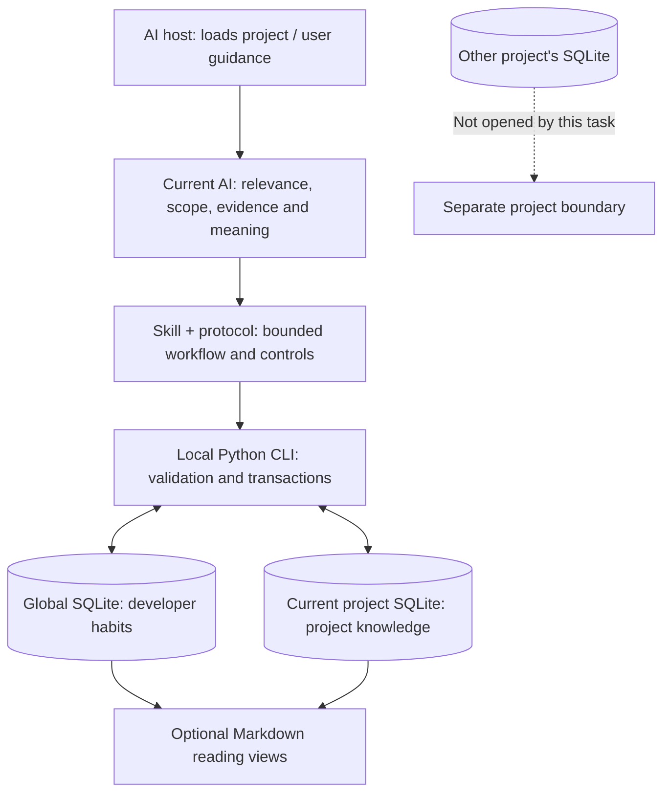
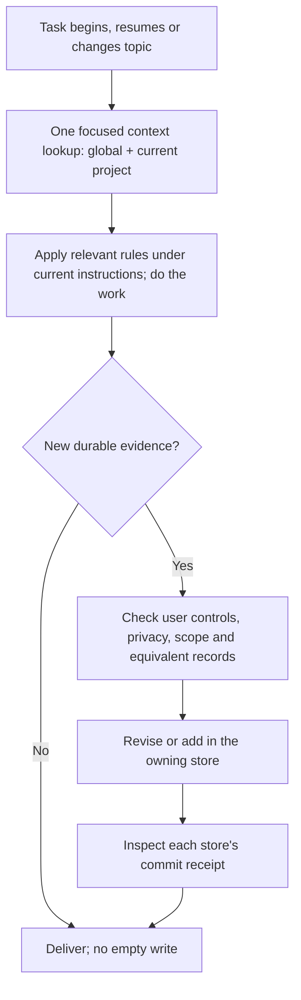
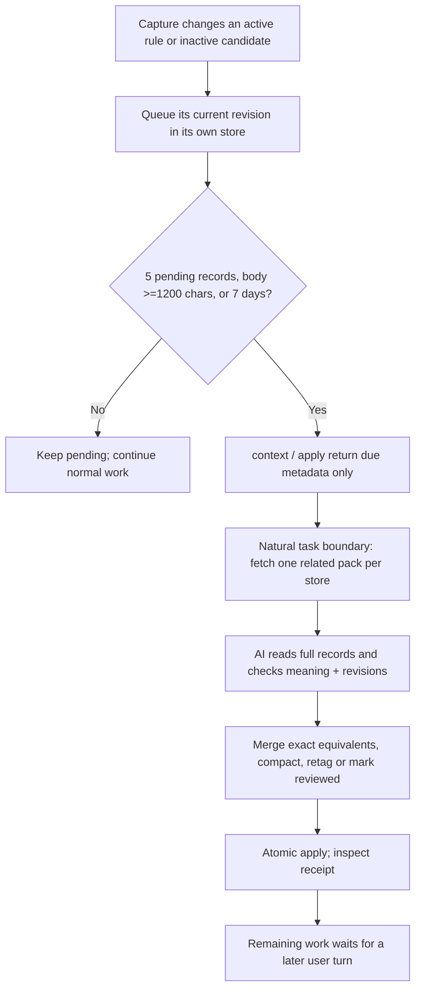

<h1 align="center">dev-memory</h1>

<p align="center"><strong>Local memory for how you develop and how each project works.</strong></p>

<p align="center">
  <a href="https://github.com/chrisstarr7/dev-memory/actions/workflows/check.yml"></a>
  <a href="LICENSE"></a>
  
  
</p>

<p align="center"><strong>English</strong> · <a href="docs/readme/README.zh-CN.md">简体中文</a> · <a href="docs/readme/README.ja.md">日本語</a> · <a href="docs/readme/README.ko.md">한국어</a></p>

Dev Memory is a portable Skill and local Python program for AI-assisted development. It recalls relevant developer habits and project knowledge, learns durable information from actual requirements and evidence, and keeps the sources and revision history inspectable. Your assistant makes the semantic decisions; SQLite validates and stores the records.

[Install](#quick-start) · [What gets remembered](#what-gets-remembered) · [Architecture](#architecture-and-storage-boundaries) · [Workflow](#recall-and-capture) · [Maintenance](#automatic-organization-and-summaries) · [Controls](#control-memory) · [Troubleshooting](#if-memory-is-missing)

## Quick start

From **your development project's root**, run:

```sh
npx -y --prefer-online chrisstarr7/dev-memory <agent>
```

Replace `<agent>` with the host parameter below. Requirements: Node.js 22+ with npm/npx, Git, and Python 3.10+ with sqlite3. The runtime uses the Python standard library; memory operations do not need npx or an external memory service.

| AI host | Parameter | Project guidance |
| --- | --- | --- |
| Codex | `codex` | `AGENTS.md`, or an existing nonempty `AGENTS.override.md` |
| Claude Code | `claude` | `CLAUDE.local.md` |
| Cursor | `cursor` | `.cursor/rules/dev-memory.mdc` |
| Gemini CLI | `gemini` | `GEMINI.md` |
| GitHub Copilot | `copilot` | `.github/copilot-instructions.md` |
| OpenCode | `opencode` | `AGENTS.md` |
| DeepSeek Harness (DSH) | `deepseek` | `AGENTS.md` |

**For Codex:** `npx -y --prefer-online chrisstarr7/dev-memory codex` configures user-level global habits **and** the current project in one installation. In other uninitialized projects, the Codex user guidance recalls only global habits; it does not create their project stores. Run the same command from each additional project that needs its own memory. Other hosts currently use project guidance, without this Codex user-level adapter. Choose the actual host: using a DeepSeek model through OpenCode requires `opencode`, not `deepseek`.

Start a **new AI session** in the project after installation or upgrade. Work normally: you do not need to invoke the Skill, label each instruction's scope, or say “remember this.” Initial stores are empty; no personal habits are invented or pre-seeded. Setup receipts verify files and stores, not that a particular model followed every instruction. See [installation and removal](docs/installation.md) for paths, alternate installers, permissions and host requirements.

## What gets remembered

The AI asks whether information will help a future task, what evidence supports it, and where it applies. Your current request always overrides memory.

| Destination | Eligible information | Examples |
| --- | --- | --- |
| **Global** | De-identified, reusable developer habits and methods | Preferred explanation order; inspect existing implementations before adding code; evidence-led debugging |
| **Current project** | Durable conventions, contracts, constraints, decisions and evidenced facts | Coding and documentation rules; business states; API/data contracts; transaction, security and ownership boundaries |
| **Conversation only** | One-time requests, task progress, unconfirmed guesses and sensitive content | “Skip tests this time”; today's todo list; an untested root-cause theory; credentials |

Project memory can also cover verification and acceptance rules, compatibility, deployment/environment constraints, performance limits, dependencies, migrations, and verified incident lessons with their conditions and prevention checks. It is not limited to a fixed list of categories. Do not snapshot whole files or treat every implementation detail as a permanent rule. Observed behavior and desired behavior are different claims; code that happens to exist does not establish the user's preferred design.

**Global evidence has two paths:** an explicit ongoing cross-project instruction can be an active confirmed rule immediately. A first reusable user choice/correction can be saved as an **inactive candidate**; two genuinely independent task signals can promote it to a soft preference. Recall, AI repetition and summarization create no new evidence. Candidates are saved records, but do not instruct the assistant.

**Project capture defaults:** new projects use `full-project`, allowing eligible project knowledge without a separate save command. `developer-first` is an optional mode that blocks new project records. Upgrading preserves existing modes and pause/disable/read-only controls; an older developer-first project requires an explicit switch. Unknown business decisions remain questions; unconfirmed hypotheses are not active rules and are excluded from normal recall. Normal Skill use excludes legacy task memories and checkpoints.

## Architecture and storage boundaries



| Location | Contents |
| --- | --- |
| `~/.dev-memory/global/` | Global database, configuration and optional views/backups |
| `<project-root>/.dev-memory/` | Project database, configuration and private activation binding |
| Host's installed `skills/dev-memory/` | Public Skill, CLI and reference files; not the private memory store |

There is no central database containing every project. One initialized-project recall consults global and current-project stores; it does not enumerate other projects. Project business, paths, code and customer details must never enter global memory. Separate clones/worktrees have separate project stores by default. SQLite is authoritative; Markdown views can be rebuilt.

## Recall and capture



- Recall is part of the primary workflow. One focused `context --exclude-task` lookup supplies a bounded set of relevant rules; valid context is reused. Context loss requires a fresh lookup. Default body budget is five records / 4000 characters, normally reserving three global and two project records; unloaded or incomplete results may require targeted follow-up. If global scope has no eligible rules or recall is disabled there, the project borrows that unused capacity; the total budget stays unchanged.
- The primary AI evaluates capture during its existing reasoning. Important corrections are captured before affected edits; ordinary eligible changes are batched before final delivery. Equivalent records are reused or revised, with evidence and history preserved.
- An optional host-provided read-only reviewer can help with complex assessment when useful work overlaps. If used, the primary AI joins it, applies eligible records and checks receipts **before ending the response**. A launched reviewer is not a successful save. There is no required extra model call or continuous conversation listener.
- Global and project writes have separate transactions: one can succeed while the other fails. A write failure must be reported accurately. See the [protocol](skills/dev-memory/references/protocol.md) for operation schemas, source requirements, revision guards and retrieval limits.

## Throughout the development lifecycle

| Phase | How memory participates |
| --- | --- |
| Requirements | Recall current business rules; save confirmed durable requirements and exceptions. |
| Design | Reuse contracts and decisions; keep provisional assumptions out of active rules. |
| Implementation | Apply conventions and canonical capabilities; distinguish observed legacy behavior from required behavior. |
| Verification | Recall acceptance/regression obligations; old test evidence is version-bound, not a fresh pass. |
| Correction | Save important corrections before affected edits; invalidate obsolete derived summaries. |
| Delivery | Follow artifact/reporting rules, finish eligible capture and inspect receipts; do not save task progress. |
| Next task/project | Focused recall from global and the current project; fetch missing relevant rules and keep projects isolated. |

## Automatic organization and summaries

“Automatic” means the assistant handles eligible work during authorized interactions. There is **no daemon, timer, background summarization model or full-library sweep**.



The trigger starts a store-local cycle. Once started, later interactions can finish the below-threshold tail. Each user turn processes at most **one related topic per store**, capped at **8 records / 12000 characters**. Eligible inactive candidates can also be organized, while retaining candidate status; unresolved hypotheses are excluded. Stable unchanged records do not need repeated summaries. A protocol upgrade may queue existing eligible active and candidate records once. Oversized anchors are reported and skipped while selecting a fitting topic; oversized or unread records remain explicit follow-up work. A character cap is never permission to discard a condition. Paused, disabled, excluded and read-only stores retain their controls.

| Action | What it changes | What it preserves |
| --- | --- | --- |
| **Compact** | Shortens one current record's prose | Conditions, exceptions, negative requirements, strength, scope, evidence and old revisions |
| **Merge duplicates** | Keeps one equivalent canonical rule; supersedes duplicates | Original evidence/history and inspectable source links; incompatible rules stay separate |
| **Retag / review** | Improves classification or marks fully read revisions as reviewed | Meaning and evidence; no new observation or preference |
| **Derived summary** | Creates a reviewed, source-linked reading aid within one scope | Active, compatible atomic sources; no stronger claim than the sources; source changes invalidate the derived summary |
| **Archive** | Removes a rule from ordinary recall when newer confirmed evidence or demonstrated expiry supports it | Audit history; age alone does not prove obsolescence |

Automatic organization cannot invent facts, turn summaries into user evidence, promote candidates just by combining them, silently resolve incompatible business rules, or move project content into global scope. A summary is not independent confirmation. Semantic equivalence is an AI judgment; structural checks cannot prove two differently worded rules mean the same thing. If uncertain, retain the originals and mark only what was actually reviewed. Topic retrieval is bounded and does not guarantee discovery of every semantic conflict, especially across differently classified records. Summary preparation also respects disabled/excluded recall and the 8-record / 12000-character budget.

**Context cleanup is separate from disk cleanup.** Compaction and merging reduce active text, while old bodies and provenance remain on disk. Explicit `storage` inspection/reclamation can clear disposable caches, retired search terms and free pages; validated same-store backup retention is separately user-selected. Evidence, revisions, privacy receipts and forgotten-record suppression are not an automatic retention target. Permanent forget requires the deletion workflow. No fixed lossless disk cap is promised.

## Control memory

Normal requirements need no scope label; scope names below are useful when changing the controls themselves.

| Goal | Example instruction |
| --- | --- |
| Record a project convention | “For this repository, document new or changed API request/response fields in the interface document.” |
| Record a project contract | “A cancelled order must not be charged again; preserve this in future changes.” |
| Express a confirmed global habit | “Across all projects, reuse a suitable existing implementation before adding one.” |
| Correct an existing rule | “Revise that convention: generated files are excluded.” |
| Enable / restrict project capture | “Switch this project to full-project.” / “Switch it to developer-first.” |
| Pause global learning, keep recall | “Pause global habit writes, but keep reading them.” |
| Disable / resume global memory | “Stop global reading and writing.” / “Resume reading and learning global habits.” |
| Exclude this turn | “Do not save any memory from this turn.” |
| Inspect / organize | “Show relevant memories.” / “Organize pending related records without losing conditions or exceptions.” |
| Forget | “Preview the records to delete; wait for my confirmation before deleting.” |

## Privacy and limitations

The core stores memory locally and has no telemetry or automatic memory upload. Installation downloads public program files; it does not publish private stores. However, memory passages supplied to a hosted AI are subject to that host's data policy. “Local SQLite” does not mean a hosted model never sees recalled text.

Global records and their evidence must be de-identified: no project names, business entities, code, paths, customers, credentials, raw dialogue or logs. Program checks reject known sensitive/project markers; semantic privacy still requires AI review. Never store secrets in either scope. Store controls and turn opt-outs override routine learning and maintenance. Backups also contain private data.

Installation, unit tests and successful SQL writes do not prove that every real AI session correctly classifies natural language, obeys guidance, or has negligible latency. Host permission/trust settings still apply. Optional Codex hooks are a separate integration, not a prerequisite for project-guided use or proof of event delivery.

## If memory is missing

Ask the assistant to inspect the **installed** CLI's `doctor` output once, not every coding turn:

1. Check installed version, activation binding, Python/CLI paths and store readability/writability.
2. Check project capture mode and pause/disable/read-only/turn controls. An older `developer-first` mode can explain missing new project records.
3. Distinguish **saved candidates**, **active rules**, and **recall matches**. A candidate is stored but inactive; zero lexical matches does not mean the database is empty.
4. Check write receipts and source evidence. A model saying “remembered” without a receipt is not proof. Inspect relevant records and revisions rather than scanning all projects.
5. For Codex, `automatic_mode: not_configured` refers to optional hook setup; separately inspect project activation and store status. It alone does not show a broken Skill.

Never bypass Windows ACLs or user controls by redirecting project data into global storage. See [installation diagnostics](docs/installation.md) and [verification evidence](reports/verification.md).

## Upgrade, references and contribution

Rerun the same installation command from the project root, then open a new AI session. Existing stores, capture modes, privacy settings and unrelated instructions are preserved. Updating this GitHub checkout alone does not update the installed Skill or an already loaded conversation.

- [Architecture](docs/architecture.md): components, storage boundaries and runtime behavior.
- [Protocol](skills/dev-memory/references/protocol.md): operator commands and structured apply/maintenance contracts.
- [Installation and removal](docs/installation.md): hosts, paths, alternate installation and troubleshooting.
- [Verification reports](reports/verification.md): actual program/host checks and known gaps.
- [0.8.4 maintenance review](reports/maintenance-review-0.8.4.md).
- [0.8.5 lifecycle exercise and review](reports/lifecycle-review-0.8.5.md).
- [Security](SECURITY.md) · [Contributing](CONTRIBUTING.md) · [MIT license](LICENSE).

Report sanitized issues at [GitHub Issues](https://github.com/chrisstarr7/dev-memory/issues). Do not attach private databases, credentials or raw conversations.
