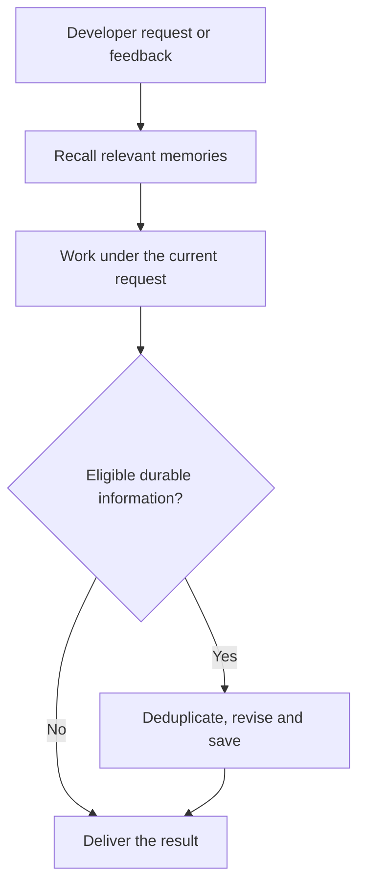

<h1 align="center">dev-memory</h1>

<p align="center"><strong>Local development memory that learns how you work.</strong></p>

<p align="center">
  <a href="https://github.com/chrisstarr7/dev-memory/actions/workflows/check.yml"></a>
  <a href="LICENSE"></a>
  
  
</p>

<p align="center"><strong>English</strong> · <a href="docs/readme/README.zh-CN.md">简体中文</a> · <a href="docs/readme/README.ja.md">日本語</a> · <a href="docs/readme/README.ko.md">한국어</a></p>

Dev Memory is a developer-centered local memory system for AI-assisted development. It learns traceable, correctable habits and reasoning preferences from visible requirements, corrections, technical choices and working methods, then recalls them for later tasks and projects. Optional project rules stay isolated; SQLite stores the records, evidence and revisions.

[Quick start](#quick-start) · [Workflow](#how-learning-and-recall-work) · [Memory controls](#control-memory) · [Privacy](#storage-and-privacy)

## What it does

- Learns your preferences for requirements analysis, implementation, debugging, verification and delivery.
- Recalls a small set of relevant habits and authorized project rules for the current task.
- Keeps one-time directions in the conversation; new project memory is off by default.
- Runs as a host-guided Skill with a local Python CLI. It has no daemon, telemetry or external memory service.

## Quick start

Run this from your project root. Replace `<agent>` with the parameter for your AI host from the table below:

```sh
npx -y --prefer-online chrisstarr7/dev-memory <agent>
```

| AI host | Parameter |
| --- | --- |
| Codex | `codex` |
| Claude Code | `claude` |
| Cursor | `cursor` |
| Gemini CLI | `gemini` |
| GitHub Copilot | `copilot` |
| OpenCode | `opencode` |
| DeepSeek Harness (DSH) | `deepseek` |

Requirements: Node.js 22+ with npm/npx, Git, and Python 3.10+ with sqlite3. After setup, start a new AI session in that project and work normally; no repeated Skill invocation or save request is needed.

For Codex, the command configures both user-level global habits and the current project's binding. Other hosts need project setup for automatic use; only Codex currently supports user-level guidance across uninitialized projects. DeepSeek here means the local DSH host.

**After installation:** Start a new session and describe tasks and corrections normally. No personal habits are pre-seeded; they accumulate from actual feedback. To inspect use, ask the assistant which relevant habits it recalled and how they affected its work. An empty initial result is normal; an unavailable store must be reported.

## Memory scope and defaults

| Memory | Examples | Scope and default |
| --- | --- | --- |
| Global habits | Reuse suitable existing code; diagnose from evidence; preferred response order | Reused across projects after removing project details. Eligible global capture requires an authorized setup. |
| Project rules | Business constraints, architecture decisions, interface agreements | Available only in the owning project. New project records require `full-project`. |
| One-time directions | “Skip tests this time” | Current conversation only. |

New project stores use **`developer-first`**: existing project rules can be recalled, but new project records are off. Use `full-project` to enable new durable project records. Existing settings and data are preserved during upgrades.

Codex user-level guidance can use global habits in an uninitialized project without initializing or capturing that project's business memory. To give another project its own store and project rules, run the setup command from that project's root. Initialized projects make one combined global/project recall.

## How learning and recall work



This shows the ordinary task path. Important corrections are saved before affected edits; valid context is reused within the task. Pending organization is handled at a suitable interaction boundary, as described below.

1. **Recall for the task:** One focused lookup uses task terms and optional intent, with indexed English/Chinese wording and code entities. Default combined recall allows five record bodies/4000 characters: three global habits and two project rules. Tags help ranking but never restrict discovery. Reuse valid context while working.
2. **Learn:** Explicit cross-project preferences can become confirmed habits. A reusable user requirement, choice or correction can be saved as an inactive candidate on its first occurrence; two genuinely independent tasks can promote it to a soft preference. Repetition is needed for adoption, not for the first record. AI summaries and retrieval do not count as user evidence.
3. **Correct without duplication:** Compare existing records before adding; revise a corrected habit, retaining its evidence and history. Exact and reviewed paraphrase reuse both support candidate promotion. Current instructions always take priority.
4. **Organize at quiet boundaries:** Changed records become due after five pending records, a 1200-character body, or seven days unreviewed. Ordinary calls return only a due notice. At a quiet boundary, review one related pack (at most eight records/12000 characters), merge equivalents, shorten redundant prose and correct tags. Due work resumes on later interactions; no timer runs in the background.

The primary assistant assesses user feedback in its existing task reasoning and batches eligible writes before final delivery. No new information means no write or NOOP call. Important corrections are saved before affected edits; saves require actual store receipts. There is no continuous conversation monitor or default extra model call.

## Control memory

| Goal | Tell the assistant |
| --- | --- |
| Express an ongoing habit | “Across all projects, check for suitable existing code before adding an implementation.” |
| Enable project records | “Switch this project to full-project memory capture.” |
| Return to the default mode | “Switch this project to developer-first.” |
| Correct a habit | “Revise that habit: reuse existing code when it fits the requirement.” |
| Pause global learning, keep recall | “Pause global habit writes, but keep recall.” |
| Disable global memory | “Stop both reading and writing global habits.” |
| Resume global memory | “Resume reading and learning global habits.” |
| Exclude this turn | “Do not save memory from this turn.” |
| Organize pending records | “At a quiet boundary, group related habits and shorten duplicates without losing conditions.” |
| Inspect or forget a record | “Show relevant memories.” / “Preview deletion scope, then delete after I confirm.” |

## Storage and privacy

| Store | Default location |
| --- | --- |
| User's global habits | `~/.dev-memory/global/` |
| Current project's rules | `<project-root>/.dev-memory/` |

SQLite is authoritative; exported Markdown is a reading view. The workflow excludes project names, business details, code, paths, credentials and raw conversations from global records. The program rejects known sensitive and project-specific markers, but semantic de-identification remains the assistant's responsibility. The core does not upload stores or collect telemetry. Excerpts processed by a hosted model follow that host's data policy.

For an explicit storage review, ask the assistant to run `storage --scope global` (or `project`). `--reclaim` clears disposable old caches, retired search terms and free pages. `--backup-keep N` previews retention; adding `--reclaim` removes only validated same-store backup copies. These commands stay off the coding path. Evidence, revisions and privacy/idempotency receipts remain until explicit forget; unique history can still grow, so there is no fixed lossless disk cap.

## If memory is not being recorded

Ask the assistant to run the installed CLI's `doctor` once: check `skill_version`, user/project activation, capture controls and separate active/candidate counts. Updating this GitHub repository alone does not upgrade an installed Skill or a running session. A saved candidate is stored memory even though ordinary recall does not apply it; inspect `list --scope global --status candidate` when needed.

For authorized Codex use without project setup, the current installed CLI supports `setup --user`; start a new AI session afterward. This initializes no project and preserves paused/disabled controls. Project business rules still require their own scope and capture mode. See the [0.8.2 capture review](reports/capture-review-0.8.2.md) for reproduced causes, fixes and actual verification.

## Upgrade and verification

Upgrade by rerunning the installation command in an initialized project, then start a new session. Existing stores, capture controls and unrelated instructions are preserved; setup refreshes content fingerprints without rewriting memory bodies.

Installation/program checks do not prove real host compliance or negligible end-to-end latency. See the [0.8.0 review and measurements](reports/optimization-0.8.0.md) for actual program/host results and remaining gaps. Other hosts have separate instruction adapters; trusted hook delivery is not inferred from installation.

[Installation and removal](docs/installation.md) · [Architecture](docs/architecture.md) · [Protocol](skills/dev-memory/references/protocol.md) · [Verification reports](reports/verification.md) · [Security](SECURITY.md) · [Contributing](CONTRIBUTING.md)

Report sanitized issues at [GitHub Issues](https://github.com/chrisstarr7/dev-memory/issues). Released under the [MIT License](LICENSE).
