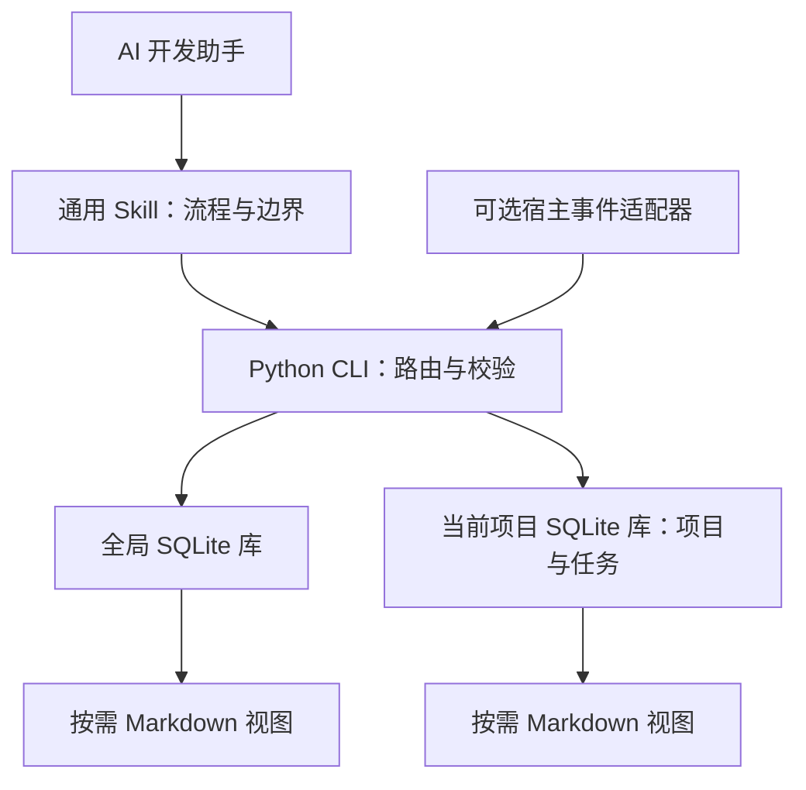

# dev-memory

### 给 AI 开发助手的本地研发记忆

任务开始时召回相关要求，纠错时保存准确条件，下一会话接着真实进度继续开发。

dev-memory 是一个独立的 Agent Skill，由通用 Skill、小型 Python CLI 和可选宿主适配器组成。程序与协议公开，每个安装者的记忆保存在自己的本地目录。首次启用从空知识库开始。

[开始使用](#三步开始使用) · [日常使用](#日常使用) · [工作方式](#工作方式) · [架构](#架构) · [隐私与安全](#隐私与安全) · [贡献](#贡献与反馈)

## 为什么使用 dev-memory？

- **记住准确约束**：保存要求的条件、例外、禁止事项和验证方法，纠错时修订已有规则。
- **继续真实进度**：保留任务断点、未完成工作、阻塞和下一步。
- **项目之间隔离**：项目 A 的业务留在 A；只有明确确认跨项目适用的研发规范进入全局。
- **轻量参与开发**：每轮在当前上下文中判断增量，按需召回，普通变化批量提交，阅读视图按需生成。
- **可检查、可控制**：支持查看、纠正、本轮不记、暂停、只读召回、归档和遗忘。
- **依赖简单**：Python 标准库与 SQLite，无后台进程、向量服务或额外付费模型。

## 三步开始使用

### 1. 安装

**推荐：把下面这句话复制给正在使用的 AI 开发助手。**

> 请从 https://github.com/chrisstarr7/dev-memory 安装 dev-memory Skill，按安装指南选择当前 AI 的安装目录并验证结果。保留我的已有记忆和配置。

需要能读写本地文件、运行命令的 AI（例如 Codex、Claude Code、Cursor）。网页聊天或无本机权限的云端会话不能直接安装到你的电脑。AI 的具体安装步骤见 [安装指南](docs/installation.md#给-ai-的安装流程)。

**手动安装：**点击本仓库的 **Code → Download ZIP**，解压，在包含 `install.py` 的目录打开终端，执行：

```sh
python3 install.py
```

按提示选择你的 AI。Windows 执行 `py -3 install.py`。需要 Python 3.10+（含 sqlite3），不需要 Node.js/npm。成功后会显示实际安装目录、检查结果和下一步。

已有 Skill 管理器的用户可使用 [命令行安装方式](docs/installation.md#使用-skills-管理器)。

### 2. 重开会话并启用

重开 AI 或新建会话，**打开你要开发的项目**，发送：

> 使用 dev-memory，为当前项目启用研发记忆，先检查环境并召回相关要求。

Codex 也可用 `$dev-memory` 调用。AI 会确认项目根目录并初始化空库；非 Git 项目需要你指定项目路径。安装只放置程序文件，这一步才授权该项目使用记忆。未明确跨项目适用的业务要求不会进入全局。

### 3. 开始任务并确认结果

正常提出你的开发任务。新增要求或纠错保存后，AI 应报告实际保存的范围和结果。**“已经记住”必须有成功回执；安装成功或复述你的要求不能证明已保存。**

需要检查时，发送：

> 用 dev-memory 只读列出这个项目已保存的记忆，告诉我来源和适用条件。

下一会话继续时，发送：

> 使用 dev-memory 继续上次任务，先读取断点和相关要求，再核对当前代码。

找不到 Skill、缺少 Python、只读权限或已有安装冲突时，见 [常见问题](docs/installation.md#常见问题)。**基础模式依赖 AI 实际调用 Skill，不保证每轮自动执行。**

## 日常使用

| 想做什么 | 对 AI 说 |
| --- | --- |
| 纠正业务条件 | “用 dev-memory 修订本项目规则：退款期限是签收后 14 天。” |
| 保存全局规范 | “这是所有项目都适用的研发规范，请保存到全局。” |
| 本轮不记 | “这一轮不要保存记忆。” |
| 暂停写入 | “暂停这个项目的记忆写入，仍可召回。” |
| 恢复写入 | “恢复这个项目的记忆写入。” |
| 只读使用 | “用 dev-memory 只读召回，不初始化、不写入。” |
| 遗忘内容 | “预览这条规则的遗忘范围，我确认后再删除。” |

表中的规则示例是虚构的，不会自动导入记忆。无需手工编写 JSON；AI 按 [协议](skills/dev-memory/references/protocol.md) 调用本地程序。升级与卸载见 [安装指南](docs/installation.md#升级与卸载)。

## 工作方式

1. **召回**：任务开始、恢复、切换项目或模块时，检索适用的全局、当前项目和当前任务记忆。
2. **判断与保存**：当前 AI 提炼语义；CLI 校验范围、来源和版本，保存明确纠错，轮末批量提交普通增量。
3. **继续与修订**：记录真实断点；修改或删除源记录时，相关派生摘要失效。下一会话重新召回适用要求。

没有新增信息时提交简短的已检查 NOOP 回执。同一上下文内复用有效记忆；压缩、修订或工作区变化后重新检查。程序分别返回各存储的结果，失败不能报告为“已保存”。

### 模式与兼容状态

| 模式 | 行为与条件 |
| --- | --- |
| 基础模式 | AI 调用 Skill 和 CLI；仅安装 Skill 无法保证每轮执行 |
| 自动模式 | 需要宿主事件、权限与信任验证；可选 Codex 适配器的真实自动事件链路尚未验证 |
| 只读模式 | 召回已有记忆，不初始化或写入 |
| 不可用 | 缺少运行权限或存储不可访问时，如实报告 |

Ubuntu/macOS、Python 3.10/3.14 的程序测试与打包 CI 已通过；六种 AI 安装目标已通过从 GitHub 安装、重复安装和卸载的隔离检查。安装成功不代表宿主自动调用已验证；各宿主状态、S01–S48 验收及性能结果见 [验证报告](reports/verification.md)。

## 架构



| 范围 | 保存内容 | 默认位置 |
| --- | --- | --- |
| global | 明确跨项目适用的研发偏好、规范和方法 | `~/.dev-memory/global/` |
| project | 所属项目的业务、架构、接口、约束、决策和缺陷经验 | `<项目根>/.dev-memory/` |
| task | 本次任务要求、进度、阻塞和下一步 | 所属项目库内 |

全局和各项目拥有独立存储、事务、证据、回执与备份。项目目录不可写时返回失败。业务范围由内容和用户意思决定；没有明确归属项目的业务不能保存到全局。

```text
dev-memory/
├── skills/dev-memory/       # 可独立安装的运行 Skill
│   ├── SKILL.md            # 触发条件与工作流程
│   ├── scripts/            # CLI、存储与可选宿主适配器
│   ├── references/         # 按需读取的协议与说明
│   ├── assets/             # 配置模板
│   └── agents/             # 可选宿主元数据
├── docs/                   # 安装与架构文档
├── tests/                  # 使用临时数据的程序测试
├── evals/                  # 验收场景与性能评估工具
├── reports/                # 验证证据和已知限制
├── .github/workflows/      # CI
├── install.py              # 本地安装入口
├── build_release.py        # 发布包与完整性清单
└── plugin.json             # 可选插件描述
```

模块职责、数据流和性能策略见 [架构说明](docs/architecture.md)。

## 隐私与安全

- 安装包不含真实记忆、作者个人数据或默认演示记录。
- 核心程序不上传记忆、不收集遥测。AI 宿主的模型调用遵循该宿主的配置与数据政策。
- 程序目录与运行数据分离；升级和卸载默认保留记忆。项目记忆默认排除在 Git 之外。
- 不保存密钥、密码、完整敏感日志和不必要的客户数据。凭证检测不能代替 AI 的语义筛选。
- 旧记忆按历史资料处理，不能覆盖当前用户要求或安全规则。
- 本地库没有默认应用加密。遗忘清理工具管理的内容，不能清理宿主对话、外部副本或系统快照，也不承诺安全擦除。

安全边界见 [SECURITY.md](SECURITY.md)，已知问题见 [对抗性审查报告](reports/adversarial-review.md)。

## 贡献与反馈

欢迎通过本仓库的 Issues 报告问题，通过 Pull Requests 提交改进。反馈请使用脱敏信息和最小复现，不附带真实记忆库。

```sh
python3 -m unittest discover -s tests -v
```

开发约定、隔离安装检查和评估方法见 [CONTRIBUTING.md](CONTRIBUTING.md)。

## 许可证

Copyright © 2026 dev-memory contributors. 本项目采用 [MIT License](LICENSE)。
