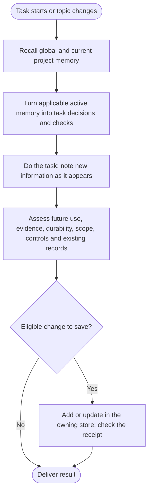
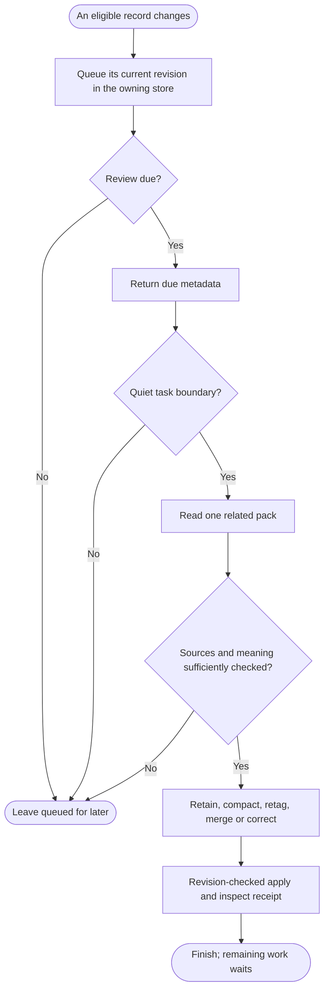

<h1 align="center">dev-memory</h1>

<p align="center"><strong>Local memory for your development habits and project rules.</strong></p>

<p align="center">
  <a href="https://github.com/chrisstarr7/dev-memory/actions/workflows/check.yml"></a>
  <a href="LICENSE"></a>
  
  
</p>

<p align="center"><strong>English</strong> · <a href="docs/readme/README.zh-CN.md">简体中文</a> · <a href="docs/readme/README.ja.md">日本語</a> · <a href="docs/readme/README.ko.md">한국어</a></p>

Dev Memory is a Skill and local Python program for AI-assisted development. It helps your assistant recall relevant habits and project rules, then save durable knowledge backed by requirements or evidence. The assistant judges meaning; the program validates and stores records in SQLite.

## Install

Run this from the root of a development project:

```sh
npx -y --prefer-online chrisstarr7/dev-memory codex
```

For another AI host, replace `codex` with its parameter:

| Host | Parameter | Project guidance |
| --- | --- | --- |
| Codex | `codex` | `AGENTS.md` or an existing nonempty `AGENTS.override.md` |
| Claude Code | `claude` | `CLAUDE.local.md` |
| Cursor | `cursor` | `.cursor/rules/dev-memory.mdc` |
| Gemini CLI | `gemini` | `GEMINI.md` |
| GitHub Copilot | `copilot` | `.github/copilot-instructions.md` |
| OpenCode | `opencode` | `AGENTS.md` |
| DeepSeek Harness | `deepseek` | `AGENTS.md` |

Installation needs Node.js 22+ with npm/npx, Git, and Python 3.10+ with sqlite3. The base memory runtime uses the Python standard library. Installation also attempts to prepare local vector search in an isolated environment; dependency or model setup failure leaves base memory available and reports vector degradation. Use `--without-vectors` for a basic offline installation. Choose the host running the assistant: DeepSeek through OpenCode uses `opencode`.

Codex setup enables global habits for your user and project memory for the current project. In an uninitialized project, its user guidance recalls global habits only. Run the install command again in each project that needs its own memory. Other hosts currently use project guidance only. After installation or upgrade, start a new AI session in the project. You can then work normally without invoking the Skill or saying “remember this.” New stores start empty; existing records are retained.

See [installation and removal](docs/installation.md) for alternate paths, permissions, and host details.

## What it remembers

Dev Memory has **two persistent scopes**:

| Scope | What belongs there | Example |
| --- | --- | --- |
| Global | De-identified development habits useful across projects | Check for a suitable existing implementation before adding one |
| Current project | Durable rules, contracts, decisions, and evidenced facts | API requirements, security boundaries, coding conventions |

Temporary requests, work in progress, and unconfirmed guesses stay in the current conversation. Dev Memory does not save conversation transcripts or task checkpoints. A new chat may need to inspect the code to recover progress. Never save credentials in either scope.

Project knowledge can include acceptance rules, compatibility, deployment constraints, migrations, and verified incident lessons. Save a code observation only if it is durable, non-obvious, and likely to change future work; it describes what exists, not what the user wants. The assistant keeps the original scope and checks for equivalent records before writing. A review-only task can still reveal a durable new rule, even when the code already complies.

For global habits, an explicit ongoing cross-project instruction can become an active rule immediately. A reusable requirement, choice, or correction without that explicit scope is first saved as an **inactive candidate**. It becomes an active soft preference only after evidence from two independent tasks. AI summaries and repeated recall do not count as new evidence.

New project stores use `full-project` mode, which allows eligible project knowledge to be saved automatically. The optional `developer-first` mode blocks new project records. Upgrades preserve existing modes and pause, disable, and read-only controls; switching an older project to `full-project` is explicit.

## How it works

For an initialized project, this [Mermaid flowchart](https://mermaid.js.org/syntax/flowchart.html) shows how recall guides the task and how new information is assessed during the work:



The capture question applies to requirements, choices, conventions, decisions, verified facts, methods, and corrections—not just mistakes. Assess new information when it appears and at turn end, including review-only work. Save an important correction before the edit it affects; save other eligible increments before delivery.

Global and project writes have separate receipts; report a failed or partial write accurately. No eligible increment means no empty write.

## Recall

Recall retrieves a bounded set of relevant memories for the current task. It does not load the entire library or search other projects. The assistant runs one focused `context` request at task start, after context loss, or when the project, module, or topic materially changes, then reuses that result while it remains valid.

1. Use task terms and an optional development intent to find relevant records. Keyword retrieval works independently; a ready local vector index adds semantic matches.
2. Return selected record bodies within the configured budget. The default combined budget is 5 records / 4,000 characters, reserving space for both global habits and current-project rules. An unused global allocation is available to the project when no eligible active global rules exist or global recall is disabled.
3. The AI checks applicability, conditions, exceptions and source currency before using the result. Current instructions take priority. An old code observation or test result must be checked against the current workspace.

If relevant bodies are omitted because of the budget, the response identifies them as incomplete. The assistant can fetch the specific records it needs rather than reload the library. A returned memory is context, not proof that the AI adopted it or that its referenced code still behaves the same way.

| Record status | Normal recall | Automatic review queue |
| --- | --- | --- |
| `active`, non-hypothesis | Eligible within relevance and size limits | Its changed revision is queued |
| `candidate`, non-hypothesis | Excluded; not an instruction | Eligible for review without activation |
| `candidate` + `hypothesis` | Excluded | Excluded; remains unconfirmed |
| `conflicted` | May be returned as conflict context; resolve before relying on it | Excluded from routine review; needs explicit conflict resolution |
| `stale`, `archived`, `superseded` | Excluded | Excluded |
| Legacy `active` + `hypothesis` | Excluded | Included as an anomaly requiring source-backed revision or archival |

Monthly recall counts measure full record details returned to the AI, not proven adoption. Cached and read-only retrieval and capture-paused stores do not increment the counter. Counts are independent of the review queue: repeated recall alone does not schedule organization, and a new record can need review before it has ever been recalled.

## Automatic organization

Organization reviews changed knowledge for future usefulness, source authority, currentness and duplication. It can retain a correct record, improve its wording or tags, merge genuinely equivalent records, or revise/archive a claim when authoritative evidence justifies it. It does not automatically turn similar text into one rule, promote a candidate, or discard an old record because of its age.

Each store maintains its own queue of current record revisions. Review becomes due when **any** of these conditions holds:

| Trigger | Meaning |
| --- | --- |
| 5 pending records | Five distinct eligible record IDs; five edits of one record still count as one |
| A pending body reaches 1,200 characters | A long record can be reviewed before the count threshold |
| An unreviewed change waits 7 days | Default age threshold, evaluated on the next authorized interaction |

These thresholds schedule review, not a background rewrite. Normal `context` and save responses return a due notice without historical bodies. At a safe task boundary, the assistant requests one related review pack, assesses it and applies revision-checked changes. If work is urgent or sources are insufficient, the unresolved records remain queued. Once a review cycle starts, later turns can drain the smaller remainder without waiting for another five records.



One turn handles at most one related pack per store: **8 records / 12,000 characters, including embedded source evidence**. A pack includes up to three recent evidence excerpts per record and marks omitted evidence explicitly. Missing context calls for targeted source inspection; a short acknowledgement without its original proposal cannot establish additional detailed requirements.

The assistant preserves valid conditions, exceptions, negative rules and scope boundaries. It keeps desired contracts separate from observed implementation facts, rechecks cited code, and prefers a concise invariant plus a canonical document reference over copying a specification. Legacy active hypotheses must be resolved before being marked reviewed. Unread, oversized or unresolved records remain pending; a character limit never permits silently dropping constraints.

A review-protocol upgrade may queue eligible existing records once without changing their contents. Pause, disable, exclusion and read-only controls remain in force. There is no daemon, continuous conversation listener or required extra model call; automatic use depends on the host loading the instructions and the assistant executing them. Normal recall does not load review evidence. Evidence and revision history remain available after organization, so fewer active records do not imply equivalent disk-space savings. See the [protocol](skills/dev-memory/references/protocol.md) for operations and safeguards.

## Storage and privacy

| Location | Contents |
| --- | --- |
| `~/.dev-memory/global/` | Global SQLite store, configuration, optional views and backups |
| `<project-root>/.dev-memory/` | This project's SQLite store and activation binding |

One project lookup opens the global store and that project’s store; it does not search other projects. Separate clones and worktrees have separate project stores by default. SQLite is authoritative; optional Markdown views can be rebuilt. Session and turn IDs support retries, opt-outs, and recall caching. They are operational metadata, not a third memory scope.

The core has no telemetry or automatic memory upload. Text recalled into a hosted AI is still subject to that host’s data policy. Global records and their evidence must exclude project names, business details, code, paths, customer data, raw dialogue, logs, and secrets. Backups contain private data too.

Older databases may contain task/checkpoint rows. This version does not create, recall, maintain, or export them. It retains those rows for explicit audit or deletion: use `list --scope project --status all`, then the `forget preview` / `forget apply` workflow. Historical files under `reports/` may describe the former behavior.

## Local semantic recall

Each memory scope keeps its original text and optional vector index in the same SQLite database. The original text remains authoritative. Install or update prepares a local model when possible; if it is unavailable, keyword search and memory storage continue to work. Ordinary development does not download models. Similarity helps find candidates but does not change their status.

An unfinished vector calculation does not affect the saved memory. The dashboard shows index status and never starts model inference just because it is open. See [vector setup and recovery](skills/dev-memory/references/vectors.md) for platform details and diagnostics.

## Local dashboard

With Node.js 22+ and Python 3.10+, run this from a project directory on Windows, macOS, or Linux:

```sh
npx -y --prefer-online chrisstarr7/dev-memory dashboard
```

It starts the dashboard locally and tries to open your browser. If no browser opens, copy the URL printed in the terminal. Keep the terminal open and press `Ctrl+C` to stop the server. It listens only on the local machine; its temporary access URL is private and must not be shared.

Use the dashboard to view memory text, evidence, revisions and stored vectors; search records; preview recall; manage registered projects; and create backups. Monthly recall counts mean full memory details were returned to the AI, not that the AI adopted them; earlier periods cannot be reconstructed.

If Windows reports a project-list permission error, the dashboard can still show global memory. See [Windows dashboard permissions](docs/installation.md#windows-dashboard-permissions) to repair the local folder, then restart it.

## Memory controls

You can ask the assistant to:

- Pause global memory writes while continuing to read existing rules.
- Skip memory writes for one turn.
- Show relevant memories.
- Preview the records affected before deleting them.

The current request always takes priority over memory. If capture or recall seems wrong, ask the assistant to run `doctor` from the installed program and check its actual result.

## Update

Run this from the project, then start a new AI session:

```sh
npx -y --prefer-online chrisstarr7/dev-memory update codex
```

Replace `codex` with your host parameter. Updates preserve existing stores, controls, and unrelated instructions. Install separately in each project that needs project memory.

## Help and references

- [Installation, removal, and troubleshooting](docs/installation.md)
- [Vector setup and recovery](skills/dev-memory/references/vectors.md)
- [Architecture](docs/architecture.md) · [Protocol](skills/dev-memory/references/protocol.md)
- [Verification](reports/verification.md) · [Security](SECURITY.md) · [Contributing](CONTRIBUTING.md)

Report sanitized issues at [GitHub Issues](https://github.com/chrisstarr7/dev-memory/issues). Do not attach databases, credentials, or raw conversations.
