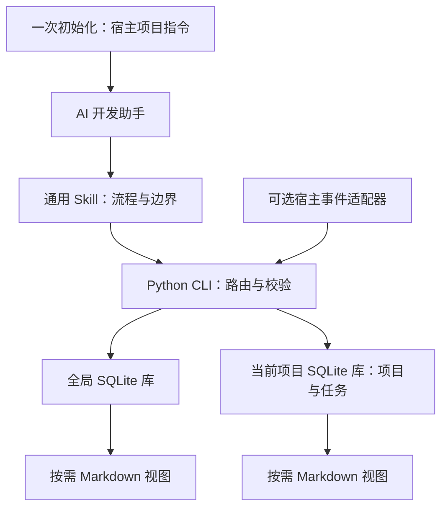

# dev-memory

### 给 AI 开发助手的本地研发记忆

任务开始时召回相关要求，纠错时保存准确条件，下一会话接着真实进度继续开发。

dev-memory 是一个独立的 Agent Skill，由通用 Skill、小型 Python CLI 和可选宿主适配器组成。程序与协议公开，每个安装者的记忆保存在自己的本地目录。首次初始化从空知识库开始。

[开始使用](#开始使用) · [日常使用](#日常使用) · [工作方式](#工作方式) · [架构](#架构) · [隐私与安全](#隐私与安全) · [贡献](#贡献与反馈)

## 为什么使用 dev-memory？

- **记住准确约束**：保存要求的条件、例外、禁止事项和验证方法，纠错时修订已有规则。
- **继续真实进度**：保留任务断点、未完成工作、阻塞和下一步。
- **项目之间隔离**：项目 A 的业务留在 A；只有明确确认跨项目适用的研发规范进入全局。
- **轻量参与开发**：每轮在当前上下文中判断增量，按需召回，普通变化批量提交，阅读视图按需生成。
- **自动去重与精简**：写入前对照相关记录，重复要求复用已有条目；积累到阈值或出现长记录时，在当前开发轮次整理相关主题。
- **可检查、可控制**：支持查看、纠正、本轮不记、暂停、只读召回、归档和遗忘。
- **依赖简单**：Python 标准库与 SQLite，无后台进程、向量服务或额外付费模型。

## 开始使用

### 一条命令安装并初始化

在**要开发的项目根目录**执行（macOS、Linux、Windows 使用同一条命令）：

```sh
npx -y chrisstarr7/dev-memory codex
```

使用其他 AI 时，把末尾 `codex` 换成 `claude`、`cursor`、`gemini`、`copilot` 或 `opencode`。

需要 Node.js 22+（含 npm/npx）、Git 和 Python 3.10+（含 sqlite3）。**安装器自动下载程序、检查环境、初始化当前项目，并配置 AI 自动加载。** 无需下载 ZIP、填写项目路径或发送启用口令。

看到“安装成功”和“项目已初始化”后，在该项目新建 AI 会话，直接开发即可。升级或初始化另一个项目，也在它的根目录运行同一命令；已有记忆、原项目指令和暂停状态会保留。

也可以让本地 AI 安装：

> 请从 https://github.com/chrisstarr7/dev-memory 安装并初始化当前项目的 dev-memory，选择当前 AI 宿主，检查成功回执，保留已有记忆和配置。

没有 Node.js、需要离线安装或卸载时，见 [安装指南](docs/installation.md)。网页聊天或没有本机文件与命令权限的会话无法直接安装到你的电脑。

### 然后正常开发

在**已初始化的项目**打开新的 AI 会话，直接提出开发任务即可。无需发送启用口令、指定 `$dev-memory`，也无需每次要求保存或读取。

AI 默认召回相关要求、及时保存明确纠错、轮末判断增量并记录真实断点。下一会话直接继续开发，AI 会主动读取相关断点并核对代码。安装或修改启动指令前已打开的会话需要重新开始，才能加载新引导。

每个项目只初始化一次。切换到另一项目时，为它运行同一条初始化命令；业务记忆按项目隔离，明确确认的全局研发偏好可以共用。

自动引导依赖宿主加载项目指令及 AI 实际执行。Codex CLI 的普通任务、新会话恢复和项目切换验证见 [验证报告](reports/verification.md)；其他宿主目前只有配置与程序测试。宿主权限、禁用指令或模型漏执行可能阻止工作，失败不能声称“已经保存”。

## 日常使用

| 想做什么 | 对 AI 说 |
| --- | --- |
| 纠正业务条件 | “退款期限改为签收后 14 天。” |
| 保存全局规范 | “这是所有项目都适用的研发规范，请保存到全局。” |
| 本轮不记 | “这一轮不要保存记忆。” |
| 暂停写入 | “暂停这个项目的记忆写入，仍可召回。” |
| 恢复写入 | “恢复这个项目的记忆写入。” |
| 只读使用 | “这一轮只读召回，不写入记忆。” |
| 遗忘内容 | “预览这条规则的遗忘范围，我确认后再删除。” |

表中的规则示例是虚构的，不会自动导入记忆。无需手工编写 JSON；AI 按 [协议](skills/dev-memory/references/protocol.md) 调用本地程序。升级与卸载见 [安装指南](docs/installation.md#升级与卸载)。

## 工作方式

1. **召回**：任务开始、恢复、切换项目或模块时，检索适用的全局、当前项目和当前任务记忆。
2. **判断与保存**：当前 AI 提炼语义；CLI 校验范围、来源和版本，保存明确纠错，轮末批量提交普通增量。
3. **自动整理**：确定相同的内容直接拦截；换句话说的重复内容由当前 AI 对照来源判断，复用已有规则。默认五条待整理变化或正文超过 1200 字符时触发有限整理；会话或任务边界补查已有积累。合并重复条目、精简长正文，保留条件、例外、否定要求、版本和证据。
4. **继续与修订**：记录真实断点；修改或删除源记录时，相关派生摘要失效。下一会话重新召回适用要求。

没有新增信息时提交简短的已检查 NOOP 回执。同一上下文内复用有效记忆；压缩、修订或工作区变化后重新检查。程序分别返回各存储的结果，失败不能报告为“已保存”。

整理只处理相关主题，每轮最多一批，不另起总结会话。当前 Codex 小样本性能对照仍显示明显的任务总耗时和调用开销，详见 [实测结果](reports/verification.md#whole-workflow-onoff-comparison)。重复旧条目退出默认召回，原文和旧版本保留为可追溯历史；这不等于清空历史或限制磁盘总量。暂停、只读和本轮不记同时约束整理，语义不确定时保留原条目。

### 模式与兼容状态

| 模式 | 行为与条件 |
| --- | --- |
| 基础模式 | AI 调用 Skill 和 CLI；仅安装 Skill 无法保证每轮执行 |
| 默认项目引导 | 初始化后由宿主自动加载项目指令；AI 在正常开发中执行召回与记忆管理 |
| 事件自动模式 | 可选 Codex hooks 需要宿主信任与事件验证；真实 hook 事件链路尚未验证 |
| 只读模式 | 召回已有记忆，不初始化或写入 |
| 不可用 | 缺少运行权限或存储不可访问时，如实报告 |

Ubuntu/macOS、Python 3.10/3.14 的程序测试与打包 CI 已通过；六种 AI 安装目标已通过从 GitHub 安装、重复安装和卸载的隔离检查。安装成功不代表宿主自动调用已验证；各宿主状态、S01–S48 验收及性能结果见 [验证报告](reports/verification.md)。

## 架构



| 范围 | 保存内容 | 默认位置 |
| --- | --- | --- |
| global | 明确跨项目适用的研发偏好、规范和方法 | `~/.dev-memory/global/` |
| project | 所属项目的业务、架构、接口、约束、决策和缺陷经验 | `<项目根>/.dev-memory/` |
| task | 本次任务要求、进度、阻塞和下一步 | 所属项目库内 |

全局和各项目拥有独立存储、事务、证据、回执与备份。项目目录不可写时返回失败。业务范围由内容和用户意思决定；没有明确归属项目的业务不能保存到全局。

```text
dev-memory/
├── skills/dev-memory/       # 可独立安装的运行 Skill
│   ├── SKILL.md            # 触发条件与工作流程
│   ├── scripts/            # CLI、存储与可选宿主适配器
│   ├── references/         # 按需读取的协议与说明
│   ├── assets/             # 配置模板
│   └── agents/             # 可选宿主元数据
├── docs/                   # 安装与架构文档
├── tests/                  # 使用临时数据的程序测试
├── evals/                  # 验收场景与性能评估工具
├── reports/                # 验证证据和已知限制
├── .github/workflows/      # CI
├── bin/install.cjs         # npx 安装入口
├── package.json            # GitHub npx 分发配置
├── install.py              # 共享 Python 安装与初始化逻辑
├── build_release.py        # 发布包与完整性清单
└── plugin.json             # 可选插件描述
```

模块职责、数据流和性能策略见 [架构说明](docs/architecture.md)。

## 隐私与安全

- 安装包不含真实记忆、作者个人数据或默认演示记录。
- 核心程序不上传记忆、不收集遥测。AI 宿主的模型调用遵循该宿主的配置与数据政策。
- 程序目录与运行数据分离；升级和卸载默认保留记忆。项目记忆默认排除在 Git 之外。
- 不保存密钥、密码、完整敏感日志和不必要的客户数据。凭证检测不能代替 AI 的语义筛选。
- 旧记忆按历史资料处理，不能覆盖当前用户要求或安全规则。
- 本地库没有默认应用加密。遗忘清理工具管理的内容，不能清理宿主对话、外部副本或系统快照，也不承诺安全擦除。

安全边界见 [SECURITY.md](SECURITY.md)，已知问题见 [对抗性审查报告](reports/adversarial-review.md)。

## 贡献与反馈

欢迎通过本仓库的 Issues 报告问题，通过 Pull Requests 提交改进。反馈请使用脱敏信息和最小复现，不附带真实记忆库。

```sh
python3 -m unittest discover -s tests -v
```

开发约定、隔离安装检查和评估方法见 [CONTRIBUTING.md](CONTRIBUTING.md)。

## 许可证

Copyright © 2026 dev-memory contributors. 本项目采用 [MIT License](LICENSE)。
