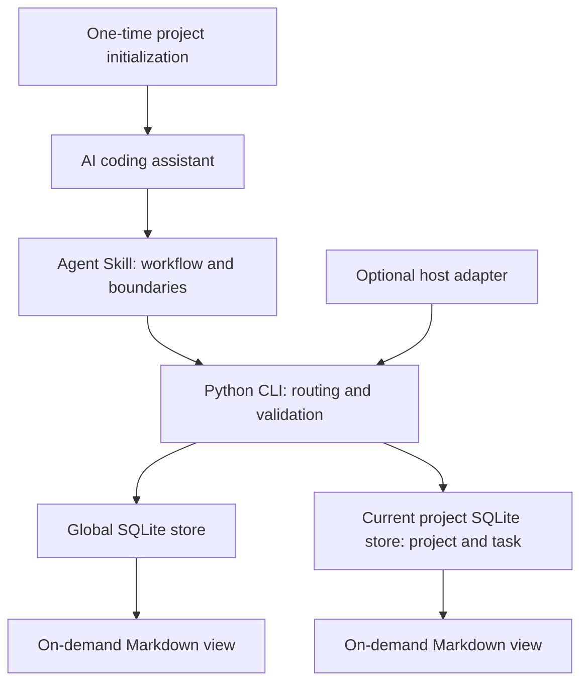

<h1 align="center">dev-memory</h1>

<p align="center">
  <strong>Private local memory for developer habits across projects.</strong><br />
  Learn how you work. Recall only what the current task needs.
</p>

<p align="center">
  <a href="https://github.com/chrisstarr7/dev-memory/actions/workflows/check.yml"></a>
  <a href="LICENSE"></a>
  
  
</p>

<p align="center"><strong>English</strong> · <a href="docs/readme/README.zh-CN.md">简体中文</a> · <a href="docs/readme/README.ja.md">日本語</a> · <a href="docs/readme/README.ko.md">한국어</a></p>

<p align="center"><a href="#quick-start">Quick start</a> · <a href="#features">Features</a> · <a href="#how-memory-works">How it works</a></p>

<p align="center"><kbd>Codex</kbd> · <kbd>Claude Code</kbd> · <kbd>Cursor</kbd> · <kbd>Gemini CLI</kbd> · <kbd>GitHub Copilot</kbd> · <kbd>OpenCode</kbd> · <kbd>DeepSeek Harness</kbd></p>

---

## Quick start

Run this in the **root of a project** for developer-first project activation:

```sh
npx -y chrisstarr7/dev-memory codex
```

Use `claude`, `cursor`, `gemini`, `copilot`, `opencode`, or `deepseek` (DeepSeek Harness / DSH) instead of `codex` for another assistant. The same command works on macOS, Linux, and Windows.

**Requirements:** Node.js 22+ with npm/npx, Git, and Python 3.10+ with sqlite3. The installer downloads the program, checks the environment, initializes an empty project store, and configures project instructions. New project stores default to developer-first: existing project rules can be recalled, but new project business memory and task checkpoints are off until explicitly enabled.

After installation succeeds, **start a new AI session in that project and develop normally**. No enable phrase, explicit Skill invocation, or repeated save/recall request is needed. Existing sessions must restart to load the new instructions.

To make global developer habits available in every Codex project, run this once instead:

```sh
npx -y chrisstarr7/dev-memory codex --user
```

It adds a managed block to Codex user instructions and uses only the global store. It does not initialize the current project. The user-level option currently supports Codex; other hosts need their own supported adapter. Project activation remains separate when project business memory is wanted. The user can enable it with `dev-memory mode full-project --project-root <path>`.

Run the project command in each project only when you want project-specific recall. The same global habit store can then be used across those initialized projects. Install and upgrade preserve existing memories and text outside managed instruction blocks.

<details>
<summary>Ask your local AI to install it</summary>

> Install dev-memory from https://github.com/chrisstarr7/dev-memory and initialize the current project for this AI host. Check the success receipt and preserve existing memories and settings.

The AI needs local file and command access. A web-only chat cannot install software on your computer. Offline installation, installation without Node.js, and uninstallation are covered in the [installation guide](docs/installation.md).

</details>

Windows Codex: version 0.5.2 repairs public program-directory ACL creation. Upgrade with the same command above and start a new session. See the [Windows access guide](docs/installation.md#windows-codex-访问权限).

## Features

| Capability | What it does |
| --- | --- |
| Accurate constraints | Keeps conditions, exceptions, prohibitions, and verification steps; corrections revise the existing rule. |
| Real task checkpoints | Records completed work, unfinished work, blockers, and the next step. Each task has one current checkpoint. |
| Developer-first learning | Explicit habits are global rules; repeated, de-identified user feedback forms a soft candidate and can become active across independent tasks. |
| Project isolation | Project A's business stays in A. Global habits contain no project business, paths, code, or raw dialogue. |
| Selective recall | Retrieves applicable global, current-project, and current-task records; reuses valid context and invalidates it after changes. |
| Deduplication and compaction | Intercepts exact duplicates; the current AI compares paraphrases and shortens related records while preserving constraints and evidence. |
| Local control | Supports inspection, correction, turn opt-out, pause, read-only recall, archive, and forget. |

An independent Agent Skill plus a small Python CLI: standard library and SQLite, with no daemon, vector service, or additional paid model. Program and protocol are public; each installer's memory is private and local. New stores contain no demo records.

## Everyday use

Describe your development work normally. An explicitly activated Codex user guide recalls a few relevant global habits across projects. The assistant can learn repeated behavior from actual user feedback without requiring a “save globally” phrase each time. One-time instructions do not become permanent preferences.

| To control memory | Tell your AI |
| --- | --- |
| Correct a business condition | “Change the refund deadline to 14 days after delivery.” |
| Save an explicit global preference | “This preference applies across my projects: reuse existing code before adding another implementation.” |
| Enable project memory | `dev-memory mode full-project --project-root /path/to/project` |
| Skip this turn | “Do not save memory from this turn.” |
| Pause / resume writes | “Pause memory writes for this project, but keep recall.” / “Resume memory writes.” |
| Use read-only recall | “Recall memory only; do not write anything this turn.” |
| Forget a record | “Preview the forget scope for this rule; delete it after I confirm.” |

Examples are fictional and are never imported automatically. No hand-written JSON is needed; the AI uses the [local protocol](skills/dev-memory/references/protocol.md). A save claim requires a successful per-store receipt.

## How memory works

1. **Recall:** one bounded call at task start returns a few relevant active habits and, when authorized, current-project constraints.
2. **Capture:** explicit global preferences are saved as confirmed rules. Repeated feedback is stored as generic candidates, with one hashed task signal per task; two independent tasks promote a soft preference. No additional model is used.
3. **Organize:** exact duplicates are reused. Bounded maintenance remains threshold-triggered and is not a per-turn coding workflow.
4. **Continue:** task checkpoints are optional. Source edits/deletion invalidate dependent summaries.

The AI connects applicable remembered conditions to design/code decisions and regression checks before editing. Relevant rules receive priority; a small candidate directory supports selective follow-up. Optional use receipts name a concrete action informed by a rule and add no user evidence. Task correctness is evaluated separately from reported use.

### Maintenance defaults

| Trigger or limit | Default |
| --- | --- |
| Distinct changed records pending in one store | **5 records** |
| A pending record's body length | **1,200 characters** |
| A related batch in each store | Up to **8 records / 12,000 characters** |
| Each development turn | At most **one batch per store**, within the current AI turn |
| Recall and maintenance SQL budget | **500 ms**; report deferred work on timeout |

Thresholds are separate for global and project stores. NOOPs and repeated checks do not accumulate changes. Session/task boundaries can check unfinished topics once; startup work is not repeated. No pending change means no maintenance. Pause, read-only, and turn opt-out suppress it. There is no background timer, per-tool summary, or full-library sweep.

Once a threshold starts a cleanup cycle, later normal interactions process the remaining queue, including a final one-to-four-record tail. A turn that has already organized memory receives no second pack. An idle queue returns no memory bodies.

Reuse valid memory and the loaded protocol. Context compaction, memory revision, and workspace changes invalidate reuse. Recall reserves capacity for project constraints; overflow is reported as incomplete and critical missing constraints require follow-up. Stores commit separately and report success or failure independently.

Retired originals and old bodies remain traceable history. Compaction reduces active context, **not total disk usage**. Semantic uncertainty leaves the original record intact.

## Architecture and storage



| Scope | Contents | Default location |
| --- | --- | --- |
| `global` | Explicit developer habits and de-identified, evidence-backed soft preferences | `~/.dev-memory/global/` |
| `project` | Optional project-specific business, architecture, interfaces and constraints | `<project-root>/.dev-memory/` |
| `task` | Optional temporary requirements and continuation points | Inside the owning project's store |

Each store has separate transactions, evidence, receipts, views, and backups. Project writes never fall back to global storage. Scope follows content and user intent, not just the working directory; business without an identified project never goes global.

Runtime files live in `skills/dev-memory/`; installation entry points are `bin/install.cjs` and `install.py`. `docs/`, `tests/`, `evals/`, and `reports/` contain documentation, isolated tests, evaluation tools, and evidence. See the [architecture guide](docs/architecture.md).

## Compatibility and verification

| Mode | Behavior / status |
| --- | --- |
| Base mode | The AI calls the Skill and CLI; installing the Skill alone does not guarantee execution each turn. |
| Default project guidance | Initialization configures host-native project instructions for ordinary development tasks. It depends on the host loading instructions and the model following them. |
| Optional event mode | Codex hooks require host trust and event verification; the real hook delivery chain remains unverified. |
| Read-only mode | Recall existing records without initialization or writes. |
| Unavailable | Missing permissions or inaccessible storage are reported honestly. |

Program tests and packaging CI passed on Ubuntu, macOS, and Windows with Python 3.10/3.14. Seven installation targets have isolated installation and repeat-install checks; successful installation does not prove automatic behavior on every host. Real Codex CLI evidence, host versions, semantic checks, and outstanding S01–S48 scenarios are listed in the [verification report](reports/verification.md). DSH has program installation and published-provider checks; a full DeepSeek model session remains unverified. See [DSH results](reports/deepseek.json).

**Performance evidence is exploratory.** A 0.7.0 real Codex CLI comparison completed one synthetic run per memory-on/off cell, including a maintenance stress case. It observed extra memory-tool calls in enabled cells; the sample is too small to estimate normal coding latency, and 0.6.0 was not rerun on the same task. See the [0.7.0 comparison](reports/benchmark-0.7.0.md) and [memory use and maintenance review](reports/memory-cycle-review.md). No negligible-overhead claim is made.

## Privacy and safety

- Release packages contain no real memories, author data, or automatically seeded examples.
- The core program does not upload memory or collect telemetry. AI model calls follow the host's configuration and data policies.
- Program files and runtime data are separate. Upgrades and default uninstallation preserve memory; project memory is excluded from Git by default.
- Do not store credentials, passwords, full sensitive logs, or unnecessary customer data. Credential detection does not replace semantic minimization.
- Historical memory cannot override current instructions or safety rules. Local stores have no default application encryption.
- Forget removes tool-managed data; it cannot clean host chats, external copies, or system snapshots and does not promise secure erasure.

See [SECURITY.md](SECURITY.md), the [adversarial review](reports/adversarial-review.md), and the [multi-project review](reports/multi-project-review.md).

## Contributing and support

Use [Issues](https://github.com/chrisstarr7/dev-memory/issues) for bugs and ideas, and Pull Requests for improvements. Share sanitized minimal reproductions, never real memory stores. Development and evaluation guidance: [CONTRIBUTING.md](CONTRIBUTING.md).

## License

Copyright © 2026 dev-memory contributors. Released under the [MIT License](LICENSE).
