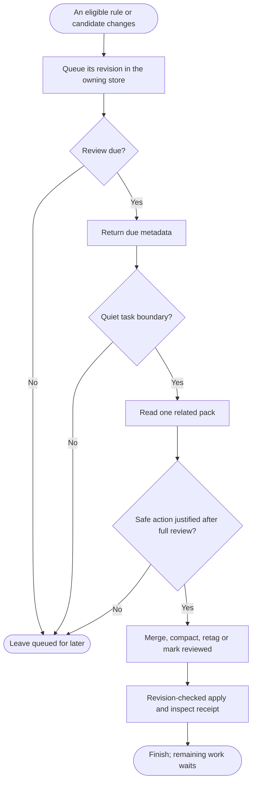

<h1 align="center">dev-memory</h1>

<p align="center"><strong>Local memory for your development habits and project rules.</strong></p>

<p align="center">
  <a href="https://github.com/chrisstarr7/dev-memory/actions/workflows/check.yml"></a>
  <a href="LICENSE"></a>
  
  
</p>

<p align="center"><strong>English</strong> · <a href="docs/readme/README.zh-CN.md">简体中文</a> · <a href="docs/readme/README.ja.md">日本語</a> · <a href="docs/readme/README.ko.md">한국어</a></p>

Dev Memory is a Skill and local Python program for AI-assisted development. It helps your assistant recall relevant habits and project rules, then save durable knowledge backed by requirements or evidence. The assistant judges meaning; the program validates and stores records in SQLite.

## Install

Run this from the root of a development project:

```sh
npx -y --prefer-online chrisstarr7/dev-memory codex
```

For another AI host, replace `codex` with its parameter:

| Host | Parameter | Project guidance |
| --- | --- | --- |
| Codex | `codex` | `AGENTS.md` or an existing nonempty `AGENTS.override.md` |
| Claude Code | `claude` | `CLAUDE.local.md` |
| Cursor | `cursor` | `.cursor/rules/dev-memory.mdc` |
| Gemini CLI | `gemini` | `GEMINI.md` |
| GitHub Copilot | `copilot` | `.github/copilot-instructions.md` |
| OpenCode | `opencode` | `AGENTS.md` |
| DeepSeek Harness | `deepseek` | `AGENTS.md` |

Installation needs Node.js 22+ with npm/npx, Git, and Python 3.10+ with sqlite3. The memory runtime uses only the Python standard library. Choose the host running the assistant: DeepSeek through OpenCode uses `opencode`.

Codex setup enables global habits for your user and project memory for the current project. In an uninitialized project, its user guidance recalls global habits only. Run the install command again in each project that needs its own memory. Other hosts currently use project guidance only. After installation or upgrade, start a new AI session in the project. You can then work normally without invoking the Skill or saying “remember this.” New stores start empty; existing records are retained.

See [installation and removal](docs/installation.md) for alternate paths, permissions, and host details.

## What it remembers

Dev Memory has **two persistent scopes**:

| Scope | What belongs there | Example |
| --- | --- | --- |
| Global | De-identified development habits useful across projects | Check for a suitable existing implementation before adding one |
| Current project | Durable rules, contracts, decisions, and evidenced facts | API requirements, security boundaries, coding conventions |

Temporary requests, work in progress, and unconfirmed guesses stay in the current conversation. Dev Memory does not save conversation transcripts or task checkpoints. A new chat may need to inspect the code to recover progress. Never save credentials in either scope.

Project knowledge can include acceptance rules, compatibility, deployment constraints, migrations, and verified incident lessons. Save a code observation only if it is durable, non-obvious, and likely to change future work; it describes what exists, not what the user wants. The assistant keeps the original scope and checks for equivalent records before writing. A review-only task can still reveal a durable new rule, even when the code already complies.

For global habits, an explicit ongoing cross-project instruction can become an active rule immediately. A reusable requirement, choice, or correction without that explicit scope is first saved as an **inactive candidate**. It becomes an active soft preference only after evidence from two independent tasks. AI summaries and repeated recall do not count as new evidence.

New project stores use `full-project` mode, which allows eligible project knowledge to be saved automatically. The optional `developer-first` mode blocks new project records. Upgrades preserve existing modes and pause, disable, and read-only controls; switching an older project to `full-project` is explicit.

## How it works

For an initialized project, this [Mermaid flowchart](https://mermaid.js.org/syntax/flowchart.html) shows how recall guides the task and how new information is assessed during the work:


The capture question applies to requirements, choices, conventions, decisions, verified facts, methods, and corrections—not just mistakes. Assess new information when it appears and at turn end, including review-only work. Save an important correction before the edit it affects; save other eligible increments before delivery.

Current instructions take priority over memory. The AI turns applicable active records, including their conditions and exceptions, into task decisions and checks; inactive candidates are not instructions. Recheck old observations and test results against the workspace. Recall supplies context to the AI; a returned record alone does not prove the AI followed it.

Global and project writes have separate receipts; report a failed or partial write accurately. No eligible increment means no empty write.

## Organization

Changed active rules and inactive non-hypothesis candidates enter a queue in their own store. Five pending records, a pending body of at least 1,200 characters, or an unreviewed change waiting the default seven-day interval can make one related group due for review.



One turn handles at most one related pack per store, with a limit of 8 records and 12,000 characters. Unread, oversized, or uncertain records stay explicit and queued; a character limit never permits dropping a condition. Organization preserves evidence and inactive candidate status. There is no daemon, continuous conversation listener, or required extra model call. The [protocol](skills/dev-memory/references/protocol.md) specifies operations, controls, and revision checks.

## Storage and privacy

| Location | Contents |
| --- | --- |
| `~/.dev-memory/global/` | Global SQLite store, configuration, optional views and backups |
| `<project-root>/.dev-memory/` | This project's SQLite store and activation binding |

One project lookup opens the global store and that project’s store; it does not search other projects. Separate clones and worktrees have separate project stores by default. SQLite is authoritative; optional Markdown views can be rebuilt. Session and turn IDs support retries, opt-outs, and recall caching. They are operational metadata, not a third memory scope.

The core has no telemetry or automatic memory upload. Text recalled into a hosted AI is still subject to that host’s data policy. Global records and their evidence must exclude project names, business details, code, paths, customer data, raw dialogue, logs, and secrets. Backups contain private data too.

Older databases may contain task/checkpoint rows. This version does not create, recall, maintain, or export them. It retains those rows for explicit audit or deletion: use `list --scope project --status all`, then the `forget preview` / `forget apply` workflow. Historical files under `reports/` may describe the former behavior.

## Control it in plain language

- “For this project, document changes to API request and response fields.”
- “Across all projects, check existing implementations before adding code.”
- “Pause global learning but keep reading existing habits.”
- “Do not save any memory from this turn.”
- “Show the relevant memories.”
- “Preview records to delete before forgetting them.”

The current request always takes priority. To investigate missing capture or recall, ask the assistant to run the **installed** CLI’s `doctor` once. Check activation, capture mode, store access, candidate versus active status, and actual write receipts. An installation receipt or a model’s “remembered” message alone does not prove a record was saved or used.

## Update

For an existing managed installation, run the update command from the project and start a new AI session:

```sh
npx -y --prefer-online chrisstarr7/dev-memory update codex
```

Replace `codex` with your host parameter. Update preserves existing stores, controls, and unrelated instructions. It does not initialize an unbound project. Updating a source checkout alone does not update the installed Skill.

## More detail

- [Architecture](docs/architecture.md): components and storage boundaries.
- [Protocol](skills/dev-memory/references/protocol.md): CLI operations, evidence, maintenance, and limits.
- [Installation and removal](docs/installation.md): hosts, paths, and troubleshooting.
- [Verification evidence](reports/verification.md): completed checks and known gaps.
- [Security](SECURITY.md) · [Contributing](CONTRIBUTING.md) · [MIT license](LICENSE).

Report sanitized issues at [GitHub Issues](https://github.com/chrisstarr7/dev-memory/issues). Do not attach private databases, credentials, or raw conversations.
