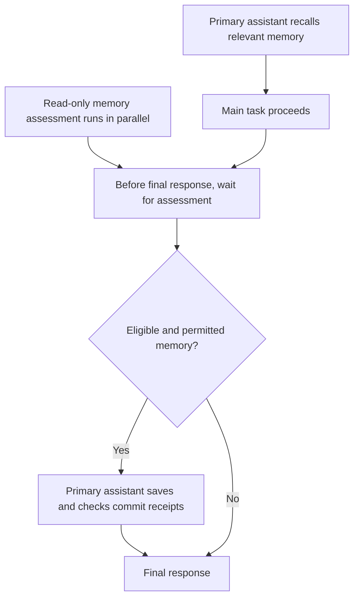

<h1 align="center">dev-memory</h1>

<p align="center"><strong>Local memory for development habits and project rules.</strong></p>

<p align="center">
  <a href="https://github.com/chrisstarr7/dev-memory/actions/workflows/check.yml"></a>
  <a href="LICENSE"></a>
  
  
</p>

<p align="center"><strong>English</strong> · <a href="docs/readme/README.zh-CN.md">简体中文</a> · <a href="docs/readme/README.ja.md">日本語</a> · <a href="docs/readme/README.ko.md">한국어</a></p>
<p align="center"><a href="#quick-start">Quick start</a> · <a href="#using-another-project">Another project</a> · <a href="#what-is-remembered">Memory scope</a> · <a href="#when-memory-is-read-and-saved">Read and save</a></p>

Dev Memory helps an AI coding assistant reuse your development habits and an individual project's durable rules in later sessions. The assistant assesses what is worth remembering; a local Python program stores and retrieves the records in SQLite.

## Quick start

Requires Node.js 22+ with npm/npx, Git, and Python 3.10+ with sqlite3. Run this command **from the root of the project you want to configure**:

```sh
npx -y --prefer-online chrisstarr7/dev-memory codex
```

Then **start a new Codex session in that project** and work normally. You do not need to invoke the Skill or say “remember this” on every turn.

For Codex, this one command sets up:

| Configuration | What it enables |
| --- | --- |
| User-level guidance | Relevant global development habits can be recalled and learned across projects. |
| Current-project guidance | This project gets its own memory store and startup binding. Its business rules remain project-local. |

Installation creates or reuses stores and configures instructions. **The permission to add new project records is controlled separately by the capture mode below.**

### Default capture mode

New projects use **`developer-first`**. Setting up a project does not automatically enable new business-memory records.

| Mode | Global development habits | Existing project rules | New durable project records |
| --- | --- | --- | --- |
| `developer-first` — default | Recall and eligible capture | Recall | Off |
| `full-project` | Recall and eligible capture | Recall | On |

Pause, disable, read-only and turn opt-out controls still apply in either mode. To enable project capture, tell the assistant: **“Enable memory recording for this project; switch it to full-project.”** It uses the installed CLI and this project's binding. No second installation command is needed. See the [installation guide](docs/installation.md) for the exact mode command.

## Using another project

**To give project B its own project configuration, enter B's root, run the same installation command again, and start a new Codex session there.**

| Situation | What to do / what happens |
| --- | --- |
| First setup in project A | Run the command in A. It configures user-level global habits and A's project binding. |
| Project B also needs project memory | Run the same command in B. B gets its own store and binding; its new-project capture mode is `developer-first`. |
| Codex enters a project that has not been initialized | User-level guidance can use global habits; it does not initialize or capture that project's business memory. |
| An initialized project needs an update | Run the same command there. Managed program files update; memories, capture settings and unrelated instructions are preserved. |

A and B share the user's global store. Their project stores are separate. An initialized project uses **one combined global/project recall**, rather than repeating the global recall.

### Other AI hosts

Replace `codex` in the command with the appropriate parameter:

| Host | Parameter |
| --- | --- |
| Codex | `codex` |
| Claude Code | `claude` |
| Cursor | `cursor` |
| Gemini CLI | `gemini` |
| GitHub Copilot | `copilot` |
| OpenCode | `opencode` |
| DeepSeek Harness (DSH) | `deepseek` |

Only Codex currently has user-level guidance across uninitialized projects. Other hosts require project setup for automatic use. DeepSeek here means the local DSH host. Installation paths, offline setup and removal are in the [installation guide](docs/installation.md).

## What is remembered

| Memory | Examples | Scope |
| --- | --- | --- |
| Global habits | Reuse suitable existing code; diagnose from evidence; preferred response order | Reusable across projects, with project details removed |
| Project rules | Business constraints, architecture decisions, interface agreements and durable lessons | The owning project; new capture requires `full-project` |
| One-time directions | “Skip tests this time” | Current conversation only |

Temporary task progress and checkpoints stay in the conversation. The ordinary Skill workflow uses global and project memory only.

The AI judges visible user requirements, corrections and choices; you do not have to label each one as a memory. A clearly cross-project instruction can become a confirmed habit. An inferred habit first becomes an inactive candidate and needs feedback from **two genuinely independent tasks** before it becomes a soft preference. AI summaries, repeated retrieval and repeated wording within one task do not add independent user evidence. Current instructions take priority over remembered habits.

## When memory is read and saved

**Reading happens in the primary assistant.** It makes a small, focused recall at task start, resume, or a meaningful topic/module change, and reuses valid context while working. It does not reload the entire store for every tool call.

**Assessment can run in parallel with development.** When the host supports asynchronous subagents, a read-only reviewer assesses possible new memories. The primary assistant remains responsible for scope, privacy, capture controls, duplicate checks and all writes.



**Before ending the turn, the assistant waits for pending capture assessment and confirms required writes.** Finishing development first does not discard eligible memories. Without a usable subagent, the primary assistant assesses them itself. No eligible increment means no write. A failed save gets a bounded repair attempt and an explicit unsaved status; it must not be reported as saved. Unrelated maintenance can wait for a later task boundary.

This is a host-guided Skill workflow, not a continuously running conversation monitor. Subagents use the host's model/account allowance; there is no separate learning service.

## Control your memory

| Goal | Tell the assistant |
| --- | --- |
| Enable project records | “Switch this project to full-project memory capture.” |
| Return to the default mode | “Switch this project to developer-first.” |
| Correct a habit | “Revise that habit: reuse existing code when it fits the requirement.” |
| Pause global learning, keep recall | “Pause global habit writes, but keep recall.” |
| Exclude this turn | “Do not save memory from this turn.” |
| Inspect records | “Show the relevant global and current-project memories.” |
| Forget a record | “Preview this memory's deletion scope; delete it after I confirm.” |

## Storage and privacy

| Store | Default location |
| --- | --- |
| User's global habits | `~/.dev-memory/global/` |
| Current project's rules | `<project-root>/.dev-memory/` |

SQLite holds records, evidence and revisions; exported Markdown is a reading view. Global records exclude project names, business data, code, paths, credentials and raw conversations. The core does not upload stores or collect telemetry. Any excerpts processed by a hosted model follow that host's data policy.

## Documentation and current limits

Installation success confirms configuration, not that every real host session follows it correctly. Automatic use requires the host to load instructions and the assistant to follow them. The unified two-project Codex workflow, asynchronous capture completion and current-version total task latency still need real-host verification.

[Installation and removal](docs/installation.md) · [Architecture](docs/architecture.md) · [Protocol](skills/dev-memory/references/protocol.md) · [Verification reports](reports/verification.md) · [Security](SECURITY.md) · [Contributing](CONTRIBUTING.md)

Report sanitized issues at [GitHub Issues](https://github.com/chrisstarr7/dev-memory/issues). Released under the [MIT License](LICENSE).
