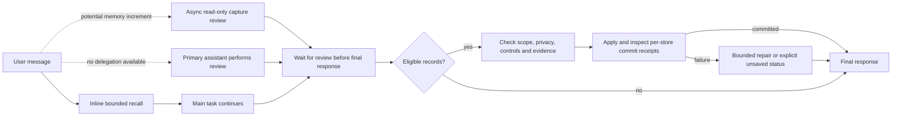

<h1 align="center">dev-memory</h1>

<p align="center"><strong>A developer-centered local memory system for AI development habits.</strong></p>

<p align="center">
  <a href="https://github.com/chrisstarr7/dev-memory/actions/workflows/check.yml"></a>
  <a href="LICENSE"></a>
  
  
</p>

<p align="center"><strong>English</strong> · <a href="docs/readme/README.zh-CN.md">简体中文</a> · <a href="docs/readme/README.ja.md">日本語</a> · <a href="docs/readme/README.ko.md">한국어</a></p>
<p align="center"><a href="#how-it-works">How it works</a> · <a href="#installation">Installation</a> · <a href="#everyday-use">Everyday use</a></p>

Dev Memory learns from the requirements, corrections, technical decisions and working methods you express during everyday coding. It builds traceable, correctable habits and reasoning preferences that can be reused across projects. With host guidance configured, your AI assistant can recall them in a new project or session and apply them to analysis, implementation and delivery.

## How it works

1. **Assess feedback.** The assistant judges whether a user message signals a durable cross-project habit. When memory capture is authorized, a read-only subagent can assess potential global or project records while the main task continues. Before the final response, the assistant waits for review and confirms any required writes. Explicit cross-project rules remain direct evidence; inferred feedback stays a candidate until two independent task IDs support it.
2. **Recall for the task.** The assistant retrieves a small set of relevant active habits and applies their conditions and exceptions. It reuses valid context within the task; current user instructions take priority over soft preferences.
3. **Revise with evidence.** Corrections update existing habits, preserving their sources and revision history. Exact duplicates are detected locally; the current assistant judges equivalent wording. AI summaries and retrieval hits add no user evidence.

| What you express | How it is treated |
| --- | --- |
| “Across my projects, check existing code before adding another implementation.” | Confirmed global habit |
| Repeatedly choosing evidence-based diagnosis in separate tasks | Candidate, then a soft preference when supported |
| “Do not modify this project's payment module.” | Project constraint, when project capture is enabled |
| “Skip tests this time.” | Applies in the current conversation; not saved |



## Installation

Run from the project root. Replace `<agent>` with a parameter from the table:

```sh
npx -y --prefer-online chrisstarr7/dev-memory <agent>
```

| AI host | `<agent>` |
| --- | --- |
| Codex | `codex` |
| Claude Code | `claude` |
| Cursor | `cursor` |
| Gemini CLI | `gemini` |
| GitHub Copilot | `copilot` |
| OpenCode | `opencode` |
| DeepSeek Harness (DSH) | `deepseek` |

Requires Node.js 22+ with npm/npx, Git, and Python 3.10+ with sqlite3. The installer copies the runtime and configures the selected host's project instructions. **Start a new host session after setup.** Activated projects share the same user's global habits while keeping their project stores separate. DeepSeek here means the local DSH host; web and mobile chats cannot run the installer.

**Codex also supports user-level activation:** run the following once to use global habits across projects without initializing each project:

```sh
npx -y --prefer-online chrisstarr7/dev-memory codex --user
```

User-level activation currently supports Codex only. Other hosts use their project adapters. Repeating the install command updates the managed runtime; local memories and unrelated user instructions are preserved. Offline installation, host paths and removal are in the [installation guide](docs/installation.md).

## Everyday use

Develop normally after setup. Memory assessment can run in a read-only host subagent while coding proceeds. Before ending the turn, the primary assistant waits for that review, validates eligible records and checks successful store receipts; finishing coding first does not discard a memory increment. If delegation is unavailable or fails, the primary assistant performs the assessment. A finding of no eligible memory requires no write. Storage failure is reported honestly after a bounded repair attempt. This uses the host's existing model capability and account usage. Recall remains inline before edits, all writes belong to the primary assistant, and unrelated maintenance can be deferred. There is no always-running conversation monitor, daemon or separate learning service.

| To control memory | Tell your assistant |
| --- | --- |
| Correct a habit | “Revise that preference: reuse existing code only when it fits the requirement.” |
| Pause learning | “Pause global habit writes, but keep recall.” |
| Exclude a turn | “Do not save memory from this turn.” |
| Forget a habit | “Preview the deletion scope for this habit; delete it after I confirm.” |

The Skill recalls only global habits and durable rules for the current project. New project stores default to **`developer-first`**: existing project rules remain recallable, while new project records are disabled until the user enables `full-project` mode. Task progress and checkpoints are not part of the normal Skill workflow. Legacy task records are preserved but excluded from ordinary recall and maintenance.

## Local storage and control

| Memory | Default location |
| --- | --- |
| Global developer habits | `~/.dev-memory/global/` |
| Project rules and decisions | `<project-root>/.dev-memory/` |

SQLite stores atomic habits, evidence and revisions; the working profile consists of the current effective habits. The runtime supports idempotent writes, isolation, backup, read-only access and controlled forgetting. Global habit signals must be de-identified; project names, business data, code, paths and raw conversations do not belong there. The core uploads no memory and collects no telemetry; model processing follows the host's data policy.

## Documentation and verification

The runtime uses Python's standard library and SQLite. Program checks, semantic evaluation and real-host checks are reported separately. Successful installation confirms configuration; automatic use depends on the host loading instructions and the assistant following them. Real two-project Codex user-level activation and a matched disabled/old/new performance comparison remain unverified.

[Architecture](docs/architecture.md) · [Protocol](skills/dev-memory/references/protocol.md) · [Verification](reports/verification.md) · [0.7.0 task comparison](reports/benchmark-0.7.0.md) · [Security](SECURITY.md) · [Contributing](CONTRIBUTING.md)

Report sanitized issues at [GitHub Issues](https://github.com/chrisstarr7/dev-memory/issues). Released under the [MIT License](LICENSE).
