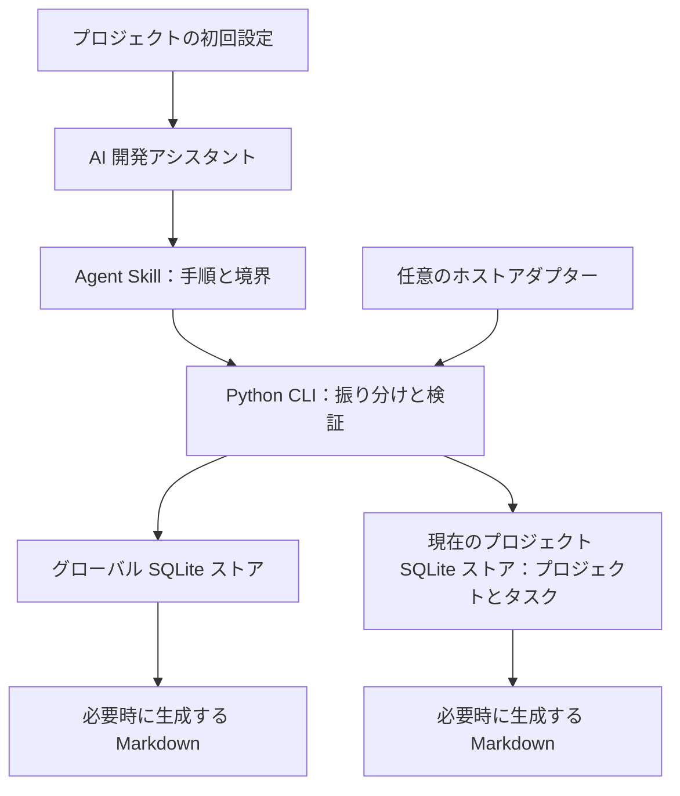

<h1 align="center">dev-memory</h1>

<p align="center">
  <strong>AI 開発アシスタントのための、ローカルで管理するプライベートな記憶。</strong><br />
  制約を読み出し、訂正を保存し、実際の進捗から開発を再開。
</p>

<p align="center">
  <a href="https://github.com/chrisstarr7/dev-memory/actions/workflows/check.yml"></a>
  <a href="../../LICENSE"></a>
  
  
</p>

<p align="center"><a href="../../README.md">English</a> · <a href="README.zh-CN.md">简体中文</a> · <strong>日本語</strong> · <a href="README.ko.md">한국어</a></p>

<p align="center"><a href="#クイックスタート">クイックスタート</a> · <a href="#主な機能">主な機能</a> · <a href="#動作の流れ">動作の流れ</a></p>

<p align="center"><kbd>Codex</kbd> · <kbd>Claude Code</kbd> · <kbd>Cursor</kbd> · <kbd>Gemini CLI</kbd> · <kbd>GitHub Copilot</kbd> · <kbd>OpenCode</kbd> · <kbd>DeepSeek Harness</kbd></p>

---

## クイックスタート

**開発するプロジェクトのルートディレクトリ**で実行します。

```sh
npx -y chrisstarr7/dev-memory codex
```

ほかの AI では `codex` を `claude`、`cursor`、`gemini`、`copilot`、`opencode`、`deepseek`（DeepSeek Harness／DSH）に置き換えます。macOS、Linux、Windows で同じコマンドを使用できます。

**必要な環境：** npm/npx を含む Node.js 22+、Git、sqlite3 を含む Python 3.10+。インストーラーがプログラムを取得し、環境を確認して、空のプロジェクト用ストアと AI のプロジェクト指示を設定します。

インストールが成功したら、**そのプロジェクトで新しい AI セッションを開始し、通常どおり開発してください**。有効化の合言葉、明示的な Skill 呼び出し、毎回の保存・読み出し依頼は不要です。既存のセッションは新しい指示を読み込むために再開してください。

更新や別のプロジェクトの初期化にも同じコマンドを使います。更新時には既存の記憶、無関係なプロジェクト指示、一時停止設定を保持します。各プロジェクトを個別に初期化し、明示的に確認されたグローバル設定だけを共有します。

<details>
<summary>ローカル AI にインストールを依頼する</summary>

> https://github.com/chrisstarr7/dev-memory から dev-memory をインストールし、現在の AI ホスト向けにこのプロジェクトを初期化してください。成功の応答を確認し、既存の記憶と設定を保持してください。

AI にはローカルファイルとコマンドの実行権限が必要です。Web チャットだけでは PC にインストールできません。オフライン、Node.js を使わないインストール、アンインストールについては [インストールガイド](../../docs/installation.md) を参照してください。

</details>

## 主な機能

| 機能 | 内容 |
| --- | --- |
| 正確な制約 | 条件、例外、禁止事項、検証方法を保持し、訂正時は既存のルールを改訂します。 |
| 実際の進捗を再開 | 完了・未完了の作業、阻害要因、次の手順を記録します。各タスクには現在のチェックポイントを一つ保持します。 |
| プロジェクトの分離 | A の業務情報は A に保持します。グローバルには明示的に確認された共通の設定・手法だけを保存します。 |
| 必要な記憶を取得 | 適用可能なグローバル・現在のプロジェクト・タスクの記録を取得し、有効な文脈を再利用します。変更後は無効化して再確認します。 |
| 重複排除と整理 | 完全一致はプログラムが検出します。言い換えや短縮は現在の AI が制約・証拠を保ちながら判断します。 |
| ローカルで制御 | 閲覧、訂正、このターンの記録除外、一時停止、読み取り専用、アーカイブ、削除に対応します。 |

独立した Agent Skill と小さな Python CLI で構成され、標準ライブラリと SQLite を使用します。常駐プロセス、ベクトルサービス、追加の有料モデルは不要です。プログラムとプロトコルは公開され、各利用者の記憶は個別にローカルで保持されます。新しいストアにはデモ記録が入りません。

## 日常の使い方

開発したい内容を通常どおり伝えてください。初期化済みの AI は関連する制約を取得し、明確な訂正を速やかに保存し、通常の変更をターンの最後にまとめます。チェックポイントの再開前には実際のコードを確認します。

| 操作 | AI への依頼例 |
| --- | --- |
| 業務条件の訂正 | 「返金期限を配達完了から 14 日以内に変更して。」 |
| グローバル設定の保存 | 「この開発規約は全プロジェクトに適用するので、グローバルに保存して。」 |
| 今回は記録しない | 「このターンの内容は記憶に保存しないで。」 |
| 書き込みの停止・再開 | 「このプロジェクトへの記憶の書き込みを停止し、読み出しは続けて。」／「書き込みを再開して。」 |
| 読み取り専用 | 「このターンは記憶の読み出しだけにして、何も書き込まないで。」 |
| 記録の削除 | 「このルールを削除する範囲を表示して、私の確認後に削除して。」 |

例は架空のもので、自動取り込みされません。JSON を手書きする必要はなく、AI が [ローカルプロトコル](../../skills/dev-memory/references/protocol.md) を使います。保存済みとの報告には、該当ストアからの成功応答が必要です。

## 動作の流れ

1. **取得：** タスクの開始・再開、プロジェクトやモジュールの変更時に、一回の呼び出しで関連記録と整理待ちの状態を取得します。通常の開始時にホスト診断を繰り返しません。
2. **保存：** 現在の AI が意味を抽出し、CLI が範囲、出典、改訂、トランザクションの境界を検証します。追加情報がなければ、確認済みの短い NOOP 応答を返します。
3. **整理：** 関連記録を比較し、同等の重複を通常の取得対象から外し、長い本文を短縮します。条件、例外、否定、バージョン境界、出典は保持します。
4. **再開：** タスクごとに現在のチェックポイントを一つ保持し、古いものは履歴として残します。出典の変更・削除により派生要約を無効化します。

### 整理の既定値

| 条件・上限 | 既定値 |
| --- | --- |
| 一つのストアで変更され、整理待ちの異なる記録 | **5 件** |
| 整理待ちの記録の本文 | **1,200 文字** |
| ストアごとの関連バッチ | 最大 **8 件／12,000 文字** |
| 開発の各ターン | 現在の AI ターン内で最大 **1 バッチ** |
| 取得・整理の SQL 処理時間 | **500 ms**。超過は延期として報告 |

閾値はグローバルとプロジェクトのストアごとに計算します。NOOP や繰り返しの確認で変更数は増えません。セッション・タスクの区切りでは未処理の話題を一度確認でき、開始時の確認を重複させません。変更がなければ整理しません。一時停止、読み取り専用、ターンの記録除外でも整理を停止します。バックグラウンドタイマー、ツール呼び出しごとの要約、全ストアの走査はありません。

有効な記憶と読み込み済みプロトコルを再利用します。文脈の圧縮、記憶の改訂、ワークスペースの変更後には再確認します。プロジェクト制約の取得枠を確保し、候補の超過は不完全として報告します。重要な制約の不足は追加確認が必要です。各ストアは個別にコミットし、成功・失敗をそれぞれ報告します。

古い記録と本文は追跡可能な履歴として残ります。整理は有効な文脈を減らしますが、**ディスク使用量全体は制限しません**。意味の同等性が不確かな場合は元の記録を保持します。

## アーキテクチャと保存先



| 範囲 | 内容 | 既定の保存先 |
| --- | --- | --- |
| `global` | 全プロジェクトに適用すると明示的に確認された開発設定、規約、手法 | `~/.dev-memory/global/` |
| `project` | 所属プロジェクトの業務、構成、インターフェース、制約、決定、不具合の教訓 | `<project-root>/.dev-memory/` |
| `task` | 一時的な要件、進捗、阻害要因、次の手順 | 所属プロジェクトのストア内 |

トランザクション、証拠、応答、ビュー、バックアップはストアごとに分離されます。プロジェクトへの書き込み失敗をグローバルに回しません。範囲は内容と利用者の意図で判断し、作業ディレクトリだけでは決めません。所属先のない業務情報はグローバルに保存しません。

実行用 Skill は `skills/dev-memory/`、インストール入口は `bin/install.cjs` と `install.py` です。`docs/`、`tests/`、`evals/`、`reports/` には文書、隔離テスト、評価ツール、証拠を置きます。[アーキテクチャガイド](../../docs/architecture.md) を参照してください。

## 互換性と検証状況

| モード | 動作・状態 |
| --- | --- |
| 基本モード | AI が Skill と CLI を呼び出します。Skill のインストールだけでは毎ターンの実行を保証しません。 |
| 既定のプロジェクト指示 | 初期化でホストのプロジェクト指示を設定します。ホストによる読み込みとモデルによる遵守に依存します。 |
| 任意のイベントモード | Codex hooks には信頼設定とイベント検証が必要です。実際のイベント伝達経路は未検証です。 |
| 読み取り専用 | 初期化・書き込みをせず、既存の記録を取得します。 |
| 利用不可 | 権限不足やストアにアクセスできない状態を正しく報告します。 |

Ubuntu/macOS、Python 3.10/3.14 でプログラムテストとパッケージ CI が成功しています。6 種類のインストール対象について、隔離環境で GitHub からの初回・再インストールを確認しました。インストール成功は全ホストの自動動作の証明ではありません。Codex CLI の実行証拠、ホストのバージョン、意味の評価、未完了の S01–S48 は [検証報告](../../reports/verification.md) に記載しています。 DSH はプログラムのインストールと公式公開コンポーネントを確認しましたが、DeepSeek モデルによる完全なセッションは未検証です。[DSH の結果](../../reports/deepseek.json) を参照してください。

**処理時間には未解決の制約があります。** 最新の全タスク比較は 0.4.0 の部分サンプルで、記憶を無効にすると約 52–53 秒、有効にすると約 86–89 秒でした。0.5.0 では開始時と重複読み込みを減らしましたが、新しい比較はホストのクレジット不足で未完了です。遅延が小さいとは保証しません。[全工程のレビュー](../../reports/lifecycle-review.md) を参照してください。

## プライバシーと安全性

- 公開パッケージに実際の記憶、作者のデータ、自動投入するデモは含めません。
- コアプログラムは記憶をアップロードせず、テレメトリーも収集しません。モデル呼び出しにはホストの設定とデータポリシーが適用されます。
- プログラムと実行データは分離されます。更新・通常のアンインストールは記憶を保持し、プロジェクトの記憶は既定で Git から除外します。
- 認証情報、パスワード、機密ログ全体、不要な顧客情報は保存しません。認証情報の検出だけで意味の判断を代替できません。
- 過去の記憶は現在の指示や安全規則を上書きしません。ローカルストアに既定のアプリケーション暗号化はありません。
- 削除はツール管理下のデータが対象です。ホストの会話、外部コピー、システムのスナップショットは消せず、安全な消去を保証しません。

[SECURITY.md](../../SECURITY.md) と [リスク検証レポート](../../reports/adversarial-review.md) を参照してください。

## コントリビュートとサポート

不具合・提案は [Issues](https://github.com/chrisstarr7/dev-memory/issues)、改善は Pull Request で受け付けます。匿名化した最小再現例を使い、実際の記憶ストアは添付しないでください。開発・評価の手順は [CONTRIBUTING.md](../../CONTRIBUTING.md) を参照してください。

## ライセンス

Copyright © 2026 dev-memory contributors. [MIT License](../../LICENSE) で公開しています。
