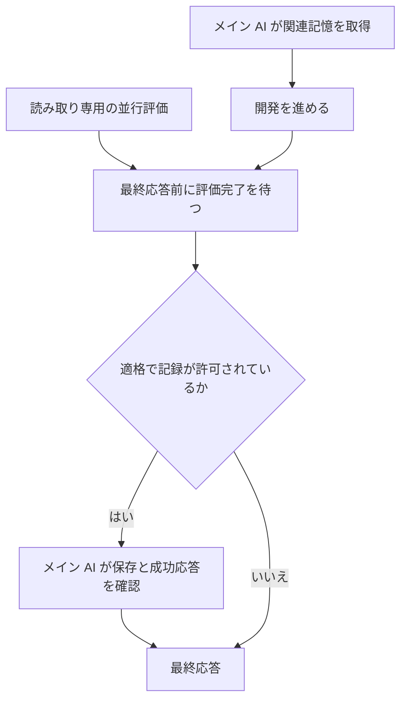

<h1 align="center">dev-memory</h1>

<p align="center"><strong>開発習慣とプロジェクト規則を、新しい AI セッションでも使えるローカルメモリ。</strong></p>

<p align="center">
  <a href="https://github.com/chrisstarr7/dev-memory/actions/workflows/check.yml"></a>
  <a href="../../LICENSE"></a>
  
  
</p>

<p align="center"><a href="../../README.md">English</a> · <a href="../../docs/readme/README.zh-CN.md">简体中文</a> · <strong>日本語</strong> · <a href="../../docs/readme/README.ko.md">한국어</a></p>
<p align="center"><a href="#クイックスタート">クイックスタート</a> · <a href="#別のプロジェクトで使う">別プロジェクト</a> · <a href="#記憶する内容">記憶の範囲</a> · <a href="#取得と保存のタイミング">取得と保存</a></p>

Dev Memory は AI コーディングアシスタント用の記憶 Skill です。AI が長く使える開発習慣やプロジェクト規則を判断し、ローカルの Python プログラムが SQLite への保存と取得を担当します。

## クイックスタート

Node.js 22+（npm/npx）、Git、Python 3.10+（sqlite3）が必要です。**設定したいプロジェクトのルート**で実行します。

```sh
npx -y --prefer-online chrisstarr7/dev-memory codex
```

完了後、そのプロジェクトで**新しい Codex セッションを開始**し、通常どおり開発します。毎ターン Skill を呼んだり「覚えて」と伝えたりする必要はありません。

Codex では、この一つのコマンドが二つの設定を行います。

| 設定 | 用途 |
| --- | --- |
| ユーザー単位の指示 | 複数プロジェクトで使えるグローバルな開発習慣の取得・学習。 |
| 現在のプロジェクトの指示 | 独立した記憶ストアと起動時の紐付け。業務規則はこのプロジェクトに属します。 |

インストールはストアを作成または再利用して指示を設定します。**新しいプロジェクト記録を許可するかは、次の記録モードで決まります。**

### 既定の記録モード

新規プロジェクトの既定は **`developer-first`** です。プロジェクト設定を作っても、新しい業務記憶の記録は自動で有効になりません。

| モード | グローバルな開発習慣 | 既存のプロジェクト規則 | 新しい長期プロジェクト記録 |
| --- | --- | --- | --- |
| `developer-first`（既定） | 取得と適格な記録 | 取得 | 無効 |
| `full-project` | 取得と適格な記録 | 取得 | 有効 |

どちらも一時停止、無効化、読み取り専用、ターン除外を尊重します。プロジェクト記録が必要なら、AI に **「このプロジェクトの記憶記録を full-project に切り替えて」** と伝えてください。インストール済み CLI と現在の紐付けを使うため、再インストールは不要です。具体的なモードコマンドは [インストールガイド](../../docs/installation.md) にあります。

## 別のプロジェクトで使う

**プロジェクト B にも専用の設定が必要なら、B のルートで同じインストールコマンドを再実行し、B で新しい Codex セッションを開始します。**

| 場面 | 操作と結果 |
| --- | --- |
| プロジェクト A の初回設定 | A のルートで実行し、ユーザー単位の習慣と A の設定を作成。 |
| B にもプロジェクト記憶が必要 | B のルートで同じコマンドを実行。独立したストアと紐付けを作成し、新規モードは `developer-first`。 |
| 未初期化のプロジェクトを開く | Codex のユーザー指示でグローバル習慣を使えます。業務記憶の自動初期化・記録は行いません。 |
| 設定済みプロジェクトを更新 | そのルートで同じコマンドを実行。記憶、記録設定、無関係な指示は保持。 |

A と B は同じユーザーのグローバルストアを共有し、プロジェクトストアは分離します。初期化済みプロジェクトはグローバルと現在のプロジェクトを**一度で取得**し、グローバル取得を重複実行しません。

### 他の AI ホスト

コマンドの `codex` を対応する値に置き換えます。

| ホスト | 値 |
| --- | --- |
| Codex | `codex` |
| Claude Code | `claude` |
| Cursor | `cursor` |
| Gemini CLI | `gemini` |
| GitHub Copilot | `copilot` |
| OpenCode | `opencode` |
| DeepSeek Harness（DSH） | `deepseek` |

未初期化プロジェクトでもユーザー単位の指示を使えるのは現在 Codex のみです。他のホストはプロジェクトごとの設定が必要です。DeepSeek はローカル DSH を指します。パス、オフライン導入、削除は [インストールガイド](../../docs/installation.md) を参照してください。

## 記憶する内容

| 種類 | 例 | 範囲 |
| --- | --- | --- |
| グローバルな開発習慣 | 適切な既存実装の再利用、証拠に基づく調査、報告順序 | プロジェクト情報を除いて複数プロジェクトで使用。 |
| プロジェクト規則 | 業務制約、設計判断、インターフェース規約、長く使える教訓 | 所有プロジェクトのみ。新規記録には `full-project` が必要。 |
| 一時的な指示 | 「今回はテストを実行しないで」 | 現在の会話のみ。 |

一時的な進捗、チェックポイント、次の手順は会話に残します。通常の Skill はグローバルとプロジェクトの二種類の記憶を使います。

AI が可視の要求、訂正、選択を評価するため、ユーザーが毎回記憶対象を指定する必要はありません。明確な横断的指示は確認済み習慣になれます。推定した習慣は未適用の候補とし、**実際に独立した二つのタスクの反応**が揃うとソフトな好みに昇格できます。AI の要約、検索ヒット、同じタスクの繰り返しは独立した証拠を増やしません。現在の指示を優先します。

## 取得と保存のタイミング

**取得はメイン処理内で行います。** タスク開始、再開、実質的な話題・モジュール変更時に関連記憶を少数取得し、有効な文脈を再利用します。ツール呼び出しのたびに全体を読み直しません。

**評価は開発と並行できます。** ホストが非同期サブエージェントを提供する場合、読み取り専用の評価役が記憶候補を判断します。範囲、プライバシー、記録設定、重複の確認と全書き込みはメインの AI が担当します。



**ターンを終える前に、進行中の記憶評価を待ち、必要な保存の成功を確認します。** 開発が先に終わっても記録対象を捨てません。委譲できない、または失敗した場合はメインの AI が評価します。対象がなければ書き込まず、保存失敗は限定的な修復後も残れば未保存として報告します。無関係な保守は後の区切りに延期できます。

これはホストの指示に従う Skill であり、常駐会話監視ではありません。サブエージェントはホストのモデルと利用枠を使い、独立した学習サービスはありません。

## 記憶を管理する

| 目的 | AI への依頼例 |
| --- | --- |
| プロジェクト記録を有効化 | 「このプロジェクトを full-project に切り替えて」 |
| 既定モードへ戻す | 「このプロジェクトを developer-first に戻して」 |
| 習慣を修正 | 「既存実装は要件に適合する場合に再利用する、と修正して」 |
| グローバル記録を停止し、取得は継続 | 「グローバル習慣の書き込みを一時停止して」 |
| 今回を除外 | 「このターンの記憶は保存しないで」 |
| 記憶を確認 | 「現在のタスクに関係するグローバル・プロジェクト記憶を見せて」 |
| 記憶を削除 | 「削除範囲を表示し、私の確認後に削除して」 |

## 保存先とプライバシー

| ストア | 既定の場所 |
| --- | --- |
| ユーザーのグローバル習慣 | `~/.dev-memory/global/` |
| 現在のプロジェクト規則 | `<project-root>/.dev-memory/` |

SQLite が記録、証拠、改訂を保持し、Markdown は閲覧用の出力です。グローバル記録にプロジェクト名、業務データ、コード、パス、認証情報、元の会話を含めません。コアはストアをアップロードせず、テレメトリーを収集しません。ホストモデルに渡した抜粋には、そのホストのデータポリシーが適用されます。

## 資料と現在の制限

インストール成功は設定の確認です。自動利用はホストの指示読み込みと AI の遵守に依存します。統合インストール後の実際のプロジェクト間取得、非同期記録の完了、現行版のタスク総所要時間には実ホスト検証が必要です。

[導入と削除](../../docs/installation.md) · [構成](../../docs/architecture.md) · [プロトコル](../../skills/dev-memory/references/protocol.md) · [検証報告](../../reports/verification.md) · [安全性](../../SECURITY.md) · [貢献](../../CONTRIBUTING.md)

機密情報を除いた問題を [GitHub Issues](https://github.com/chrisstarr7/dev-memory/issues) に報告してください。[MIT License](../../LICENSE) で公開しています。
