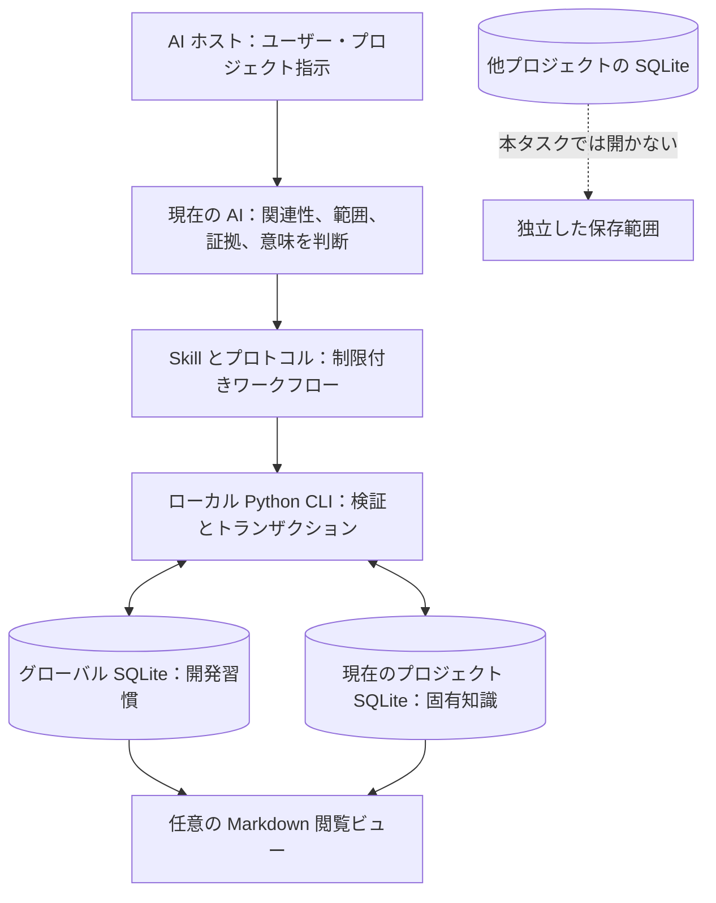
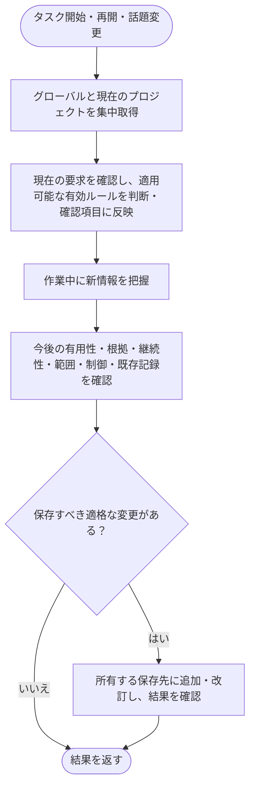
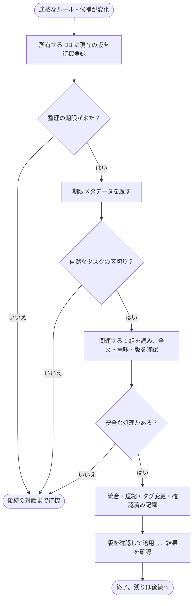

<h1 align="center">dev-memory</h1>

<p align="center"><strong>開発習慣と、各プロジェクト固有のルールを覚えるローカルメモリ。</strong></p>

<p align="center">
  <a href="https://github.com/chrisstarr7/dev-memory/actions/workflows/check.yml"></a>
  <a href="../../LICENSE"></a>
  
  
</p>

<p align="center"><a href="../../README.md">English</a> · <a href="README.zh-CN.md">简体中文</a> · <strong>日本語</strong> · <a href="README.ko.md">한국어</a></p>

Dev Memory は AI 開発支援用の可搬な Skill とローカル Python プログラムです。関連する開発習慣とプロジェクト知識を取得し、実際の要求や証拠から長期的に有用な情報を保存します。情報源と改訂履歴を追跡でき、意味の判断は AI、検証と保存は SQLite プログラムが担当します。

[導入](#クイックスタート) · [記録対象](#何を記録するか) · [構成](#構成と保存範囲) · [取得と記録](#取得と記録) · [自動整理](#自動整理と要約) · [操作](#メモリの管理) · [問題調査](#記録や取得ができない場合)

## クイックスタート

**開発プロジェクトのルート**で実行します。

```sh
npx -y --prefer-online chrisstarr7/dev-memory <agent>
```

`<agent>` を下表の引数に置き換えてください。Node.js 22+（npm/npx）、Git、Python 3.10+（sqlite3 を含む）が必要です。導入後のメモリ処理は Python 標準ライブラリで動作し、npx や外部メモリサービスは不要です。

| AI ホスト | 引数 | プロジェクトの指示ファイル |
| --- | --- | --- |
| Codex | `codex` | `AGENTS.md`、または既存の空でない `AGENTS.override.md` |
| Claude Code | `claude` | `CLAUDE.local.md` |
| Cursor | `cursor` | `.cursor/rules/dev-memory.mdc` |
| Gemini CLI | `gemini` | `GEMINI.md` |
| GitHub Copilot | `copilot` | `.github/copilot-instructions.md` |
| OpenCode | `opencode` | `AGENTS.md` |
| DeepSeek Harness（DSH） | `deepseek` | `AGENTS.md` |

**Codex では 1 回でユーザー全体と現在のプロジェクトを設定します。**`npx -y --prefer-online chrisstarr7/dev-memory codex` を実行すると、未初期化の他プロジェクトでもユーザー指示によってグローバル習慣だけを取得できます。そのプロジェクトの保存領域は作りません。別プロジェクトにも固有のメモリが必要なら、そのルートで同じコマンドを実行してください。他のホストは現在プロジェクト単位の指示を使います。OpenCode 経由で DeepSeek モデルを使う場合は、実際のホストである `opencode` を選びます。

導入・更新後はプロジェクトで**新しい AI セッション**を開始し、通常どおり作業してください。毎回の Skill 呼び出し、「記憶して」という指示、保存範囲の指定は不要です。新規データベースは空で始まり、既存の記録は保持されます。個人の好みを事前に作りません。設定結果はファイルと保存領域の確認であり、実際の AI が指示を守った証明ではありません。パス、代替導入、権限、削除手順は[導入ガイド](../installation.md)を参照してください。

## 何を記録するか

AI は将来のタスクに役立つか、根拠があるか、どこに適用するかを判断します。現在の要求は常にメモリより優先されます。

コード変更が不要な確認・レビュー後も記録対象を判断します。既存コードが準拠済みでも、新たな継続的プロジェクト規約は対象です。適用範囲を保ち、一時的な確認結果や同じ規約を一般化した全体設定は保存しません。重複排除とプライバシー制御は引き続き適用されます。

| 保存先 | 対象 | 例 |
| --- | --- | --- |
| **グローバル** | プロジェクト情報を除いた再利用可能な習慣や方法 | 報告の順序、既存実装の確認、証拠に基づく調査 |
| **現在のプロジェクト** | 継続的な規約、契約、制約、決定、根拠のある事実 | コード・文書規約、業務状態、API/データ契約、トランザクション・権限・責務境界 |

**永続的な記憶の範囲はグローバルと現在のプロジェクトの二つだけです。**現在の会話は AI ホストが保持します。一時的指示、作業進捗、未確認の推測を Dev Memory の記録やタスクのチェックポイントには保存しません。認証情報はどちらにも保存しないでください。

プロジェクト知識は検証・受入基準、互換性、環境・配備、性能、依存関係、移行、検証済み障害の教訓と適用条件・予防確認も含みます。カテゴリは固定の網羅リストではありません。ファイル全体やあらゆる実装詳細を恒久ルールにせず、観測した動作と望ましい動作を分けてください。既存コードだけでユーザーの設計意図は確定しません。

**グローバル習慣の証拠:**「今後すべてのプロジェクトで」のような継続的指示は、確認済み有効ルールにできます。再利用可能な要求・選択・訂正は、初回から**未有効の候補**として保存し、真に独立した 2 タスクの証拠でソフトな好みに昇格できます。取得、AI の反復、要約は新しいユーザー証拠になりません。候補は保存済みでも指示として使いません。

**プロジェクトの既定値:** 新規は `full-project` で、適切な知識を自動記録します。`developer-first` は新規プロジェクト記録を制限する選択モードです。更新は既存モードと一時停止・無効化・読み取り専用設定を保持し、旧モードの切り替えには明示指示が必要です。不明な業務決定は確認事項のままとし、未確認仮説は有効化せず通常取得から除外します。旧データベースのタスク記録は自動削除せず、現在の CLI は作成・取得・整理・出力しません。

## 構成と保存範囲



| 場所 | 内容 |
| --- | --- |
| `~/.dev-memory/global/` | グローバル DB、設定、任意のビュー・バックアップ |
| `<project-root>/.dev-memory/` | プロジェクト DB、設定、非公開の有効化バインディング |
| ホストの `skills/dev-memory/` | 公開 Skill、CLI、参照文書。非公開メモリの保存先とは別 |

全プロジェクトを集めた中央 DB はありません。取得はグローバルと現在のプロジェクトだけを読み、他プロジェクトを列挙しません。プロジェクトの業務、パス、コード、顧客情報をグローバルに移してはいけません。クローン・worktree は既定で独立したプロジェクト DB を持ちます。SQLite が正本で、Markdown は再生成可能です。

## 取得と記録



記録対象は訂正だけではありません。根拠があり、適用範囲内で今後の作業を導く要求・選択・規約・決定・事実・方法も評価します。

- 取得はメイン処理で行い、`context` を 1 回実行して有効な文脈を再利用します。文脈喪失後は再取得します。既定の本文予算は 5 件 / 4000 文字（グローバル 3 件、プロジェクト 2 件）。未読・不完全な結果には必要部分だけの追加取得を行います。 有効なグローバルルールがない、または取得が無効な場合、未使用の予算を現在のプロジェクトへ割り当てます。合計上限は変わらず、未有効の候補は指示枠を消費しません。
- 主 AI が既存の推論中に記録を判断します。重要な訂正は影響する編集前に、通常の増分は最終応答前にまとめて保存します。同等の規則は再利用・改訂し、証拠と履歴を残します。
- ホストの任意の読み取り専用補助 AI を並列評価に使う場合も、**応答終了前に待機し、主 AI が保存して結果を確認**します。起動しただけでは保存成功ではありません。追加モデル呼び出しや常時会話監視は必須ではありません。
- グローバルとプロジェクトは別トランザクションです。片方の成功を両方の成功と見なさず、失敗は正確に報告します。形式と版管理は[プロトコル](../../skills/dev-memory/references/protocol.md)を参照してください。

## 開発サイクルでの役割

| 段階 | メモリの役割 |
| --- | --- |
| 要件 | 既存の業務ルールを取得し、確認済みの長期要件・条件・例外を保存します。 |
| 設計 | 契約と決定を再利用し、仮定を有効ルールにしません。 |
| 実装 | 規約と既存能力を使い、観測した現状と必要な動作を区別します。 |
| 検証 | 受け入れ・回帰条件を取得し、過去の成功を現在の成功と見なしません。 |
| 訂正 | 変更前に重要な訂正を保存し、古い派生要約を無効にします。 |
| 納品 | 文書・報告規約と保存の受領結果を確認し、作業進捗は保存しません。 |
| 次の作業 | グローバルと現在のプロジェクトだけを取得し、必要な未読ルールを補います。 |

## 自動整理と要約

取得回数と整理キューは独立しています。取得済みでなくても新規・変更記録は審査でき、同じ記録を繰り返し取得しても再登録されません。5件の閾値は異なる待機記録IDを数え、同じ記録の5回の修正は1件です。取得中に現在の根拠との矛盾が見つかった場合は、閾値を待たず採用前に確認します。

通常の未確認仮説は対象外ですが、旧データの `active + hypothesis` は例外として異常審査に含めます。根拠に基づく修正またはアーカイブで解決するまで審査済みにできません。審査パックには各記録の直近最大3件の根拠と省略表示を含め、全体の8件／12000文字予算に算入します。自動整理は期限通知後にAIが作業の区切りで行う審査であり、バックグラウンドでの自動書き換えではありません。詳細は[英語の説明](../../README.md#automatic-organization)を参照してください。

自動とは、許可された通常の対話中に AI が処理することです。**常駐プロセス、タイマー、バックグラウンド要約モデル、全ライブラリ走査はありません。**



待機が 5 件、本文が 1200 文字以上、または変更から既定の 7 日が過ぎると整理対象になります。DB 単位の整理周期が始まると、閾値未満の残りも後続対話で処理できます。ユーザーの 1 ターンにつき保存先ごとに **1 関連テーマ、最大 8 件 / 12000 文字**です。候補も未有効のまま整理でき、未確認仮説は除外します。安定した未変更記録を繰り返し要約しません。プロトコル更新は既存の適格な有効記録・候補を一度だけ待機登録することがあります。長すぎる起点は明示して別の収まるテーマを選び、未読部分を切り捨てません。ユーザーの停止・無効化・除外・読み取り専用設定を守ります。

| 操作 | 変更 | 保護するもの |
| --- | --- | --- |
| **本文圧縮** | 1 記録の冗長な表現を短縮 | 条件、例外、禁止事項、強度、範囲、証拠、旧版 |
| **重複統合** | 同等の正規ルールを残し、重複を通常取得から除外 | 元の証拠・履歴・参照。不一致のルールは別に保持 |
| **タグ変更・確認** | 分類や確認済み版を更新 | 意味と証拠。新観測を作らない |
| **派生要約** | 同一範囲の、確認済み情報源付き閲覧補助 | 有効かつ両立する原子ルール。強度を増やさず、元の変更で無効化 |
| **アーカイブ** | 新しい確認済み情報や明確な期限で通常取得から除外 | 監査履歴。古いことだけを廃止の根拠にしない |

整理から事実やユーザー証拠を生成したり、候補を統合するだけで昇格させたり、業務矛盾を勝手に裁定したり、プロジェクト情報をグローバルに移したりしてはいけません。意味の等価性は AI の判断で、構造チェックだけでは証明できません。不明なら原文を残します。有界のテーマ検索は、特に異なる分類間の全矛盾を検出する保証はありません。要約の準備も取得無効化・除外設定と 8 件 / 12000 文字予算を守ります。

**文脈整理とディスク回収は別です。**圧縮や統合後も証拠・旧本文・監査履歴は残ります。明示的な `storage` 回収は使い捨てキャッシュ、退役検索語、空きページを対象とし、検証済み同一 DB バックアップの保持数は別途選択します。証拠、改訂、プライバシー結果、削除済み記録の復活防止情報は自動保持期限の対象ではありません。恒久削除は忘却手順で行い、無損失の固定容量上限は約束しません。

## メモリの管理

通常の要求に保存範囲の指定は不要です。制御自体を変更するときは範囲を明示できます。

| 目的 | AI への指示例 |
| --- | --- |
| プロジェクト規約 | 「このリポジトリでは API の入出力変更時にインターフェース文書も更新して」 |
| プロジェクト契約 | 「取消済み注文は再課金しない。以後の変更でも守って」 |
| 確認済み全体習慣 | 「今後すべてのプロジェクトで適切な既存実装を先に調べて」 |
| 訂正 | 「その規約を修正。生成ファイルは対象外」 |
| プロジェクト記録の切り替え | 「full-project に切り替えて」 / 「developer-first に戻して」 |
| 全体学習の一時停止 | 「グローバルの書き込みだけ止め、取得は続けて」 |
| 無効化・再開 | 「グローバル取得・書き込みを停止して」 / 「取得と学習を再開して」 |
| 今回の除外 | 「このターンの内容は一切保存しないで」 |
| 閲覧・整理 | 「関連メモリを表示して」 / 「条件と例外を残して待機中の関連項目を整理して」 |
| 忘却 | 「削除範囲をプレビューして、確認後に削除して」 |

## ローカル記憶ダッシュボード

`<Python> <Skill>/scripts/dev_memory.py dashboard serve` で、`127.0.0.1` のみにバインドする画面を必要なときだけ開けます。グローバル記憶と登録済みの各プロジェクト記憶の原文、状態、根拠、改訂履歴、月ごとの詳細返却回数を表示します。既存プロジェクトは画面または `dashboard add --project-root /absolute/path` で登録します。新しいプロジェクトはセットアップ時に登録されます。登録簿はローカルのパスとストア ID だけを保存し、記憶本文を集約しません。

閲覧と読み取り専用の取得プレビューは返却回数を増やしません。返却回数は AI が実際に規則を使用した証拠ではありません。無効化・除外されたストアの本文は表示しません。改訂とアーカイブは既存の版チェックを使い、完全削除は影響範囲のプレビュー後に確認します。外部サービスへのアップロードや常駐プロセスはありません。

## プライバシーと限界

コアはローカル保存で、テレメトリやメモリの自動アップロードはありません。導入は公開プログラムを取得し、非公開 DB は公開しません。ただしホスト型 AI に渡す記憶断片はホストのデータ方針に従います。ローカル SQLite でも、取得本文をホスト型モデルに渡す場合があります。

グローバル記録と証拠からプロジェクト名、業務、コード、パス、顧客、認証情報、会話原文、ログを除去してください。既知の機密パターンは検査しますが、意味上のプライバシーは AI の確認も必要です。どちらの範囲にも秘密を保存せず、バックアップも非公開データとして扱います。停止・本ターン除外は学習や整理より優先されます。

導入、テスト、SQL 書き込みの成功だけでは全実セッションの正確な分類、指示遵守、低遅延は証明できません。ホストの信頼・権限設定は必要です。任意の Codex Hooks は別の統合で、プロジェクト指示方式の前提でもイベント配信の証明でもありません。

## 記録や取得ができない場合

AI に**導入済み CLI** の `doctor` を一度実行させます。毎ターンの診断は不要です。

1. バージョン、有効化、Python/CLI パス、保存先の読み書きを確認します。
2. モードと停止・無効化・読み取り専用・ターン除外を確認します。旧 `developer-first` は新規プロジェクト記録を制限します。
3. 保存済み候補、有効ルール、今回の検索結果を分けます。候補は未有効で、検索 0 件でも DB が空とは限りません。
4. 保存結果と根拠を確認します。「覚えた」という発言だけでは成功証明になりません。関連記録だけを調べ、全プロジェクトを走査しません。
5. Codex の `automatic_mode: not_configured` は任意の Hooks 設定です。プロジェクト有効化と保存先を別に確認してください。

Windows 権限やユーザー設定を回避するためにプロジェクト情報をグローバルへ移さないでください。[導入診断](../installation.md)と[検証報告](../../reports/verification.md)を参照できます。

## 更新・参照・貢献

既存の管理対象インストールを更新し、新しいセッションを開きます：

```sh
npx -y --prefer-online chrisstarr7/dev-memory update codex
```

他のホストは `codex` を置き換えます。既存のプロジェクト・ユーザーバインドだけを更新し、未設定のプロジェクトやユーザー記憶は初期化しません。既存データ、モード、プライバシー設定、無関係な指示は保持します。新規プロジェクトでは導入コマンドを使います。

- [構成](../architecture.md)：構成要素、保存範囲、実行方式。
- [プロトコル](../../skills/dev-memory/references/protocol.md)：CLI、構造化操作、整理契約。
- [導入と削除](../installation.md)：ホスト、パス、導入方法、診断。
- [検証報告](../../reports/verification.md)：実際の確認結果と未検証範囲。
- [0.8.4 整理機構のレビューと検証](../../reports/maintenance-review-0.8.4.md).
- [0.8.5 開発サイクルの検証とレビュー](../../reports/lifecycle-review-0.8.5.md).
- [セキュリティ](../../SECURITY.md) · [貢献](../../CONTRIBUTING.md) · [MIT ライセンス](../../LICENSE)。

[GitHub Issues](https://github.com/chrisstarr7/dev-memory/issues) には匿名化した情報だけを提出し、非公開 DB、認証情報、会話原文を添付しないでください。
