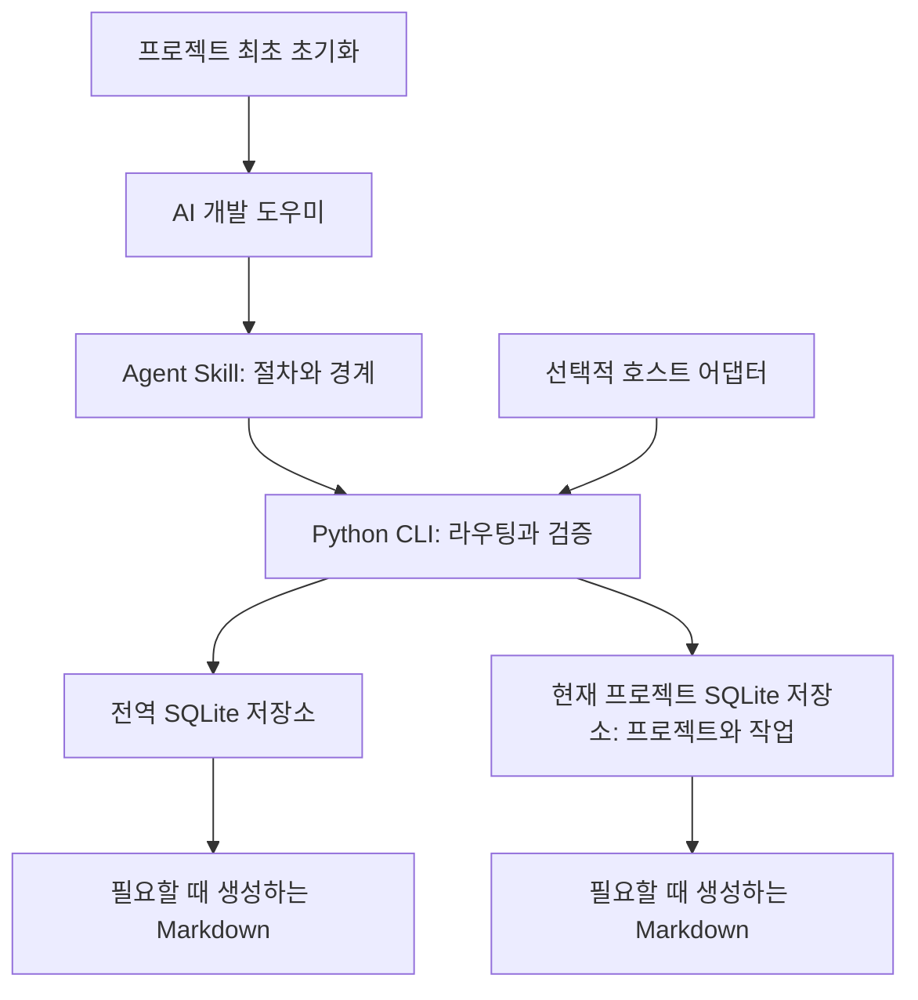

<h1 align="center">dev-memory</h1>

<p align="center">
  <strong>AI 개발 도우미를 위한 개인 로컬 개발 기억.</strong><br />
  제약조건을 조회하고, 정정을 저장하고, 실제 진행 상황에서 개발을 이어가세요.
</p>

<p align="center">
  <a href="https://github.com/chrisstarr7/dev-memory/actions/workflows/check.yml"></a>
  <a href="../../LICENSE"></a>
  
  
</p>

<p align="center"><a href="../../README.md">English</a> · <a href="README.zh-CN.md">简体中文</a> · <a href="README.ja.md">日本語</a> · <strong>한국어</strong></p>

<p align="center"><a href="#빠른-시작">빠른 시작</a> · <a href="#주요-기능">주요 기능</a> · <a href="#동작-방식">동작 방식</a></p>

<p align="center"><kbd>Codex</kbd> · <kbd>Claude Code</kbd> · <kbd>Cursor</kbd> · <kbd>Gemini CLI</kbd> · <kbd>GitHub Copilot</kbd> · <kbd>OpenCode</kbd> · <kbd>DeepSeek Harness</kbd></p>

---

## 빠른 시작

**개발할 프로젝트의 루트 디렉터리**에서 실행하세요.

```sh
npx -y chrisstarr7/dev-memory codex
```

다른 AI를 사용한다면 `codex`를 `claude`, `cursor`, `gemini`, `copilot`, `opencode`, `deepseek`(DeepSeek Harness / DSH)로 바꾸세요. macOS, Linux, Windows에서 같은 명령을 사용합니다.

**필수 환경:** npm/npx가 포함된 Node.js 22+, Git, sqlite3가 포함된 Python 3.10+. 설치 프로그램이 코드를 내려받고 환경을 확인한 뒤, 빈 프로젝트 저장소와 AI의 프로젝트 지침을 설정합니다.

설치가 성공하면 **해당 프로젝트에서 새 AI 세션을 열고 평소처럼 개발하세요**. 활성화 문구나 명시적인 Skill 호출, 매번 저장·조회 요청을 할 필요가 없습니다. 기존 세션은 새 지침을 읽도록 다시 시작해야 합니다.

각 프로젝트 루트에서 같은 명령으로 초기화하거나 업데이트합니다. 관리되는 프로그램은 공유하며, 같은 파일은 재사용하고 변경된 파일은 업데이트합니다. 프로젝트는 각각 초기화됩니다. 기존 기억, 관련 없는 프로젝트 지침, 일시 중지 설정은 유지됩니다. 프로젝트마다 별도로 초기화하며, 명시적으로 확인한 전역 개발 선호사항은 함께 사용할 수 있습니다.

<details>
<summary>로컬 AI에게 설치 요청하기</summary>

> https://github.com/chrisstarr7/dev-memory 에서 dev-memory를 설치하고 현재 AI 호스트에 맞게 이 프로젝트를 초기화해 주세요. 성공 응답을 확인하고 기존 기억과 설정을 유지해 주세요.

AI에는 로컬 파일 및 명령 실행 권한이 필요합니다. 웹 채팅만으로는 컴퓨터에 설치할 수 없습니다. 오프라인 설치, Node.js 없이 설치하기, 제거 방법은 [설치 안내](../../docs/installation.md)를 참고하세요.

</details>

Windows Codex: 0.5.2에서 프로그램 디렉터리의 ACL 생성 방식을 수정했습니다. 같은 명령으로 업데이트한 뒤 새 세션을 시작하세요. [Windows 접근 안내](../../docs/installation.md#windows-codex-访问权限)를 참고하세요.

## 주요 기능

| 기능 | 동작 |
| --- | --- |
| 정확한 제약조건 | 조건, 예외, 금지사항, 검증 방법을 유지하며 정정 시 기존 규칙을 수정합니다. |
| 실제 작업 이어가기 | 완료·미완료 작업, 장애 요인, 다음 단계를 기록합니다. 작업마다 현재 체크포인트 하나를 유지합니다. |
| 프로젝트 격리 | A의 업무 정보는 A에 남습니다. 명시적으로 확인한 공통 선호사항과 방법만 전역으로 저장합니다. |
| 필요한 기억 조회 | 적용되는 전역·현재 프로젝트·현재 작업 기록을 조회하고 유효한 문맥을 재사용합니다. 변경 시 무효화하고 다시 확인합니다. |
| 중복 제거와 정리 | 완전히 같은 기록은 프로그램이 감지합니다. 현재 AI가 의미상 중복을 비교하고 제약조건과 근거를 유지하며 내용을 줄입니다. |
| 로컬 제어 | 조회, 정정, 이번 턴 기록 제외, 일시 중지, 읽기 전용 조회, 보관, 삭제를 지원합니다. |

독립적인 Agent Skill과 작은 Python CLI로 구성되며 표준 라이브러리와 SQLite를 사용합니다. 상주 프로세스, 벡터 서비스, 추가 유료 모델은 필요하지 않습니다. 프로그램과 프로토콜은 공개되지만 각 사용자의 기억은 개별 로컬 저장소에 보관됩니다. 새 저장소에는 데모 기록이 없습니다.

## 일상적인 사용

개발 작업을 평소처럼 설명하세요. 초기화된 AI는 관련 제약조건을 조회하고 명확한 정정을 즉시 저장하며, 일반 변경사항은 턴 마지막에 묶어서 저장합니다. 체크포인트를 이어가기 전에는 실제 코드를 확인합니다.

| 원하는 제어 | AI에게 말하기 |
| --- | --- |
| 업무 조건 정정 | “환불 기한을 배송 완료 후 14일 이내로 바꿔 줘.” |
| 전역 선호사항 저장 | “이 개발 규칙은 모든 프로젝트에 적용하므로 전역으로 저장해 줘.” |
| 이번 턴 기록 제외 | “이번 턴의 내용은 기억에 저장하지 마.” |
| 쓰기 중지·재개 | “이 프로젝트의 기억 쓰기는 중지하고 조회는 유지해 줘.” / “기억 쓰기를 다시 시작해 줘.” |
| 읽기 전용 조회 | “이번 턴은 기억만 조회하고 아무것도 쓰지 마.” |
| 기록 삭제 | “이 규칙의 삭제 범위를 먼저 보여 주고 내가 확인한 후 삭제해 줘.” |

예시는 가상이며 자동으로 가져오지 않습니다. JSON을 직접 작성할 필요 없이 AI가 [로컬 프로토콜](../../skills/dev-memory/references/protocol.md)을 사용합니다. 저장했다고 말하려면 해당 저장소의 성공 응답이 있어야 합니다.

## 동작 방식

1. **조회:** 작업 시작·재개 또는 프로젝트·모듈 변경 시 한 번의 호출로 관련 기록과 정리 대기 상태를 얻습니다. 일반적인 시작 과정에서 호스트 진단을 반복하지 않습니다.
2. **저장:** 현재 AI가 의미를 추출하고 CLI가 범위, 출처, 수정 버전, 트랜잭션 경계를 검증합니다. 새 정보가 없으면 확인을 마쳤다는 짧은 NOOP 응답을 남깁니다.
3. **정리:** 관련 기록을 비교해 동등한 중복을 기본 조회 대상에서 제외하고 긴 본문을 줄입니다. 조건, 예외, 부정 표현, 버전 경계, 출처는 유지합니다.
4. **이어가기:** 작업마다 현재 체크포인트 하나를 유지하고 이전 기록은 이력으로 남깁니다. 원본 수정·삭제 시 파생 요약은 무효화됩니다.

### 기본 정리 정책

AI는 편집 전에 적용 가능한 기억의 조건을 설계·코드 결정과 회귀 검사에 연결합니다. 관련 규칙을 우선 조회하고 작은 후보 목록으로 필요한 기록만 추가 확인합니다. 선택적 사용 영수증은 규칙이 영향을 준 구체적 행동을 기록하며 사용자 근거를 늘리지 않습니다. 작업의 정확성은 AI의 사용 보고와 별도로 검증합니다.

| 조건 또는 한도 | 기본값 |
| --- | --- |
| 한 저장소에서 변경되어 정리를 기다리는 서로 다른 기록 | **5개** |
| 정리 대기 기록 한 개의 본문 길이 | **1,200자** |
| 저장소별 관련 묶음 | 최대 **8개 / 12,000자** |
| 개발 턴마다 | 현재 AI 턴 안에서 저장소당 최대 **한 묶음** |
| 조회·정리 SQL 처리 시간 | **500ms**, 시간 초과 시 연기 사실 보고 |

전역과 프로젝트 저장소에서 각각 계산합니다. NOOP와 반복 확인은 변경 수에 포함되지 않습니다. 세션·작업 경계에서 미처리 주제를 한 번 확인할 수 있으며 시작 시 확인한 내용을 반복하지 않습니다. 변경이 없거나 일시 중지, 읽기 전용, 이번 턴 기록 제외 상태라면 정리하지 않습니다. 백그라운드 타이머, 도구 호출마다 요약하기, 전체 저장소 스캔은 없습니다.

임계값으로 정리 주기가 시작되면 이후의 일반적인 대화에서 남은 대기열을 처리하며 마지막 1~4개 기록도 포함합니다. 턴마다 저장소당 한 묶음만 처리하고 같은 턴에 두 번째 묶음을 반환하지 않습니다. 대기열이 비어 있으면 기억 본문을 반환하지 않습니다.

유효한 기억과 이미 읽은 프로토콜을 재사용합니다. 문맥 압축, 기억 수정, 작업 공간 변경 후에는 다시 확인합니다. 프로젝트 제약조건을 위한 조회 용량을 확보하고 후보 초과는 불완전한 결과로 보고합니다. 핵심 제약조건이 빠졌다면 추가 확인이 필요합니다. 저장소마다 별도로 커밋하고 성공·실패를 각각 보고합니다.

이전 기록과 본문은 추적 가능한 이력으로 남습니다. 정리는 활성 문맥을 줄이며 **전체 디스크 사용량을 제한하지는 않습니다**. 의미가 확실하지 않으면 원본을 유지합니다.

## 구조와 저장 위치



| 범위 | 내용 | 기본 위치 |
| --- | --- | --- |
| `global` | 프로젝트 전체에 적용한다고 명시적으로 확인한 개발 선호사항, 규칙, 방법 | `~/.dev-memory/global/` |
| `project` | 해당 프로젝트의 업무, 아키텍처, 인터페이스, 제약조건, 결정, 결함 경험 | `<project-root>/.dev-memory/` |
| `task` | 임시 요구사항, 진행 상황, 장애 요인, 다음 단계 | 해당 프로젝트 저장소 안 |

트랜잭션, 근거, 응답, 뷰, 백업은 저장소별로 분리됩니다. 프로젝트 쓰기 실패를 전역 저장으로 대체하지 않습니다. 범위는 작업 디렉터리뿐 아니라 내용과 사용자 의도로 판단하며, 프로젝트가 정해지지 않은 업무 정보는 전역에 저장하지 않습니다.

실행 Skill은 `skills/dev-memory/`, 설치 진입점은 `bin/install.cjs`와 `install.py`입니다. `docs/`, `tests/`, `evals/`, `reports/`에는 문서, 격리 테스트, 평가 도구, 근거를 보관합니다. [아키텍처 안내](../../docs/architecture.md)를 참고하세요.

## 호환성과 검증 상태

| 모드 | 동작 / 상태 |
| --- | --- |
| 기본 모드 | AI가 Skill과 CLI를 호출합니다. Skill 설치만으로 매 턴 실행을 보장하지 않습니다. |
| 기본 프로젝트 지침 | 초기화 시 호스트의 프로젝트 지침을 설정합니다. 호스트가 지침을 읽고 모델이 따르는지에 달려 있습니다. |
| 선택적 이벤트 모드 | Codex hooks에는 호스트 신뢰와 이벤트 검증이 필요합니다. 실제 이벤트 전달 경로는 아직 검증하지 않았습니다. |
| 읽기 전용 | 초기화나 쓰기 없이 기존 기록을 조회합니다. |
| 사용 불가 | 권한 부족이나 저장소 접근 실패를 그대로 보고합니다. |

Ubuntu, macOS, Windows 및 Python 3.10/3.14에서 프로그램 테스트와 패키징 CI가 통과했습니다. 일곱 설치 대상은 격리 환경에서 최초·반복 설치를 확인했습니다. 설치 성공은 모든 호스트의 자동 동작 검증을 뜻하지 않습니다. 실제 Codex CLI 근거, 호스트 버전, 의미 평가, 미완료 S01–S48 시나리오는 [검증 보고서](../../reports/verification.md)에 있습니다. DSH 프로그램 설치와 공식 배포 구성요소는 확인했지만, DeepSeek 모델의 전체 세션은 아직 검증하지 않았습니다. [DSH 결과](../../reports/deepseek.json)를 참고하세요.

**전체 작업 시간 비교는 아직 완료되지 않았습니다.** 0.6.0은 실제 Codex CLI의 개발 전 과정 및 자동 정리 평가를 통과했습니다. 켜기/끄기 비교는 호스트 크레딧 부족과 이후 수정한 평가 스크립트 결함으로 유효한 완료 표본을 얻지 못했습니다. 일정한 추가 시간이나 미미한 지연을 보장하지 않습니다. 실측 시간, 소스 검증 범위, 한계는 [기억 활용 및 유지 관리 검토](../../reports/memory-cycle-review.md)를 참고하세요.

## 개인정보와 안전

- 배포 패키지에는 실제 기억, 작성자의 데이터, 자동 입력되는 예제가 없습니다.
- 핵심 프로그램은 기억을 업로드하거나 원격 측정 정보를 수집하지 않습니다. AI 모델 호출에는 호스트 설정과 데이터 정책이 적용됩니다.
- 프로그램과 실행 데이터는 분리됩니다. 업데이트와 기본 제거는 기억을 유지하며, 프로젝트 기억은 기본적으로 Git에서 제외됩니다.
- 인증 정보, 비밀번호, 민감한 전체 로그, 불필요한 고객 데이터는 저장하지 않습니다. 인증 정보 탐지만으로 의미를 판단하는 작업을 대신할 수 없습니다.
- 과거 기억은 현재 지시나 안전 규칙을 덮어쓰지 않습니다. 로컬 저장소에는 기본 애플리케이션 암호화가 없습니다.
- 삭제는 도구가 관리하는 데이터에 적용됩니다. 호스트 대화, 외부 복사본, 시스템 스냅샷은 지울 수 없으며 안전한 완전 삭제를 보장하지 않습니다.

[SECURITY.md](../../SECURITY.md)와 [적대적 검토 보고서](../../reports/adversarial-review.md)를 참고하세요.

## 기여와 지원

버그와 아이디어는 [Issues](https://github.com/chrisstarr7/dev-memory/issues), 개선은 Pull Request로 보내 주세요. 민감한 정보를 제거한 최소 재현 예시를 사용하고 실제 기억 저장소는 첨부하지 마세요. 개발·평가 안내는 [CONTRIBUTING.md](../../CONTRIBUTING.md)에 있습니다.

## 라이선스

Copyright © 2026 dev-memory contributors. [MIT License](../../LICENSE)로 배포합니다.
