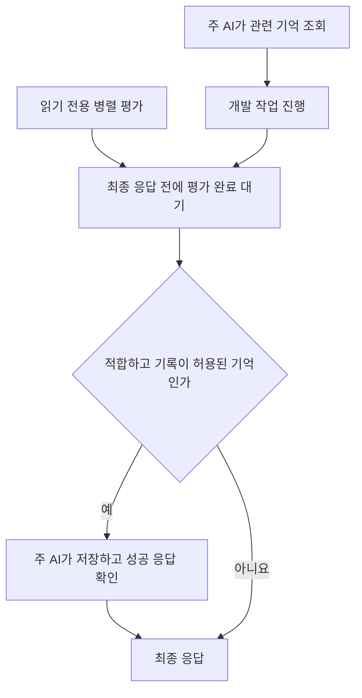

<h1 align="center">dev-memory</h1>

<p align="center"><strong>새 AI 세션에서도 개발 습관과 프로젝트 규칙을 이어 쓰는 로컬 기억.</strong></p>

<p align="center">
  <a href="https://github.com/chrisstarr7/dev-memory/actions/workflows/check.yml"></a>
  <a href="../../LICENSE"></a>
  
  
</p>

<p align="center"><a href="../../README.md">English</a> · <a href="../../docs/readme/README.zh-CN.md">简体中文</a> · <a href="../../docs/readme/README.ja.md">日本語</a> · <strong>한국어</strong></p>
<p align="center"><a href="#빠른-시작">빠른 시작</a> · <a href="#다른-프로젝트에서-사용하기">다른 프로젝트</a> · <a href="#기억하는-내용">기억 범위</a> · <a href="#조회와-저장-시점">조회와 저장</a></p>

Dev Memory는 AI 코딩 도우미용 기억 Skill입니다. AI가 오래 사용할 개발 습관과 프로젝트 규칙을 판단하고, 로컬 Python 프로그램이 SQLite에 저장하고 필요한 기록을 조회합니다.

## 빠른 시작

Node.js 22+(npm/npx), Git, Python 3.10+(sqlite3)가 필요합니다. **설정할 프로젝트의 루트**에서 실행하세요.

```sh
npx -y --prefer-online chrisstarr7/dev-memory codex
```

설치 후 해당 프로젝트에서 **새 Codex 세션을 시작**하고 평소처럼 개발하세요. 매 턴 Skill을 호출하거나 “기억해 줘”라고 말할 필요는 없습니다.

Codex에서는 이 한 명령이 두 설정을 함께 만듭니다.

| 설정 | 용도 |
| --- | --- |
| 사용자 수준 지침 | 여러 프로젝트에서 전역 개발 습관을 조회하고 학습합니다. |
| 현재 프로젝트 지침 | 독립된 기억 저장소와 시작 시 연결 정보를 만듭니다. 업무 규칙은 해당 프로젝트에 속합니다. |

설치는 저장소를 만들거나 재사용하고 지침을 설정합니다. **새 프로젝트 기록을 허용할지는 다음 기록 모드로 결정합니다.**

### 기본 기록 모드

새 프로젝트의 기본값은 **`developer-first`**입니다. 프로젝트 설정을 만들더라도 새 업무 기억 기록은 자동으로 켜지지 않습니다.

| 모드 | 전역 개발 습관 | 기존 프로젝트 규칙 | 새 장기 프로젝트 기록 |
| --- | --- | --- | --- |
| `developer-first`(기본) | 조회와 적합한 기록 | 조회 | 끔 |
| `full-project` | 조회와 적합한 기록 | 조회 | 켬 |

두 모드 모두 일시 중지, 비활성화, 읽기 전용과 턴 제외 설정을 따릅니다. 프로젝트 기록이 필요하면 AI에게 **“현재 프로젝트의 기억 기록을 full-project로 전환해 줘.”**라고 말하세요. 설치한 CLI와 현재 프로젝트 연결 정보를 사용하므로 다시 설치할 필요는 없습니다. 정확한 모드 명령은 [설치 안내](../../docs/installation.md)에 있습니다.

## 다른 프로젝트에서 사용하기

**프로젝트 B에도 자체 설정이 필요하면 B의 루트에서 같은 설치 명령을 다시 실행하고, B에서 새 Codex 세션을 시작하세요.**

| 상황 | 동작과 결과 |
| --- | --- |
| 프로젝트 A의 첫 설정 | A 루트에서 실행하면 사용자 수준 전역 습관과 A의 프로젝트 설정을 만듭니다. |
| B에도 프로젝트 기억이 필요 | B 루트에서 같은 명령을 실행합니다. B의 독립 저장소와 연결 정보를 만들며 새 모드는 `developer-first`입니다. |
| 초기화하지 않은 프로젝트를 열기 | Codex 사용자 지침으로 전역 습관을 사용할 수 있습니다. 해당 프로젝트의 업무 기억은 자동 초기화하거나 기록하지 않습니다. |
| 설정한 프로젝트 업데이트 | 해당 루트에서 같은 명령을 실행합니다. 기존 기억, 기록 설정과 관련 없는 지침은 보존합니다. |

A와 B는 같은 사용자의 전역 저장소를 공유하며 프로젝트 저장소는 분리합니다. 초기화한 프로젝트는 **전역·현재 프로젝트 기억을 한 번에 조회**해 전역 조회를 반복하지 않습니다.

### 다른 AI 호스트

명령의 `codex`를 해당 값으로 바꾸세요.

| 호스트 | 값 |
| --- | --- |
| Codex | `codex` |
| Claude Code | `claude` |
| Cursor | `cursor` |
| Gemini CLI | `gemini` |
| GitHub Copilot | `copilot` |
| OpenCode | `opencode` |
| DeepSeek Harness(DSH) | `deepseek` |

초기화하지 않은 프로젝트에서도 사용자 수준 지침을 제공하는 호스트는 현재 Codex뿐입니다. 다른 호스트는 프로젝트별 설정이 필요합니다. DeepSeek는 로컬 DSH를 뜻합니다. 경로, 오프라인 설치와 제거 방법은 [설치 안내](../../docs/installation.md)를 참고하세요.

## 기억하는 내용

| 종류 | 예시 | 범위 |
| --- | --- | --- |
| 전역 개발 습관 | 적합한 기존 구현 재사용, 근거부터 조사하기, 결과 보고 순서 | 프로젝트 정보를 제거한 뒤 여러 프로젝트에서 사용합니다. |
| 프로젝트 규칙 | 업무 제약, 설계 결정, 인터페이스 약속, 장기적으로 유효한 교훈 | 소유 프로젝트에만 적용합니다. 새 기록에는 `full-project`가 필요합니다. |
| 일회성 지시 | “이번에는 테스트를 실행하지 마.” | 현재 대화에만 적용합니다. |

임시 진행 상황, 체크포인트와 다음 단계는 대화에 둡니다. 기본 Skill은 전역과 프로젝트 두 기억 범위를 사용합니다.

AI가 눈에 보이는 요구, 정정과 선택을 평가하므로 사용자가 매번 기억 대상을 지정할 필요는 없습니다. 명확한 프로젝트 공통 지시는 확인된 습관이 될 수 있습니다. 추론한 습관은 비활성 후보로 시작하고 **실제로 독립된 두 작업의 피드백**이 모이면 소프트 선호사항이 됩니다. AI 요약, 검색 횟수와 한 작업의 반복 표현은 독립 사용자 근거를 늘리지 않습니다. 현재 지시를 우선합니다.

## 조회와 저장 시점

**조회는 주 흐름에서 수행합니다.** 작업 시작, 재개 또는 실질적인 주제·모듈 변경 시 관련 기억을 소량 조회하고 유효한 문맥을 재사용합니다. 도구 호출마다 전체 저장소를 다시 읽지 않습니다.

**평가는 개발과 병렬로 진행할 수 있습니다.** 호스트가 비동기 하위 에이전트를 제공하면 읽기 전용 평가자가 기억 후보를 판단합니다. 범위, 개인정보, 기록 설정과 중복 확인 및 모든 쓰기는 주 AI가 담당합니다.



**턴을 끝내기 전에 진행 중인 기억 평가를 기다리고 필요한 저장의 성공을 확인합니다.** 개발이 먼저 끝나도 적합한 기억을 버리지 않습니다. 위임이 불가능하거나 실패하면 주 AI가 평가합니다. 적합한 증가분이 없으면 쓰지 않습니다. 저장 실패는 제한된 복구 후에도 남으면 미저장으로 명시합니다. 관련 없는 유지보수는 이후 작업 경계로 미룰 수 있습니다.

이는 호스트 지침에 따라 동작하는 Skill이며 상시 대화 감시가 아닙니다. 하위 에이전트는 호스트의 모델과 계정 사용량을 이용하며 별도 학습 서비스는 없습니다.

## 기억 제어하기

| 목적 | AI에게 말하기 |
| --- | --- |
| 프로젝트 기록 켜기 | “현재 프로젝트를 full-project로 전환해 줘.” |
| 기본 모드로 돌아가기 | “현재 프로젝트를 developer-first로 전환해 줘.” |
| 습관 수정 | “기존 구현은 요구사항에 맞을 때 재사용하도록 수정해 줘.” |
| 전역 쓰기 중지, 조회 유지 | “전역 습관 쓰기는 중지하고 조회는 유지해 줘.” |
| 이번 턴 제외 | “이번 턴은 기억에 저장하지 마.” |
| 기억 확인 | “현재 작업에 관련된 전역·프로젝트 기억을 보여 줘.” |
| 기억 삭제 | “삭제 범위를 보여 주고 내가 확인하면 삭제해 줘.” |

## 저장 위치와 개인정보

| 저장소 | 기본 위치 |
| --- | --- |
| 사용자 전역 습관 | `~/.dev-memory/global/` |
| 현재 프로젝트 규칙 | `<project-root>/.dev-memory/` |

SQLite가 기록, 근거와 수정 이력을 보관하며 Markdown은 읽기용 출력입니다. 전역 기록에는 프로젝트 이름, 업무 데이터, 코드, 경로, 인증 정보와 원래 대화를 넣지 않습니다. 핵심 프로그램은 저장소를 업로드하거나 원격 측정을 수집하지 않습니다. 호스트 모델에 제공하는 발췌문에는 해당 호스트의 데이터 정책이 적용됩니다.

## 문서와 현재 제한

설치 성공은 설정 완료를 뜻합니다. 자동 사용은 호스트의 지침 로딩과 AI의 준수에 달려 있습니다. 통합 설치 후 실제 프로젝트 간 조회, 비동기 기록 완료와 현 버전의 총 작업 시간은 실제 호스트 검증이 필요합니다.

[설치와 제거](../../docs/installation.md) · [구조](../../docs/architecture.md) · [프로토콜](../../skills/dev-memory/references/protocol.md) · [검증 보고](../../reports/verification.md) · [보안](../../SECURITY.md) · [기여](../../CONTRIBUTING.md)

민감한 정보를 제거한 문제를 [GitHub Issues](https://github.com/chrisstarr7/dev-memory/issues)에 보고해 주세요. [MIT License](../../LICENSE)로 배포합니다.
