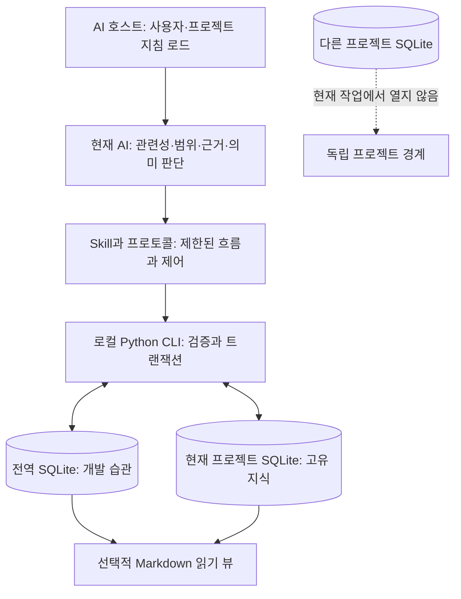
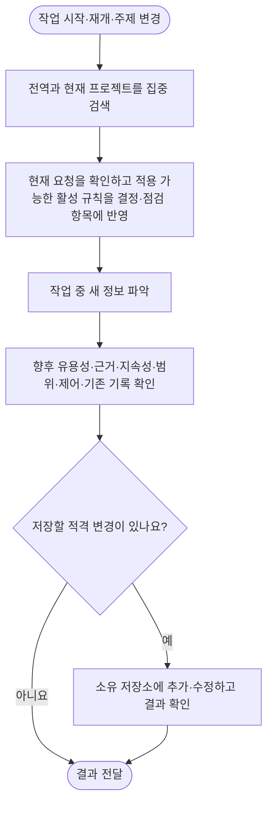
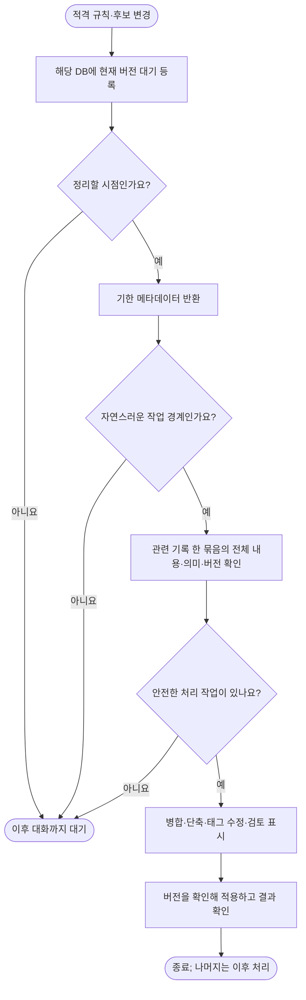

<h1 align="center">dev-memory</h1>

<p align="center"><strong>개발 습관과 각 프로젝트의 규칙을 기억하는 로컬 메모리.</strong></p>

<p align="center">
  <a href="https://github.com/chrisstarr7/dev-memory/actions/workflows/check.yml"></a>
  <a href="../../LICENSE"></a>
  
  
</p>

<p align="center"><a href="../../README.md">English</a> · <a href="README.zh-CN.md">简体中文</a> · <a href="README.ja.md">日本語</a> · <strong>한국어</strong></p>

Dev Memory는 AI 개발 도우미용 이식 가능한 Skill과 로컬 Python 프로그램입니다. 관련 개발 습관과 프로젝트 지식을 검색하고, 실제 요구와 근거에서 오래 쓸 정보를 기록하며, 출처와 수정 이력을 확인할 수 있게 합니다. AI가 의미를 판단하고 SQLite 프로그램이 기록을 검증하고 저장합니다.

[설치](#빠른-시작) · [기록-범위](#무엇을-기록하나요) · [구조](#구조와-저장-경계) · [작업-흐름](#검색과-기록) · [자동-정리](#자동-정리와-요약) · [제어](#기억-제어) · [문제-진단](#기록이나-검색이-되지-않을-때)

## 빠른 시작

**먼저 실행 환경을 준비하세요.** Node.js 22+, Git, sqlite3가 포함된 Python 3.10+가 필요합니다. Windows 로컬 벡터는 표준64비트 CPython 3.10–3.14(최신3.14 권장)와 x64 Visual C++ 런타임이 필요합니다. 현재 고정 의존성은3.15,32비트,네이티브ARM64,free-threaded Python을 지원하지 않습니다.

Windows 설치는 `winget install --exact --id Python.Python.3.14 --architecture x64`, 기존3.14 업데이트는 `winget upgrade --exact --id Python.Python.3.14 --architecture x64`를 사용하세요. 런타임은 `winget install --exact --id "Microsoft.VCRedist.2015+.x64"`로 준비하고 새 터미널에서 `py -3.14 --version`을 확인합니다. macOS는13+가 필요하며 벡터용Python3.12를 자동 준비합니다. Homebrew 사용자는 `brew install node git python@3.14`, 기존 환경 업데이트는 `brew upgrade node git python@3.14`를 사용할 수 있습니다. 자세한 내용은 [환경 준비](../installation.md#environment-prerequisites)를 참조하세요. 의존 패키지와 모델을 직접 설치할 필요는 없습니다.

**개발 프로젝트 루트**에서 실행합니다.

```sh
npx -y --prefer-online chrisstarr7/dev-memory <agent>
```

`<agent>`를 아래 호스트 인자로 바꾸세요. Node.js 22+와 npm/npx, Git, sqlite3가 포함된 Python 3.10+가 필요합니다. 설치 후 기억 처리는 Python 표준 라이브러리로 동작하며 npx나 외부 기억 서비스가 필요하지 않습니다.

| AI 호스트 | 인자 | 프로젝트 지침 파일 |
| --- | --- | --- |
| Codex | `codex` | `AGENTS.md` 또는 기존의 비어 있지 않은 `AGENTS.override.md` |
| Claude Code | `claude` | `CLAUDE.local.md` |
| Cursor | `cursor` | `.cursor/rules/dev-memory.mdc` |
| Gemini CLI | `gemini` | `GEMINI.md` |
| GitHub Copilot | `copilot` | `.github/copilot-instructions.md` |
| OpenCode | `opencode` | `AGENTS.md` |
| DeepSeek Harness(DSH) | `deepseek` | `AGENTS.md` |

**Codex는 한 번에 사용자 전역 습관과 현재 프로젝트를 설정합니다.**`npx -y --prefer-online chrisstarr7/dev-memory codex`를 실행하면 초기화하지 않은 다른 프로젝트에서는 사용자 지침으로 전역 습관만 검색하며 프로젝트 저장소를 만들지 않습니다. 다른 프로젝트도 고유 기억이 필요하면 그 루트에서 같은 명령을 실행하세요. 다른 호스트는 현재 프로젝트 지침을 사용합니다. OpenCode에서 DeepSeek 모델을 쓴다면 실제 호스트 인자인 `opencode`를 선택합니다.

설치나 업그레이드 후 프로젝트에서 **새 AI 세션**을 열고 평소대로 작업하세요. 매번 Skill을 호출하거나 범위를 지정하거나 “기억해 줘”라고 말할 필요가 없습니다. 새 저장소는 비어 있는 상태로 시작하며 기존 기록은 유지됩니다. 개인 취향을 미리 만들지 않습니다. 설치 결과는 파일과 저장소 상태를 확인할 뿐 실제 모델의 지침 준수를 증명하지 않습니다. 경로, 다른 설치 방식, 권한, 제거 방법은 [설치 안내](../installation.md)를 참고하세요.

## 무엇을 기록하나요

AI는 이후 작업에 유용한지, 근거가 있는지, 어느 범위에 적용되는지 판단합니다. 현재 요청이 항상 기억보다 우선합니다.

코드 수정이 필요 없는 확인·리뷰 뒤에도 기록 대상을 판단합니다. 코드가 이미 준수하더라도 새로 명시한 지속적 프로젝트 규칙은 기록 대상입니다. 프로젝트·모듈 범위를 유지하고 임시 점검 결과나 같은 규칙을 일반화한 전역 사본은 저장하지 않습니다. 중복 방지와 개인정보 제어도 유지합니다.

| 저장 위치 | 대상 | 예시 |
| --- | --- | --- |
| **전역** | 프로젝트 정보를 제거한 재사용 가능한 개발 습관과 방법 | 보고 순서, 기존 구현 먼저 확인하기, 근거에 기반한 디버깅 |
| **현재 프로젝트** | 오래 적용할 규약, 계약, 제약, 결정, 근거 있는 사실 | 코드·문서 규칙, 업무 상태, API·데이터 계약, 트랜잭션·권한·책임 경계 |

**영구 기억 범위는 전역과 현재 프로젝트 두 가지뿐입니다.**현재 대화는 AI 호스트가 유지합니다. 일회성 지시, 작업 진행 상황, 확인되지 않은 추측을 Dev Memory 기록이나 작업 체크포인트에 저장하지 않습니다. 인증 정보는 어느 범위에도 저장하지 않습니다.

프로젝트 지식에는 검증·인수 기준, 호환성, 배포·환경, 성능, 의존성, 마이그레이션, 조건과 예방 점검을 갖춘 검증된 장애 교훈도 포함됩니다. 분류는 고정된 목록으로 제한하지 않습니다. 파일 전체나 모든 구현 세부 사항을 영구 규칙으로 만들지 말고, 관찰된 동작과 원하는 동작을 구분하세요. 기존 코드만으로 사용자의 설계 의도가 확정되지는 않습니다.

**전역 습관의 근거:** “앞으로 모든 프로젝트에서”처럼 지속적 범위를 명시한 지시는 즉시 확인된 활성 규칙으로 저장할 수 있습니다. 재사용 가능한 요구·선택·수정 의견은 첫 발생부터 **비활성 후보**로 저장하며, 실제로 독립된 두 작업의 신호가 있으면 약한 선호로 승격할 수 있습니다. 검색, AI 반복, 요약은 사용자 근거를 추가하지 않습니다. 후보는 저장되지만 지시로 사용하지 않습니다.

**프로젝트 기본값:** 새 프로젝트는 `full-project`로 적합한 지식을 자동 기록합니다. `developer-first`는 새 프로젝트 기록을 제한하는 선택 모드입니다. 업그레이드는 기존 모드와 일시 중지·비활성·읽기 전용 설정을 유지하며 기존 모드를 바꾸려면 명시적 지시가 필요합니다. 모르는 업무 결정은 질문으로 남기고, 확인되지 않은 가설은 활성화하거나 일반 검색에 넣지 않습니다. 이전 데이터베이스의 작업 기록은 자동 삭제하지 않으며 현재 CLI는 이를 생성·검색·정리·내보내지 않습니다.

## 구조와 저장 경계



| 위치 | 내용 |
| --- | --- |
| `~/.dev-memory/global/` | 전역 DB, 설정, 선택적 뷰·백업 |
| `<project-root>/.dev-memory/` | 프로젝트 DB, 설정, 비공개 활성화 바인딩 |
| 호스트 설치 경로의 `skills/dev-memory/` | 공개 Skill, CLI, 참고 파일. 비공개 기억 저장소와 별도 |

모든 프로젝트를 모으는 중앙 DB는 없습니다. 한 번의 검색은 전역과 현재 프로젝트만 조회하며 다른 프로젝트를 열거하지 않습니다. 프로젝트 업무, 경로, 코드, 고객 정보는 전역 기억에 넣지 않습니다. 다른 clone과 worktree는 기본적으로 독립 프로젝트 DB를 씁니다. SQLite가 원본이며 Markdown은 재생성할 수 있습니다.

## 검색과 기록



기록 대상은 수정 의견에 한정되지 않습니다. 근거가 있고 적용 범위 안에서 이후 작업을 안내할 요구·선택·규약·결정·사실·방법도 평가합니다.

- 검색은 주 흐름에서 수행합니다. 한 번의 집중된 `context` 결과를 재사용하고 문맥 손실 후 다시 검색합니다. 기본 본문 예산은 5개 / 4000자이며 전역 3개, 프로젝트 2개를 확보합니다. 읽지 않았거나 불완전한 결과는 필요한 부분만 추가 조회합니다. 활성 전역 규칙이 없거나 읽기가 비활성화되면 남는 용량을 현재 프로젝트가 사용합니다. 전체 한도는 유지되며 비활성 후보는 지시 슬롯을 차지하지 않습니다.
- 주 AI가 기존 추론 과정에서 기록을 판단합니다. 중요한 수정 의견은 영향을 받는 편집 전에, 일반 증분은 최종 응답 전에 묶어 저장합니다. 동등한 규칙은 재사용하거나 수정하며 근거와 이력을 유지합니다.
- 호스트의 선택적 읽기 전용 보조 AI로 복잡한 평가를 병렬 처리하더라도 **응답 종료 전에 기다린 후 주 AI가 저장하고 결과를 확인**합니다. 실행한 것만으로 저장 성공이 아닙니다. 추가 모델 호출이나 상시 대화 감시는 필수가 아닙니다.
- 전역과 프로젝트는 별도 트랜잭션입니다. 한쪽 성공을 양쪽 성공으로 보지 않으며 실패를 정확히 알립니다. 형식과 버전 보호는 [프로토콜](../../skills/dev-memory/references/protocol.md)을 참고하세요.

## 개발 주기별 참여

| 단계 | 메모리의 역할 |
| --- | --- |
| 요구사항 | 현재 업무 규칙을 검색하고 확인된 장기 요구사항과 예외를 저장합니다. |
| 설계 | 계약과 결정을 재사용하며 임시 가정을 활성 규칙으로 만들지 않습니다. |
| 구현 | 규약과 기존 기능을 활용하고 관찰한 현재 동작과 필요한 동작을 구분합니다. |
| 검증 | 인수·회귀 조건을 검색하며 과거 성공을 현재 테스트 성공으로 간주하지 않습니다. |
| 수정 | 관련 코드 변경 전에 중요한 수정을 저장하고 오래된 파생 요약을 무효화합니다. |
| 전달 | 문서·보고 규약과 저장 영수증을 확인하며 작업 진행 상황은 저장하지 않습니다. |
| 다음 작업 | 전역과 현재 프로젝트만 검색하고 필요한 미로딩 규칙을 추가로 읽습니다. |

## 자동 정리와 요약

검색 횟수와 정리 대기열은 독립적입니다. 검색된 적이 없어도 신규·변경 기록은 검토 대상이며, 같은 기록을 반복 검색해도 다시 대기 등록하지 않습니다. 5개 기준은 서로 다른 대기 기록 ID를 세므로 한 기록을 다섯 번 수정해도 1개입니다. 사용 중 현재 근거와 충돌하면 임계치를 기다리지 않고 적용 전에 확인합니다.

일반적인 미확인 가설은 제외하지만, 과거 데이터의 `active + hypothesis`는 예외적으로 이상 검토에 포함합니다. 근거에 따른 수정 또는 보관 처리로 해결하기 전에는 검토 완료로 표시할 수 없습니다. 검토 묶음에는 기록별 최근 근거를 최대 3개와 생략 여부를 포함하며, 전체 8개 / 12000자 한도에 계산합니다. 자동 정리는 알림 후 AI가 작업 경계에서 수행하는 검토이며 백그라운드 자동 재작성은 아닙니다. 자세한 내용은 [영문 설명](../../README.md#automatic-organization)을 참조하세요.

자동이란 승인된 일반 대화 중 AI가 적합한 작업을 처리한다는 뜻입니다. **상주 프로세스, 타이머, 백그라운드 요약 모델, 전체 라이브러리 스캔은 없습니다.**



대기 기록 5개, 본문 1200자 이상 또는 변경 후 기본 7일이 지나면 정리 대상이 됩니다. 저장소별 정리 주기가 시작되면 이후 대화에서 임계치보다 적은 잔여 항목도 처리할 수 있습니다. 사용자 한 턴당 저장소별 **관련 주제 하나, 최대 8개 / 12000자**입니다. 후보도 비활성 상태를 유지하며 정리할 수 있고 미확인 가설은 제외합니다. 안정된 미변경 기록을 반복 요약하지 않습니다. 프로토콜 업그레이드가 기존의 적합한 활성 기록과 후보를 한 번 대기 등록할 수 있습니다. 너무 큰 시작 항목은 명시해 건너뛰고 예산에 맞는 주제를 선택하며, 읽지 않은 조건을 잘라내지 않습니다. 일시 중지·비활성·제외·읽기 전용 제어를 유지합니다.

| 작업 | 변경 사항 | 보존 사항 |
| --- | --- | --- |
| **본문 압축** | 한 기록의 중복 표현 단축 | 조건·예외·금지·강도·범위·근거·이전 버전 |
| **중복 병합** | 동등한 대표 규칙을 남기고 중복을 일반 검색에서 제외 | 원본 근거·이력·추적 링크. 양립하지 않는 규칙은 분리 |
| **태그·검토** | 분류 또는 실제로 읽은 버전의 검토 상태 변경 | 의미와 근거. 새 관찰을 만들지 않음 |
| **파생 요약** | 같은 범위의 검토된 출처 연결 읽기 자료 | 활성 상태이며 양립하는 원자 규칙. 강도 확대 금지, 출처 변경 시 무효화 |
| **보관 처리** | 새 확인 정보나 입증된 만료에 따라 일반 검색에서 제외 | 감사 이력. 오래됐다는 이유만으로 폐기하지 않음 |

정리로 사실이나 사용자 근거를 만들거나, 후보 병합만으로 승격하거나, 충돌하는 업무 규칙을 임의 해결하거나, 프로젝트 내용을 전역으로 옮기면 안 됩니다. 의미적 동등성은 AI 판단이며 구조 검사만으로 입증할 수 없습니다. 불확실하면 원문을 유지합니다. 제한된 주제 검색은 특히 분류가 다른 기록 사이의 모든 충돌을 발견한다고 보장하지 않습니다. 요약 준비도 검색 비활성·제외 설정과 8개 / 12000자 예산을 지킵니다.

**문맥 정리와 디스크 정리는 별개입니다.**압축·병합 후에도 이전 본문, 근거, 감사 이력이 남습니다. 명시적 `storage` 회수는 폐기 가능한 캐시, 퇴역 검색어, 빈 페이지를 대상으로 하며 검증된 동일 저장소 백업 수는 별도로 선택합니다. 근거, 수정 이력, 개인정보 결과, 삭제 기억 복원 방지 정보는 자동 보존 기한의 대상이 아닙니다. 영구 삭제는 잊기 절차를 사용하며 무손실 고정 용량 한도를 약속하지 않습니다.

## 기억 제어

일반 요구에는 범위 표시가 필요하지 않습니다. 제어 자체를 바꿀 때는 범위를 명시할 수 있습니다.

| 목적 | AI에게 할 말 |
| --- | --- |
| 프로젝트 규약 | “이 저장소에서 API 요청·응답을 바꾸면 인터페이스 문서도 갱신해.” |
| 프로젝트 계약 | “취소한 주문은 다시 결제하지 않아. 이후 변경에서도 지켜.” |
| 확인된 전역 습관 | “앞으로 모든 프로젝트에서 적합한 기존 구현부터 확인해.” |
| 규칙 수정 | “그 규약을 수정해. 생성 파일은 제외야.” |
| 프로젝트 기록 전환 | “full-project로 바꿔.” / “developer-first로 되돌려.” |
| 전역 학습 일시 중지 | “전역 쓰기만 중단하고 검색은 계속해.” |
| 비활성·재개 | “전역 읽기와 쓰기를 중단해.” / “검색과 학습을 재개해.” |
| 이번 턴 제외 | “이번 턴은 어떤 기억도 저장하지 마.” |
| 조회·정리 | “관련 기억을 보여 줘.” / “조건과 예외를 유지하며 대기 중인 관련 기록을 정리해.” |
| 잊기 | “삭제 범위를 미리 보여 주고 내가 확인한 뒤 삭제해.” |

## 로컬 기억 대시보드

`<Python> <Skill>/scripts/dev_memory.py dashboard serve`를 실행하면 필요할 때만 `127.0.0.1`에 바인딩된 화면이 열립니다. 전역 기억과 등록된 각 프로젝트 기억의 원문, 상태, 근거, 수정 이력, 월별 상세 반환 횟수를 볼 수 있습니다. 기존 프로젝트는 화면 또는 `dashboard add --project-root /absolute/path`로 등록하며 새 프로젝트는 설정 시 등록됩니다. 목록에는 로컬 경로와 저장소 ID만 남고 프로젝트 본문은 전역 저장소로 합쳐지지 않습니다.

열람과 읽기 전용 검색 미리보기는 반환 횟수를 늘리지 않습니다. 반환 횟수는 AI가 규칙을 실제 적용했다는 증거가 아닙니다. 비활성화되거나 제외된 저장소의 본문은 표시하지 않습니다. 수정·보관은 기존 버전 검사를 사용하고 영구 삭제는 영향 범위 미리보기 후 확인합니다. 외부 업로드나 상주 서비스는 없습니다.

## 개인정보와 한계

핵심 프로그램은 로컬 저장을 사용하며 원격 측정이나 자동 기억 업로드가 없습니다. 설치는 공개 프로그램만 내려받고 비공개 DB를 공개하지 않습니다. 다만 호스팅 AI에 전달하는 기억 조각은 해당 호스트의 데이터 정책을 따릅니다. 로컬 SQLite를 쓰더라도 검색 본문이 호스팅 모델에 전달될 수 있습니다.

전역 기록과 근거에서 프로젝트명, 업무, 코드, 경로, 고객, 인증 정보, 원본 대화, 로그를 제거해야 합니다. 알려진 민감 패턴을 검사하지만 의미적 개인정보 보호에는 AI 검토도 필요합니다. 어느 범위에도 비밀을 저장하지 않으며 백업도 비공개 데이터로 취급합니다. 사용자 제어와 이번 턴 제외는 학습·정리보다 우선합니다.

설치, 단위 테스트, SQL 쓰기 성공만으로 모든 실제 세션의 자연어 분류, 지침 준수, 낮은 지연을 증명하지 못합니다. 호스트의 권한·신뢰 설정은 여전히 필요합니다. 선택적 Codex Hooks는 별도 통합으로 프로젝트 지침 방식의 전제나 이벤트 전달의 증명이 아닙니다.

## 기록이나 검색이 되지 않을 때

AI에게 **설치된 CLI**의 `doctor`를 한 번 실행하게 하세요. 매 개발 턴 진단은 필요하지 않습니다.

1. 버전, 활성화 바인딩, Python/CLI 경로, 저장소 읽기·쓰기를 확인합니다.
2. 모드와 일시 중지·비활성·읽기 전용·턴 제외를 확인합니다. 기존 `developer-first`는 새 프로젝트 기록을 막습니다.
3. 저장된 후보, 활성 규칙, 이번 검색 결과를 구분합니다. 후보는 비활성이며 검색 결과가 없어도 DB가 비었다고 할 수 없습니다.
4. 실제 쓰기 결과와 근거를 확인합니다. “기억했다”는 말만으로 성공을 증명하지 못합니다. 관련 기록만 확인하고 모든 프로젝트를 스캔하지 않습니다.
5. Codex의 `automatic_mode: not_configured`는 선택적 Hooks 설정입니다. 프로젝트 활성화와 저장소 상태를 별도로 확인하세요.

Windows 권한이나 사용자 제어를 피하려고 프로젝트 데이터를 전역으로 옮기지 마세요. [설치 진단](../installation.md)과 [검증 보고서](../../reports/verification.md)를 참고할 수 있습니다.

## 업그레이드·참고·기여

기존 관리 설치는 전용 업데이트 명령을 실행한 뒤 새 세션을 여세요:

```sh
npx -y --prefer-online chrisstarr7/dev-memory update codex
```

다른 호스트는 `codex`를 바꾸세요. 기존 프로젝트와 사용자 연결만 갱신하며 미설정 프로젝트나 사용자 기억을 초기화하지 않습니다. 기억, 모드, 개인정보 설정과 무관한 지침을 유지합니다. 새 프로젝트는 설치 명령을 사용하세요.

- [구조](../architecture.md): 구성 요소, 저장 경계, 실행 방식.
- [프로토콜](../../skills/dev-memory/references/protocol.md): CLI, 구조화 작업, 정리 계약.
- [설치와 제거](../installation.md): 호스트, 경로, 다른 설치 방식, 진단.
- [검증 보고서](../../reports/verification.md): 실제 검사와 미검증 범위.
- [0.8.4 정리 메커니즘 검토 및 검증](../../reports/maintenance-review-0.8.4.md).
- [0.8.5 개발 주기 검증 및 검토](../../reports/lifecycle-review-0.8.5.md).
- [보안](../../SECURITY.md) · [기여](../../CONTRIBUTING.md) · [MIT 라이선스](../../LICENSE).

[GitHub Issues](https://github.com/chrisstarr7/dev-memory/issues)에 비식별화한 문제만 제출하고 비공개 DB, 인증 정보, 원본 대화를 첨부하지 마세요.
