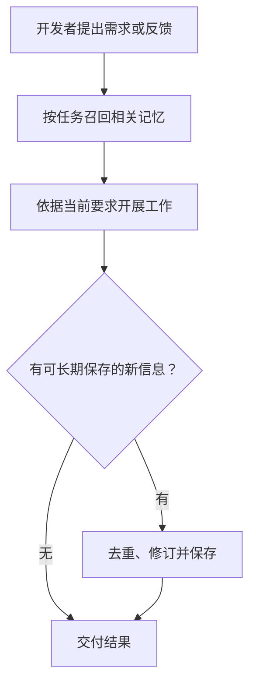

<h1 align="center">dev-memory</h1>

<p align="center"><strong>让 AI 逐渐了解你的研发习惯，并在后续任务中主动采用。</strong></p>

<p align="center">
  <a href="https://github.com/chrisstarr7/dev-memory/actions/workflows/check.yml"></a>
  <a href="../../LICENSE"></a>
  
  
</p>

<p align="center"><a href="../../README.md">English</a> · <strong>简体中文</strong> · <a href="../../docs/readme/README.ja.md">日本語</a> · <a href="../../docs/readme/README.ko.md">한국어</a></p>

Dev Memory 是一个以开发者为中心的本地 AI 研发习惯记忆系统。它从可见的要求、纠错、技术选择和工作方式中，形成可追溯、可纠正的研发习惯和思维偏好，让 AI 在后续任务与不同项目中按需采用。可选项目规则保持隔离，记忆、证据和修订历史存入本地 SQLite。

[快速开始](#快速开始) · [工作流程](#学习与召回流程) · [记忆管理](#控制记忆) · [隐私边界](#存储与隐私)

## 它能做什么

- 逐渐学习需求分析、代码实现、问题排查、验证与交付中的个人习惯。
- 按当前任务少量召回相关习惯和已授权的项目规则。
- 一次性要求只在当前对话生效；新项目默认不新增项目记忆。
- 通过宿主指令运行 Skill 和本地 Python CLI；没有常驻进程、遥测或外部记忆服务。

## 快速开始

在项目根目录执行，将 `<agent>` 替换为下表中对应的 AI 宿主参数：

```sh
npx -y --prefer-online chrisstarr7/dev-memory <agent>
```

| AI 宿主 | 参数 |
| --- | --- |
| Codex | `codex` |
| Claude Code | `claude` |
| Cursor | `cursor` |
| Gemini CLI | `gemini` |
| GitHub Copilot | `copilot` |
| OpenCode | `opencode` |
| DeepSeek Harness（DSH） | `deepseek` |

需要 Node.js 22+（含 npm/npx）、Git 和 Python 3.10+（含 sqlite3）。配置完成后，在该项目中开启新的 AI 会话即可正常开发，不需要每轮重复调用 Skill 或要求保存记忆。

对 Codex，这条命令会同时配置用户级全局习惯和当前项目绑定。其他宿主需要逐项目配置才能自动使用；目前只有 Codex 支持在未初始化项目中使用用户级引导。这里的 DeepSeek 指本地 DSH 宿主。

**安装后怎么用：**新建会话，照常描述需求、提出纠错即可。系统不会预置你的个人偏好，记忆会随真实反馈逐渐积累。想确认使用情况时，可让 AI 说明本次召回了哪些相关习惯、分别如何影响工作。初期没有相关记忆是正常情况；记忆库不可用则应明确报告。

## 记忆范围与默认设置

| 记忆 | 示例 | 作用范围与默认设置 |
| --- | --- | --- |
| 全局开发习惯 | 复用合适的已有实现、依据证据排查、交付表达偏好 | 去除项目细节后跨项目使用；宿主配置授权后可进行合规的全局学习。 |
| 项目规则 | 工程与文档规范、业务与数据契约、架构决策、验证过的经验 | 只在所属项目使用；新增项目记录需要 `full-project`。 |
| 一次性要求 | “这次不要运行测试” | 只在当前对话生效。 |

新项目默认使用 **`full-project`**：自动记录有依据、对后续工作有用的长期项目知识，无需说“记住”。`developer-first` 保留为主动选择的模式，会阻止新增项目记录。升级保留旧项目模式、暂停/禁用控制和数据；旧项目仍为 developer-first 时，需要明确切换到 full-project。

Codex 用户级引导可以在尚未初始化的项目中使用全局习惯，但不会初始化或记录该项目的业务内容。若另一个项目也需要独立记忆库和项目规则，请在该项目根目录执行安装命令。已初始化项目会一次性召回全局与当前项目记忆。

普通要求无需标注“项目”或“全局”。AI 根据适用范围判断：仓库特有的规范和契约归项目；可复用习惯可以形成全局记忆，推断型习惯先存为未生效候选；一次性要求留在对话。不能凭不确定的含义编造规则。

## 学习与召回流程



上图是普通任务路径。重要纠错会在受影响修改前保存，同一任务复用有效上下文。待整理记忆在合适的交互节点处理，具体触发条件见下文。

1. **按任务召回：**依据任务词和可选意图，通过中英文索引、代码实体查找相关记忆。默认正文预算为 5 条／4000 字符：全局习惯 3 条、项目规则 2 条。标签辅助排序，不限制查找范围；任务中复用有效上下文。
2. **学习：**明确适用于多个项目的偏好可以成为已确认习惯。可复用的用户要求、选择或纠错，首次出现就可以保存为未生效候选；两个真正独立任务的证据可以将其提升为软偏好。重复是自动采用的条件，不是首次记录的门槛。AI 总结和检索不算用户证据。
3. **纠正与去重：**新增前检查已有记录，纠正时修订原习惯并保留证据和历史。精确重复与经过语义确认的同义表达都能累积独立候选证据。当前用户要求始终优先。
4. **空闲节点整理：**积压 5 条变更、单条正文达到 1200 字符，或变更未整理达 7 天时，返回到期提示。普通调用不附带整理正文；合适的任务节点再处理一个相关主题包，最多 8 条／12000 字符，合并等价规则、压缩冗余表达、修正标签。到期工作随后续交互继续，没有后台定时器。

主 AI 在原有任务推理中评估反馈，普通增量在最终回复前批量保存。没有新信息就不写入、不调用 NOOP。重要纠错在受影响修改前保存，所有保存都要核对真实回执。没有常驻对话监听，也不默认增加独立模型调用。

## 控制记忆

| 目的 | 可以对 AI 说 |
| --- | --- |
| 表达长期习惯 | “以后所有项目，新增实现前先检查是否有合适的已有代码可复用。” |
| 开启项目记录 | “把当前项目切换到 full-project。” |
| 停止新增项目记录 | “把当前项目切回 developer-first。” |
| 修正习惯 | “修订这条习惯：符合当前需求时优先复用已有实现。” |
| 暂停全局学习，保留读取 | “暂停全局习惯写入，但继续读取。” |
| 禁用全局记忆 | “停止读取和写入全局开发习惯。” |
| 恢复全局记忆 | “恢复读取和学习全局开发习惯。” |
| 本轮不记录 | “这一轮不要保存记忆。” |
| 整理待处理记忆 | “在空闲节点归类相关习惯，精简重复表达，保留全部条件和例外。” |
| 查看或删除记录 | “查看相关记忆。” / “先预览删除范围，等我确认后再删除。” |

## 存储与隐私

| 存储 | 默认位置 |
| --- | --- |
| 用户全局习惯 | `~/.dev-memory/global/` |
| 当前项目规则 | `<项目根目录>/.dev-memory/` |

SQLite 是权威数据源，导出的 Markdown 仅供阅读。工作流程要求全局记录排除项目名称、业务细节、代码、路径、凭据和原始对话。程序会拦截已知的敏感信息和项目标记，但语义脱敏仍由 AI 负责。核心程序不上传记忆库、不收集遥测；交给云端模型处理的摘录遵循宿主的数据政策。

明确检查空间时，可让 AI 运行 `storage --scope global`（或 `project`）。`--reclaim` 清理可重建的旧缓存、退役索引和空闲页；`--backup-keep N` 预览备份保留方案，加 `--reclaim` 后才删除经过验证的同库备份。这些操作不进入日常编码路径。证据、修订历史、隐私和幂等回执会保留，直到用户明确遗忘；独立有效历史仍会增长，因此不承诺无损的固定磁盘上限。

## 没有记录记忆时怎么排查

让 AI 用实际安装的 CLI 运行一次 `doctor`，核对 `skill_version`、用户／项目激活状态、捕获开关，以及候选和生效记录的独立计数。更新 GitHub 仓库不等于升级已安装 Skill 或刷新当前会话。候选已经是落地记忆，只是普通召回不会将它作为规则采用；需要时用 `list --scope global --status candidate` 查看。

仅启用 Codex 全局习惯时，可用新版已安装 CLI 的 `setup --user`，随后新建会话。它不初始化项目，也不擅自解除暂停／禁用。项目业务规则仍受自己的作用域和捕获模式控制。实际原因、修复与验证见 [0.8.2 记录问题审查](../../reports/capture-review-0.8.2.md)。

## 升级、验证与文档

在已初始化项目中重新运行安装命令，然后新建会话即可升级。已有记忆、捕获设置和无关指令会保留；初始化会更新内容指纹，不改写记忆正文。

安装和程序检查不代表真实宿主一定遵循，也不能证明任务延迟可忽略。[0.8.0 审查与测量](../../reports/optimization-0.8.0.md)列出实际程序／宿主结果及验证缺口。其他宿主使用独立指令适配器，不能由安装成功推断 hooks 真实生效。

[安装与卸载](../../docs/installation.md) · [架构](../../docs/architecture.md) · [记录协议](../../skills/dev-memory/references/protocol.md) · [验证报告](../../reports/verification.md) · [安全说明](../../SECURITY.md) · [贡献指南](../../CONTRIBUTING.md)

通过 [GitHub Issues](https://github.com/chrisstarr7/dev-memory/issues) 提交脱敏问题。本项目采用 [MIT License](../../LICENSE)。

[0.8.3 项目与全局捕获审查](../../reports/project-capture-review-0.8.3.md)
