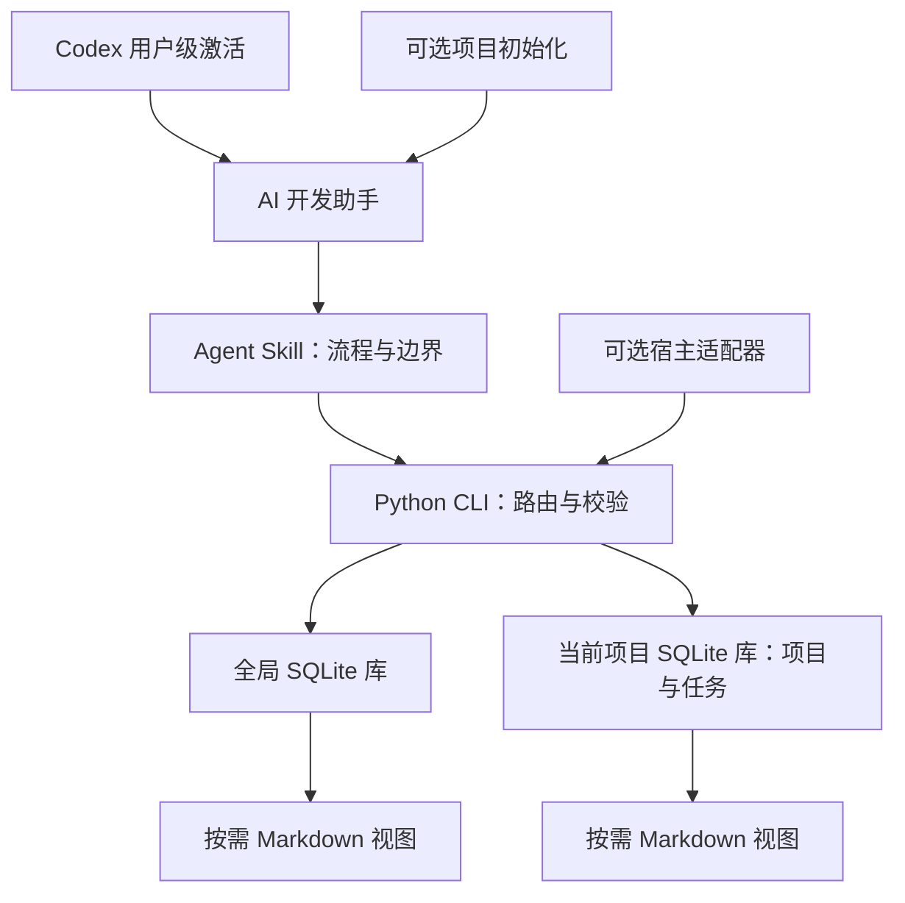

<h1 align="center">dev-memory</h1>

<p align="center">
  <strong>跨项目学习开发者工作习惯的私有本地记忆。</strong><br />
  自动学习、按需召回，尽量不拖慢编码。
</p>

<p align="center">
  <a href="https://github.com/chrisstarr7/dev-memory/actions/workflows/check.yml"></a>
  <a href="../../LICENSE"></a>
  
  
  
</p>

<p align="center"><a href="../../README.md">English</a> · <strong>简体中文</strong> · <a href="README.ja.md">日本語</a> · <a href="README.ko.md">한국어</a></p>

<p align="center"><a href="#开始使用">开始使用</a> · <a href="#特性">特性</a> · <a href="#工作方式">工作方式</a></p>

<p align="center"><kbd>Codex</kbd> · <kbd>Claude Code</kbd> · <kbd>Cursor</kbd> · <kbd>Gemini CLI</kbd> · <kbd>GitHub Copilot</kbd> · <kbd>OpenCode</kbd> · <kbd>DeepSeek Harness</kbd></p>

---

Dev Memory 让 AI 逐渐了解你在研发中表达的工作习惯：如何理解需求、分析问题、复用代码、控制修改范围、排查 Bug、验证和交付。这些习惯可以跨项目使用，项目规则和任务断点作为可选的辅助记忆。

**0.7.0** 默认以开发者习惯为重点。当前 AI 判断用户反馈的含义，本地程序保存证据、版本和有界检索结果；自动学习依赖宿主加载指令以及 AI 实际遵循。

## 开始使用

使用 **Codex** 时，为当前用户启用一次全局开发习惯：

```sh
npx -y --prefer-online chrisstarr7/dev-memory codex --user
```

随后在任意项目新建 **Codex 会话**。新项目可以使用同一份全局习惯，无需重复初始化项目。安装器管理 Codex 用户指令中的专属块并初始化全局 SQLite 库；已有非空 `AGENTS.override.md` 时使用该文件，否则使用 `AGENTS.md`。

**环境要求：** Node.js 22+（含 npm/npx）、Git、Python 3.10+（含 sqlite3）。安装和升级保留本地记忆及管理块以外的用户指令。成功回执证明配置完成；实际自动使用仍依赖宿主和 AI。用户级激活目前支持 Codex。

### 可选项目引导与其他 AI 宿主

需要绑定某个项目时，在该项目根目录运行：

```sh
npx -y --prefer-online chrisstarr7/dev-memory codex
```

其他宿主将 `codex` 换成 `claude`、`cursor`、`gemini`、`copilot`、`opencode` 或 `deepseek`（DeepSeek Harness／DSH），各自使用项目适配器。完成后新建宿主会话。

新项目默认采用 **`developer-first`**：优先学习全局习惯，已有项目规则仍可召回，项目业务记录和任务断点默认不新增。Codex 项目初始化后，可在 macOS/Linux 上用安装的运行程序开启完整项目捕获：

```sh
python3 "$HOME/.agents/skills/dev-memory/scripts/dev_memory.py" mode full-project --project-root .
```

将 `full-project` 换成 `developer-first` 可切回。Windows 路径、其他宿主目录及仅安装程序的方式见 [安装指南](../../docs/installation.md)。

<details>
<summary>让本地 AI 帮你安装</summary>

> 请从 https://github.com/chrisstarr7/dev-memory 安装 dev-memory。Codex 使用 `--user` 启用用户级全局开发习惯；其他宿主配置当前项目适配器。检查成功回执，保留已有记忆和用户指令。

AI 需要本机文件与命令权限。网页聊天不能直接安装到你的电脑。离线安装、没有 Node.js 时的安装和卸载方法见 [安装指南](../../docs/installation.md)。

</details>

Windows Codex：详见 [Windows 访问说明](../../docs/installation.md#windows-codex-访问权限)。

## 特性

| 能力 | 作用 |
| --- | --- |
| 准确约束 | 保留条件、例外、禁止事项和验证方法；纠错时修订已有规则。 |
| 开发者习惯学习 | 明确表达的习惯可直接成为全局规则；多个任务中的真实用户反馈形成软偏好候选。 |
| 项目隔离 | 项目 A 的业务留在 A；全局习惯不含项目名称、业务实体、代码、路径或原始对话。 |
| 按需召回 | 读取适用的全局、当前项目和当前任务记录；复用有效上下文，变化后失效重查。 |
| 去重与精简 | 程序拦截完全重复；当前 AI 对照语义重复、精简相关记录，保留约束和证据。 |
| 本地控制 | 支持查看、纠正、本轮不记、暂停、只读召回、归档和遗忘。 |

独立 Agent Skill 与小型 Python CLI，使用标准库和 SQLite，无后台进程、向量服务或额外付费模型。程序与协议公开，每个安装者的记忆独立保存在本地。新库不含演示记录。

## 日常使用

正常描述研发任务即可。启用 Codex 用户级引导后，AI 会在任务开始时有界召回少量相关全局习惯。重复反馈可以自动形成候选，不必每次说“保存到全局”。一次性的临时要求不会被归纳为永久偏好。

| 想控制什么 | 对 AI 说 |
| --- | --- |
| 明确全局偏好 | “以后优先复用已有实现，再考虑新增实现。” |
| 纠正已有习惯 | “修订这条偏好：先比较现有实现，适合当前需求时再复用。” |
| 限定一次性要求 | “这次任务不要测试，只对这次生效。” |
| 关闭全局学习 | “暂停全局习惯写入，仍可召回。” |
| 本轮不记 | “这一轮不要保存记忆。” |
| 暂停／恢复写入 | “暂停这个项目的记忆写入，仍可召回。”／“恢复记忆写入。” |
| 只读召回 | “这一轮只读召回，不写入任何内容。” |
| 遗忘记录 | “预览这条规则的遗忘范围，我确认后再删除。” |

示例是虚构的，不会自动导入。无需手写 JSON；AI 按 [本地协议](../../skills/dev-memory/references/protocol.md) 执行。声称保存成功必须有对应存储的成功回执。

明确的长期偏好可直接成为确认规则。反复出现的选择或纠错先形成候选，两个独立任务 ID 的反馈可晋升为可采用的软偏好。程序用受控任务引用计数，AI 仍需判断反馈真实、可复用。AI 总结和检索命中不增加用户证据；候选晋升前不执行，软偏好服从当前用户要求。

## 工作方式

1. **召回：** 任务开始时一次有界调用，取少量相关全局习惯和经授权的当前项目约束。
2. **保存：** 明确全局偏好保留用户证据；推断候选只保留通用文字，并由程序对任务 ID 哈希去重。两个独立任务的真实用户反馈才会生成可采用的软偏好。
3. **整理：** 精确重复复用已有记录。深度整理仍按阈值延后，不进入普通编码热路径。
4. **继续：** 任务断点为可选能力；修改或删除源记录会使派生摘要失效。

### 默认整理策略

AI 在编辑前，会把适用的记忆条件落实到设计、代码决策和回归检查。相关规则优先召回，简短候选目录帮助按需补读。可选使用回执说明某条规则影响了哪个具体行动，不增加用户证据；任务正确性与 AI 声称使用了记忆分别验证。

| 触发或限制 | 默认值 |
| --- | --- |
| 同一库有变化、尚未整理的不同记录 | **5 条** |
| 单条待整理记录的正文长度 | **1200 字符** |
| 每库一批相关记录 | 最多 **8 条／12000 字符** |
| 每个研发轮次 | 每库最多 **一批**，在当前 AI 轮次内处理 |
| 召回与整理 SQL 处理预算 | **500 毫秒**，超时如实延后 |

阈值分别在全局库和项目库计算。NOOP 和重复检查不累计变化。会话或任务边界可补查未完成主题一次，启动查过的不重复。没有待处理变化时不整理；暂停、只读和本轮不记时也不整理。没有后台定时器、每次工具调用后的总结或全库扫描。

阈值启动整理周期后，后续正常交互会继续处理剩余队列，包括最后不足 5 条的记录。每轮每库最多处理一批，已经整理过的同一轮不再返回第二个整理包；队列空闲时不返回记忆正文。

复用有效记忆和已加载协议。上下文压缩、记忆修订和工作区变化后失效补查。召回为项目约束保留容量，溢出会明确报告不完整，关键约束遗漏必须补查。各库独立提交、分别报告成功或失败。

旧条目和旧正文保留为可追溯历史。精简减少活跃上下文，**不限制磁盘总量**。语义不确定时保留原记录。

## 架构与存储



| 范围 | 保存内容 | 默认位置 |
| --- | --- | --- |
| `global` | 明确的开发习惯，以及有独立用户证据的去业务化软偏好 | `~/.dev-memory/global/` |
| `project` | 可选的所属项目业务、架构、接口、约束和决策 | `<project-root>/.dev-memory/` |
| `task` | 可选的临时要求和续接断点 | 所属项目库内 |

每个存储有独立事务、证据、回执、视图和备份。项目写入失败不会改存全局。范围依据内容和用户意思判断，不能只看工作目录；没有明确项目的业务不能进入全局。

运行 Skill 位于 `skills/dev-memory/`；安装入口为 `bin/install.cjs` 和 `install.py`。`docs/`、`tests/`、`evals/`、`reports/` 分别提供文档、隔离测试、评估工具和证据。详见 [架构说明](../../docs/architecture.md)。

## 兼容性与验证

| 模式 | 行为／状态 |
| --- | --- |
| 基础模式 | AI 调用 Skill 和 CLI；仅安装 Skill 不保证每轮执行。 |
| Codex 用户级引导 | 用户管理块要求跨项目仅读全局习惯；隔离配置检查已通过，真实宿主两个项目自动加载仍未验证。 |
| 默认项目引导 | 初始化配置宿主项目指令，在普通研发任务中使用；依赖宿主加载指令及 AI 实际遵循。 |
| 可选事件模式 | Codex hooks 需要宿主信任和事件验证，真实 hook 传递链路尚未验证。 |
| 只读模式 | 读取已有记录，不初始化或写入。 |
| 不可用 | 权限不足或存储无法访问时如实报告。 |

**0.7.0** 的本地 Python 测试共执行 204 项，2 项因环境条件跳过，发布包成功构建。程序检查覆盖独立任务证据、候选晋升、修订、关闭捕获和跨项目全局召回。[场景目录](../../evals/scenarios.json) 按程序、语义和宿主评估区分 S01–S52。历史平台 CI 和其他宿主结果见 [验证报告](../../reports/verification.md)，这些结果不能证明新版用户级指令在真实宿主中已自动加载。DSH 的独立适配限制见 [DSH 结果](../../reports/deepseek.json)。

**性能结果仅为探索性观察。** 0.7.0 使用真实 Codex CLI，对记忆开/关各运行了一个合成任务样本，其中包含整理压力场景。开启记忆时观察到额外记忆工具调用；样本不足以估计普通编码延迟，也未在同一任务上重跑 0.6.0。详见 [0.7.0 对照结果](../../reports/benchmark-0.7.0.md) 和 [记忆使用与维护审查](../../reports/memory-cycle-review.md)。不据此声称开销可忽略。

## 隐私与安全

- 发布包不含真实记忆、作者数据或自动写入的演示记录。
- 核心程序不上传记忆、不收集遥测；AI 模型调用遵循宿主配置与数据政策。
- 程序与运行数据分离；升级和默认卸载保留记忆，项目记忆默认排除在 Git 之外。
- 不保存凭证、密码、完整敏感日志或不必要客户数据；凭证检测不能代替语义筛选。
- 历史记忆不能覆盖当前要求或安全规则；本地库默认没有应用加密。
- 遗忘清理工具管理的数据，无法清理宿主对话、外部副本或系统快照，也不承诺安全擦除。

详见 [SECURITY.md](../../SECURITY.md) 和 [对抗性审查报告](../../reports/adversarial-review.md)。

## 贡献与支持

通过 [Issues](https://github.com/chrisstarr7/dev-memory/issues) 提交问题与想法，通过 Pull Requests 改进项目。请提供脱敏的最小复现，不附带真实记忆库。开发与评估约定见 [CONTRIBUTING.md](../../CONTRIBUTING.md)。

## 许可证

Copyright © 2026 dev-memory contributors. 本项目采用 [MIT License](../../LICENSE)。
