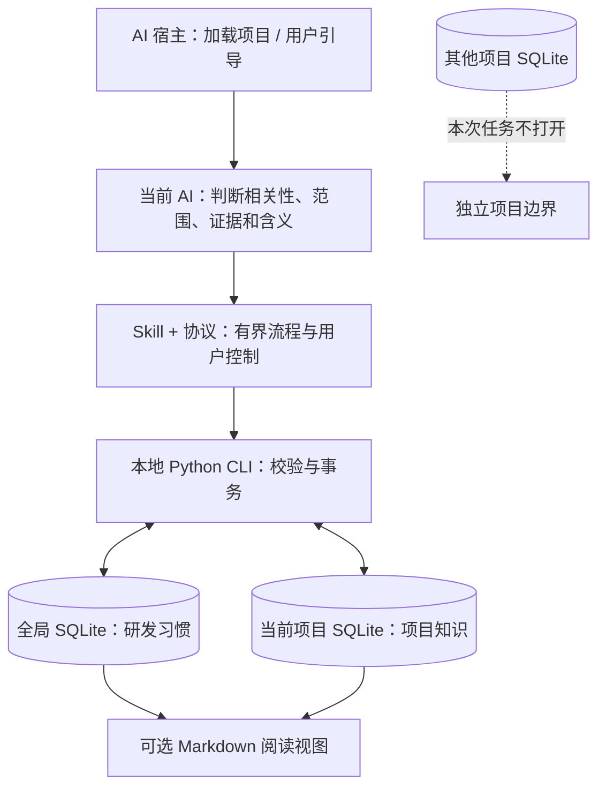
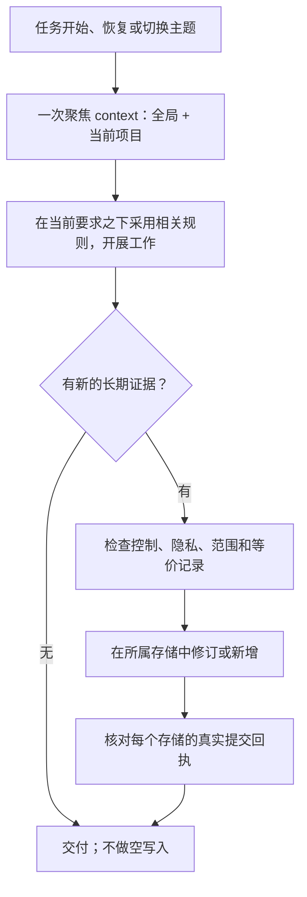
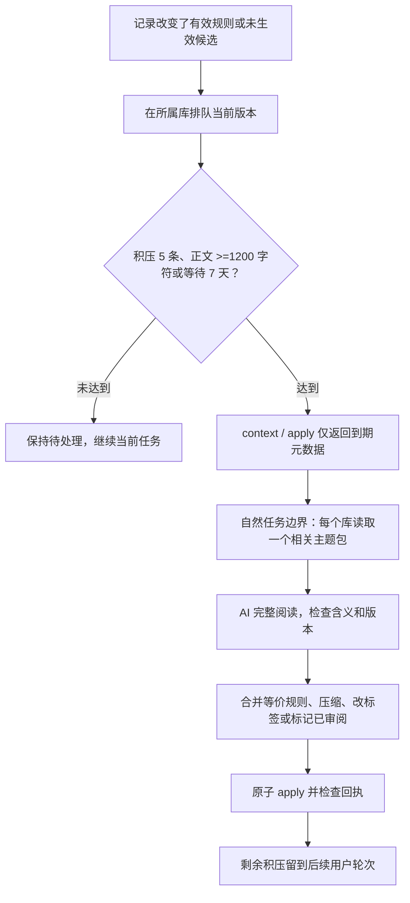

<h1 align="center">dev-memory</h1>

<p align="center"><strong>让 AI 记住你的研发习惯，以及每个项目自己的规则。</strong></p>

<p align="center">
  <a href="https://github.com/chrisstarr7/dev-memory/actions/workflows/check.yml"></a>
  <a href="../../LICENSE"></a>
  
  
</p>

<p align="center"><a href="../../README.md">English</a> · <strong>简体中文</strong> · <a href="README.ja.md">日本語</a> · <a href="README.ko.md">한국어</a></p>

Dev Memory 是面向 AI 辅助开发的可移植 Skill 和本地 Python 程序。它按任务召回相关的开发习惯与项目知识，从真实要求和证据中记录长期信息，并保留可检查的来源及修订历史。AI 负责理解语义，SQLite 程序负责校验和存储。

[安装](#快速开始) · [记录范围](#什么值得记录) · [架构](#架构与存储边界) · [工作流程](#召回与记录) · [自动整理](#自动整理与归纳) · [控制方式](#控制记忆) · [问题排查](#没有记录或召回时怎么检查)

## 快速开始

在**开发项目根目录**执行：

```sh
npx -y --prefer-online chrisstarr7/dev-memory <agent>
```

将 `<agent>` 替换为下表参数。需要 Node.js 22+（含 npm/npx）、Git 和 Python 3.10+（含 sqlite3）。记忆运行时只使用 Python 标准库；安装完成后的记忆处理无需 npx 或外部记忆服务。

| AI 宿主 | 参数 | 项目引导文件 |
| --- | --- | --- |
| Codex | `codex` | `AGENTS.md`，或已有的非空 `AGENTS.override.md` |
| Claude Code | `claude` | `CLAUDE.local.md` |
| Cursor | `cursor` | `.cursor/rules/dev-memory.mdc` |
| Gemini CLI | `gemini` | `GEMINI.md` |
| GitHub Copilot | `copilot` | `.github/copilot-instructions.md` |
| OpenCode | `opencode` | `AGENTS.md` |
| DeepSeek Harness（DSH） | `deepseek` | `AGENTS.md` |

**Codex 一条命令同时配置用户级全局习惯和当前项目：**执行 `npx -y --prefer-online chrisstarr7/dev-memory codex` 即可。以后进入未初始化的其他项目，Codex 用户级引导只召回全局习惯，不创建项目库。若另一个项目也需要自己的项目记忆，在该项目根目录再执行一次相同命令。其他宿主目前使用项目适配器，没有这项 Codex 用户级适配。按实际宿主选择参数：通过 OpenCode 使用 DeepSeek 模型，应选 `opencode`。

安装或升级后，在项目中开启**新的 AI 会话**，照常描述需求和反馈。不需要每轮调用 Skill、标注存储范围或说“记住”。初始记忆库为空，不预置或编造个人习惯。安装回执证明文件和存储配置结果，不能证明某个模型已经正确遵循全部指令。具体路径、其他安装方式、卸载和权限处理见[安装说明](../installation.md)。

## 什么值得记录

AI 判断这条信息是否对未来任务有用、有什么证据，以及适用于什么范围。当前用户要求始终高于记忆。

检查、解释、审查后即使无需修改代码，也要判断是否有合格记忆。用户新提出的长期项目规范不会因代码已经合规而失去记录资格；保留项目/模块范围，不保存临时检查结果，也不把同一项目规范泛化后再存一份全局偏好。已有等价记录、临时要求和隐私控制仍会阻止无效写入。

| 去向 | 适合保存的信息 | 示例 |
| --- | --- | --- |
| **全局记忆** | 去除项目细节后仍可复用的研发习惯和方法 | 交付表达顺序、先检查已有实现、依据证据排查问题 |
| **当前项目记忆** | 长期有效的规范、契约、约束、决策和有依据的事实 | 代码与文档规范、业务状态、API/数据契约、事务、安全和模块职责边界 |

**持久记忆只有全局和当前项目两层。**AI 宿主本身保有当前对话上下文；一次性要求、任务进度和未确认猜测留在对话中，Dev Memory 不保存对话或任务检查点。凭证在任何范围都不应入库。

项目记忆还可以覆盖测试与验收规则、兼容要求、部署与环境约束、性能限制、依赖、数据迁移，以及带适用条件和预防检查的故障经验。分类不是封闭清单；关键是有依据并能帮助后续决策。不要把整份文件或每个实现细节都保存成永久规则。已观察到的行为与期望行为应分别记录；现有代码恰好这样写，不代表用户要求以后都这样写。

**全局习惯有两种证据路径：**明确要求长期适用于所有项目时，可立即成为已确认的有效规则。没有明确跨项目声明，但可复用的用户选择或纠错，首次即可保存为**未生效候选**；两个真正独立任务的信号可将其提升为软偏好。召回、AI 重复和总结都不能增加用户证据。候选已入库，但不作为指令执行。

**项目捕获默认值：**新项目采用 `full-project`，无需额外“保存”口令即可记录合格的项目知识。`developer-first` 是可选限制模式，会阻止新增项目记录。升级保留旧项目模式和暂停、禁用、只读控制；旧项目仍为 developer-first 时，需要明确切换。关键业务决策不明时应澄清；未确认假设不能作为有效规则，普通召回排除假设。旧版项目数据库中可能仍有任务/检查点记录；此版本不再创建、召回、整理或导出它们，也不会在升级时擅自删除旧数据。

`reports/` 下的文件记录历史运行情况，可能提到旧版检查点行为。

## 架构与存储边界



| 位置 | 内容 |
| --- | --- |
| `~/.dev-memory/global/` | 全局数据库、配置和可选视图/备份 |
| `<项目根目录>/.dev-memory/` | 项目数据库、配置和私有激活绑定 |
| 宿主安装目录中的 `skills/dev-memory/` | 公开 Skill、CLI 和参考文件，不是私有记忆库 |

没有存放所有项目的中央数据库。已初始化项目的一次召回只查询全局库和当前项目库，不枚举其他项目。项目业务、路径、代码和客户信息不能进入全局记忆。不同克隆/工作树默认拥有独立项目库。SQLite 是权威数据，Markdown 只是可重建的阅读视图。

会话/轮次 ID 与哈希后的上下文缓存键仅用于重试去重、隐私跳过和避免重复召回，不保存对话正文，也不构成第三层记忆。旧任务记录可通过 `list --scope project --status all` 显式检查；删除某条记录需要走 `forget preview` / `forget apply` 流程。

## 召回与记录



- 召回在主流程中进行。一次聚焦的 `context` 获取有界相关规则；有效上下文在任务内复用，丢失上下文后重新召回。默认正文预算为 5 条 / 4000 字符，其中全局 3 条、项目 2 条；未加载或不完整结果可能需要定向补读。 全局没有合格的有效规则或已禁用读取时，项目可复用空余容量，总预算不变；未生效候选不占指令名额。
- 主 AI 在现有任务推理中评估记录。重要纠错在受影响修改前保存；普通合格增量在最终交付前批量保存。等价规则复用或修订，保留证据与历史。
- 复杂评估可以在宿主提供相应能力时，交给只读辅助智能体与其他工作并行处理。使用后，主 AI 必须在**结束回复前等待评估、落库并核对回执**。启动线程不等于保存成功。不强制增加模型调用，也没有常驻对话监听。
- 全局和项目分别提交事务，一边成功不代表另一边成功。写入失败必须如实报告。操作格式、来源要求、版本保护和检索限制见[详细协议](../../skills/dev-memory/references/protocol.md)。

## 开发周期中的参与方式

| 阶段 | 记忆如何参与 |
| --- | --- |
| 需求梳理 | 召回现有业务规则，保存已确认的长期需求、条件和例外。 |
| 方案设计 | 复用接口契约和历史决策，不把暂定假设变成有效规则。 |
| 编码实现 | 遵循规范并复用已有能力，区分旧代码现状与应当实现的行为。 |
| 测试验证 | 召回验收与回归义务；历史通过记录只对其版本有意义。 |
| 纠错调整 | 重要纠错在相关修改前保存，使过时派生摘要失效。 |
| 交付收尾 | 遵循文档和汇报约定，完成合格记录并核对回执，不保存任务进度。 |
| 后续任务/项目 | 聚焦读取全局和当前项目，定向补读缺失规则，保持项目隔离。 |

## 自动整理与归纳

“自动”指 AI 在已授权的正常交互中处理合格增量，**没有常驻进程、定时器、后台归纳模型或全库扫描**。



触发条件启动所属库的整理周期；后续正常交互可继续处理不足阈值的尾部积压。每个用户轮次、每个库最多处理**一个相关主题**，上限为 **8 条 / 12000 字符**。合格的未生效候选也能整理，但必须保持候选状态；未确认假设不进入整理。稳定且未变的规则不需要反复归纳。协议升级可能一次性将已有合格的有效规则和候选加入待审队列。选择主题时，过长的起始记录明确报告并跳过，以选择可装入预算的主题。过长或尚未读完的记录留待后续处理；字符预算不能成为丢弃条件的理由。暂停、禁用、排除和只读控制继续生效。

| 操作 | 改什么 | 保留什么 |
| --- | --- | --- |
| **压缩正文** | 精简单条当前记录的重复表达 | 条件、例外、否定要求、强度、范围、证据及旧版本 |
| **合并重复** | 保留等价的规范记录，重复项退出普通召回 | 原始证据、历史和可追溯来源；含义不兼容的规则分别保留 |
| **改标签 / 审阅** | 优化分类或标记完整读过的版本 | 含义和证据，不增加新观察或偏好 |
| **派生摘要** | 在同一范围内生成经过审阅、关联来源的阅读辅助 | 有效且兼容的原子规则，不增强原规则强度；来源变化会使相关摘要失效 |
| **归档** | 新确认信息或明确到期证据支持时，让旧规则退出普通召回 | 审计历史；仅仅陈旧不足以证明规则失效 |

自动整理不能编造事实、把总结当成用户证据、通过汇总候选来增加证据或晋升状态、擅自裁决冲突业务规则，也不能把项目内容转入全局。摘要不是独立确认。语义等价依赖 AI 判断，结构校验不能证明不同措辞完全等价；不确定时保留原记录，只标记真正完成审阅的部分。主题检索有界，不能保证发现所有语义冲突，尤其是不同分类记录之间的冲突。摘要准备同样遵守禁用/排除读取控制和 8 条 / 12000 字符预算。

**工作上下文整理与磁盘清理分开。**压缩和合并减少有效正文，旧正文与来源仍保留在磁盘。显式 `storage` 检查/回收可以清理可丢弃缓存、退役搜索词和空闲页；同库有效备份的保留数量由用户单独选择。证据、修订、隐私回执和遗忘抑制记录不属于自动清理目标。永久删除走遗忘流程。系统不承诺无损固定磁盘上限。

## 控制记忆

普通要求无需指定范围；下表中的范围名称用于明确修改控制项。

| 目的 | 可以这样说 |
| --- | --- |
| 记录项目规范 | “这个仓库新增或调整接口请求/响应字段时，同步更新接口文档。” |
| 记录项目契约 | “取消的订单不能再次扣款，后续修改都保留这个约束。” |
| 明确全局习惯 | “以后所有项目，都先复用合适的已有实现，再考虑新增。” |
| 修正规则 | “修订这条规范：生成文件不受这个限制。” |
| 开启 / 限制项目捕获 | “把当前项目切到 full-project。” / “切回 developer-first。” |
| 暂停全局学习，保留读取 | “暂停全局习惯写入，但继续读取。” |
| 禁用 / 恢复全局记忆 | “停止全局读取和写入。” / “恢复读取和学习全局习惯。” |
| 本轮不记录 | “这一轮不要保存任何记忆。” |
| 查看 / 整理 | “查看相关记忆。” / “整理待处理的相关记录，保留全部条件和例外。” |
| 遗忘 | “先预览需要删除的记录，等我确认再删除。” |

## 隐私与能力边界

核心程序本地存储记忆，没有遥测或自动上传记忆功能。安装只下载公开程序，不发布私有库。但召回后提交给托管模型的记忆片段受宿主的数据政策约束；“本地 SQLite”不意味着托管模型从未接触召回内容。

全局记录及其证据必须脱敏：不能包含项目名、业务实体、代码、路径、客户、凭证、原始对话或日志。程序能拦截已知敏感/项目标记，语义隐私仍需要 AI 检查。两个范围都不能存密钥。存储控制和本轮退出要求优先于例行学习与整理；备份同样包含私有信息。

安装、单元测试和 SQL 写入成功不能证明每个真实会话都能正确归类自然语言、遵循引导或达到特定延迟。宿主权限与信任设置仍然适用。可选 Codex Hooks 是独立集成，既不是项目引导模式的前提，也不能仅凭安装推断事件已送达。

## 没有记录或召回时怎么检查

让 AI 针对**已安装程序**执行一次 `doctor`，不用每轮开发都诊断：

1. 检查安装版本、激活绑定、Python/CLI 路径及存储可读写状态。
2. 检查项目捕获模式、暂停/禁用/只读和本轮控制。旧项目的 `developer-first` 可能解释为何没有新增项目记录。
3. 区分**已保存候选**、**有效规则**和**本次匹配**。候选已保存但不生效；没有词法匹配不等于数据库为空。
4. 检查写入回执及来源。“已记住”没有真实回执不算证明。只检查相关记录和修订，不扫描所有项目。
5. Codex 的 `automatic_mode: not_configured` 指可选 Hook 未配置；应另看项目激活和存储状态，不能单凭它认定 Skill 损坏。

不要通过把项目数据转存全局来绕过 Windows 权限或用户控制。详见[安装诊断](../installation.md)和[验证证据](../../reports/verification.md)。

## 升级、参考和贡献

已有安装使用独立更新命令，再新开 AI 会话：

```sh
npx -y --prefer-online chrisstarr7/dev-memory update codex
```

其他宿主替换 `codex` 参数。更新要求已有受管理安装，只刷新当前项目和 Codex 用户已存在的绑定，不会初始化陌生项目，也不会开启原先未配置的用户级记忆。已有记忆、捕获模式、暂停/禁用开关及无关指令保留。新项目首次启用仍使用上面的安装命令。只更新源码工作区不会同步升级已安装 Skill。

- [架构说明](../architecture.md)：组件职责、存储边界和运行机制。
- [操作协议](../../skills/dev-memory/references/protocol.md)：CLI、结构化写入和整理契约。
- [安装与卸载](../installation.md)：宿主、路径、替代安装方式和问题排查。
- [验证报告](../../reports/verification.md)：实际程序/宿主验证及未覆盖项。
- [0.8.4 整理机制审查与验证](../../reports/maintenance-review-0.8.4.md).
- [0.8.5 全开发周期模拟与审查](../../reports/lifecycle-review-0.8.5.md).
- [安全](../../SECURITY.md) · [贡献](../../CONTRIBUTING.md) · [MIT 许可](../../LICENSE)。

请通过 [GitHub Issues](https://github.com/chrisstarr7/dev-memory/issues) 提交脱敏问题，不要附带私有数据库、凭证或原始对话。
