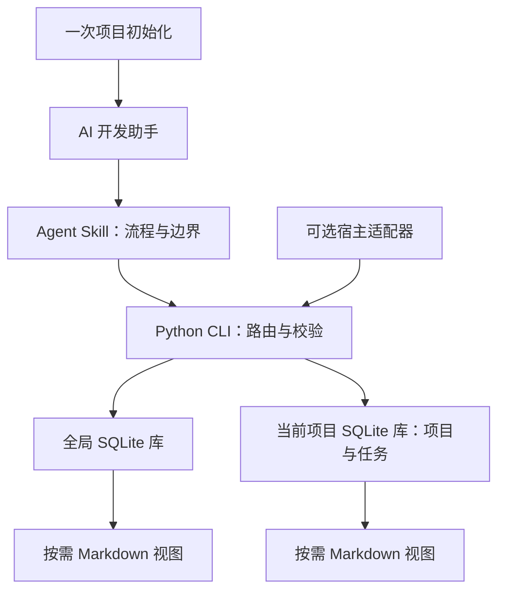

<h1 align="center">dev-memory</h1>

<p align="center">
  <strong>给 AI 开发助手的私有本地研发记忆。</strong><br />
  召回准确约束，保存纠错，接着真实进度继续开发。
</p>

<p align="center">
  <a href="https://github.com/chrisstarr7/dev-memory/actions/workflows/check.yml"></a>
  <a href="../../LICENSE"></a>
  
  
</p>

<p align="center"><a href="../../README.md">English</a> · <strong>简体中文</strong> · <a href="README.ja.md">日本語</a> · <a href="README.ko.md">한국어</a></p>

<p align="center"><a href="#开始使用">开始使用</a> · <a href="#特性">特性</a> · <a href="#工作方式">工作方式</a></p>

<p align="center"><kbd>Codex</kbd> · <kbd>Claude Code</kbd> · <kbd>Cursor</kbd> · <kbd>Gemini CLI</kbd> · <kbd>GitHub Copilot</kbd> · <kbd>OpenCode</kbd> · <kbd>DeepSeek Harness</kbd></p>

---

## 开始使用

在**要开发的项目根目录**执行：

```sh
npx -y chrisstarr7/dev-memory codex
```

使用其他 AI 时，将 `codex` 换成 `claude`、`cursor`、`gemini`、`copilot`、`opencode` 或 `deepseek`（DeepSeek Harness／DSH）。macOS、Linux、Windows 使用同一命令。

**环境要求：** Node.js 22+（含 npm/npx）、Git、Python 3.10+（含 sqlite3）。安装器自动下载程序、检查环境、初始化项目空库，并配置 AI 的项目启动指令。

安装成功后，**在该项目新建 AI 会话，直接开发即可**。无需启用口令、显式调用 Skill，也无需反复要求保存或读取。安装前已打开的会话需重新开始，才能加载新指令。

升级或初始化另一个项目时运行同一命令。升级保留已有记忆、无关项目指令和暂停状态。每个项目分别初始化；明确确认的全局研发偏好可以共用。

<details>
<summary>让本地 AI 帮你安装</summary>

> 请从 https://github.com/chrisstarr7/dev-memory 安装并初始化当前项目的 dev-memory，选择当前 AI 宿主，检查成功回执，保留已有记忆和配置。

AI 需要本机文件与命令权限。网页聊天不能直接安装到你的电脑。离线安装、没有 Node.js 时的安装和卸载方法见 [安装指南](../../docs/installation.md)。

</details>

Windows Codex：0.5.2 已修复程序目录的 ACL 创建方式。用上面的同一命令升级，再新建会话。详见 [Windows 访问说明](../../docs/installation.md#windows-codex-访问权限)。

## 特性

| 能力 | 作用 |
| --- | --- |
| 准确约束 | 保留条件、例外、禁止事项和验证方法；纠错时修订已有规则。 |
| 真实任务断点 | 保存已完成、未完成、阻塞和下一步；每个任务保留一个当前断点。 |
| 项目隔离 | 项目 A 的业务留在 A；只有明确确认跨项目适用的偏好和方法进入全局。 |
| 按需召回 | 读取适用的全局、当前项目和当前任务记录；复用有效上下文，变化后失效重查。 |
| 去重与精简 | 程序拦截完全重复；当前 AI 对照语义重复、精简相关记录，保留约束和证据。 |
| 本地控制 | 支持查看、纠正、本轮不记、暂停、只读召回、归档和遗忘。 |

独立 Agent Skill 与小型 Python CLI，使用标准库和 SQLite，无后台进程、向量服务或额外付费模型。程序与协议公开，每个安装者的记忆独立保存在本地。新库不含演示记录。

## 日常使用

正常描述研发任务即可。初始化后的 AI 默认召回相关要求、及时保存明确纠错、轮末批量保存普通变化，恢复断点前核对实际代码。

| 想控制什么 | 对 AI 说 |
| --- | --- |
| 纠正业务条件 | “退款期限改为签收后 14 天。” |
| 保存全局偏好 | “这是所有项目都适用的研发规范，请保存到全局。” |
| 本轮不记 | “这一轮不要保存记忆。” |
| 暂停／恢复写入 | “暂停这个项目的记忆写入，仍可召回。”／“恢复记忆写入。” |
| 只读召回 | “这一轮只读召回，不写入任何内容。” |
| 遗忘记录 | “预览这条规则的遗忘范围，我确认后再删除。” |

示例是虚构的，不会自动导入。无需手写 JSON；AI 按 [本地协议](../../skills/dev-memory/references/protocol.md) 执行。声称保存成功必须有对应存储的成功回执。

## 工作方式

1. **召回：** 任务开始、恢复、切换项目或模块时，一次调用取得相关记录和待整理状态；正常启动不重复探测宿主。
2. **保存：** 当前 AI 提炼语义，CLI 校验范围、来源、修订和事务边界；无增量时提交简短的已检查 NOOP 回执。
3. **整理：** 对照相关记录，合并等价重复、精简长正文，保留条件、例外、否定要求、版本边界和来源。
4. **继续：** 每个任务保留一个当前断点，旧断点保留为历史；源记录修改或删除后，相关派生摘要失效。

### 默认整理策略

| 触发或限制 | 默认值 |
| --- | --- |
| 同一库有变化、尚未整理的不同记录 | **5 条** |
| 单条待整理记录的正文长度 | **1200 字符** |
| 每库一批相关记录 | 最多 **8 条／12000 字符** |
| 每个研发轮次 | 最多 **一批**，在当前 AI 轮次内处理 |
| 召回与整理 SQL 处理预算 | **500 毫秒**，超时如实延后 |

阈值分别在全局库和项目库计算。NOOP 和重复检查不累计变化。会话或任务边界可补查未完成主题一次，启动查过的不重复。没有待处理变化时不整理；暂停、只读和本轮不记时也不整理。没有后台定时器、每次工具调用后的总结或全库扫描。

复用有效记忆和已加载协议。上下文压缩、记忆修订和工作区变化后失效补查。召回为项目约束保留容量，溢出会明确报告不完整，关键约束遗漏必须补查。各库独立提交、分别报告成功或失败。

旧条目和旧正文保留为可追溯历史。精简减少活跃上下文，**不限制磁盘总量**。语义不确定时保留原记录。

## 架构与存储



| 范围 | 保存内容 | 默认位置 |
| --- | --- | --- |
| `global` | 明确确认跨项目适用的研发偏好、规范和方法 | `~/.dev-memory/global/` |
| `project` | 所属项目的业务、架构、接口、约束、决策和缺陷经验 | `<project-root>/.dev-memory/` |
| `task` | 临时要求、进度、阻塞和下一步 | 所属项目库内 |

每个存储有独立事务、证据、回执、视图和备份。项目写入失败不会改存全局。范围依据内容和用户意思判断，不能只看工作目录；没有明确项目的业务不能进入全局。

运行 Skill 位于 `skills/dev-memory/`；安装入口为 `bin/install.cjs` 和 `install.py`。`docs/`、`tests/`、`evals/`、`reports/` 分别提供文档、隔离测试、评估工具和证据。详见 [架构说明](../../docs/architecture.md)。

## 兼容性与验证

| 模式 | 行为／状态 |
| --- | --- |
| 基础模式 | AI 调用 Skill 和 CLI；仅安装 Skill 不保证每轮执行。 |
| 默认项目引导 | 初始化配置宿主项目指令，在普通研发任务中使用；依赖宿主加载指令及 AI 实际遵循。 |
| 可选事件模式 | Codex hooks 需要宿主信任和事件验证，真实 hook 传递链路尚未验证。 |
| 只读模式 | 读取已有记录，不初始化或写入。 |
| 不可用 | 权限不足或存储无法访问时如实报告。 |

Ubuntu/macOS、Python 3.10/3.14 的程序测试与打包 CI 已通过。六种安装目标通过了隔离的 GitHub 安装和重复安装检查；安装成功不代表所有宿主的自动行为已验证。真实 Codex CLI 证据、宿主版本、语义评估与 S01–S48 未完成场景见 [验证报告](../../reports/verification.md)。 DSH 已有程序安装和官方发布组件检查；完整 DeepSeek 模型会话仍未验证，见 [DSH 结果](../../reports/deepseek.json)。

**性能仍有明确限制。** 最新整轮对照是 0.4.0 的部分样本：关闭记忆约 52–53 秒，开启约 86–89 秒。0.5.0 已减少启动与重复读取，但新版对照因宿主积分不足未完成，不能承诺无明显延迟。详见 [全流程审查](../../reports/lifecycle-review.md)。

## 隐私与安全

- 发布包不含真实记忆、作者数据或自动写入的演示记录。
- 核心程序不上传记忆、不收集遥测；AI 模型调用遵循宿主配置与数据政策。
- 程序与运行数据分离；升级和默认卸载保留记忆，项目记忆默认排除在 Git 之外。
- 不保存凭证、密码、完整敏感日志或不必要客户数据；凭证检测不能代替语义筛选。
- 历史记忆不能覆盖当前要求或安全规则；本地库默认没有应用加密。
- 遗忘清理工具管理的数据，无法清理宿主对话、外部副本或系统快照，也不承诺安全擦除。

详见 [SECURITY.md](../../SECURITY.md) 和 [对抗性审查报告](../../reports/adversarial-review.md)。

## 贡献与支持

通过 [Issues](https://github.com/chrisstarr7/dev-memory/issues) 提交问题与想法，通过 Pull Requests 改进项目。请提供脱敏的最小复现，不附带真实记忆库。开发与评估约定见 [CONTRIBUTING.md](../../CONTRIBUTING.md)。

## 许可证

Copyright © 2026 dev-memory contributors. 本项目采用 [MIT License](../../LICENSE)。
