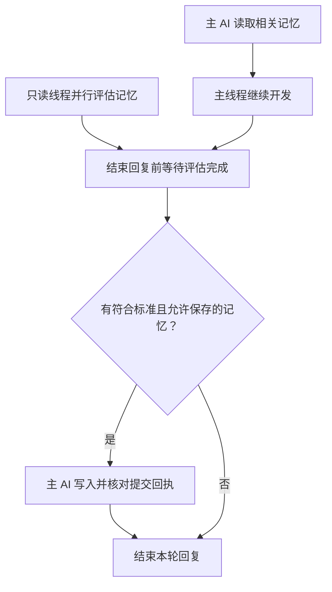

<h1 align="center">dev-memory</h1>

<p align="center"><strong>让 AI 在新会话中继续使用开发习惯和项目规则。</strong></p>

<p align="center">
  <a href="https://github.com/chrisstarr7/dev-memory/actions/workflows/check.yml"></a>
  <a href="../../LICENSE"></a>
  
  
</p>

<p align="center"><a href="../../README.md">English</a> · <strong>简体中文</strong> · <a href="../../docs/readme/README.ja.md">日本語</a> · <a href="../../docs/readme/README.ko.md">한국어</a></p>
<p align="center"><a href="#快速开始">快速开始</a> · <a href="#换一个项目怎么用">换项目</a> · <a href="#记录什么记忆">记忆范围</a> · <a href="#什么时候读取和记录">读写时机</a></p>

Dev Memory 是一个开发记忆 Skill：AI 判断哪些开发习惯和项目规则值得长期保留，本地 Python 程序负责把记录存入 SQLite，并在后续任务中按需取出。

## 快速开始

需要 Node.js 22+（含 npm/npx）、Git 和 Python 3.10+（含 sqlite3）。在**需要配置的项目根目录**执行：

```sh
npx -y --prefer-online chrisstarr7/dev-memory codex
```

完成后，在该项目中**新建 Codex 会话**，直接正常开发。不需要每轮调用 Skill，也不需要每次都说“记住这条”。

对 Codex，这一条命令会同时完成两项配置：

| 配置 | 具体作用 |
| --- | --- |
| 用户级全局引导 | 让 Codex 在不同项目中读取、学习可复用的通用开发习惯。 |
| 当前项目引导 | 为当前项目建立独立记忆库和启动绑定，业务规则只属于这个项目。 |

安装会创建或复用记忆库，并写入引导。**是否允许新增项目记忆，由下面的捕获模式单独控制。**

### 默认记录哪些内容

新项目默认采用 **`developer-first`**。建立项目配置后，新增项目业务记忆仍默认关闭。

| 模式 | 全局开发习惯 | 已有项目规则 | 新增项目长期记忆 |
| --- | --- | --- | --- |
| `developer-first`（默认） | 读取，符合标准时记录 | 读取 | 关闭 |
| `full-project` | 读取，符合标准时记录 | 读取 | 开启 |

两种模式都遵守暂停、禁用、只读和本轮不记录等设置。需要记录项目规则时，对 AI 说：**“启用当前项目的项目记忆记录，切换到 full-project。”** AI 会使用已安装程序和当前项目绑定完成切换，无需再安装一次。具体模式命令见 [安装指南](../../docs/installation.md)。

## 换一个项目怎么用

**如果项目 B 也需要自己的项目配置：进入 B 的根目录，再执行上面同一条安装命令，然后在 B 中新建 Codex 会话。**

| 场景 | 操作与结果 |
| --- | --- |
| 第一次在项目 A 使用 | 在 A 根目录执行命令，配置用户级全局习惯和 A 的项目引导。 |
| 项目 B 也需要项目记忆 | 在 B 根目录重复执行同一命令，建立 B 独立的库和绑定；新项目仍默认 `developer-first`。 |
| Codex 进入尚未初始化的项目 | 用户级引导可使用全局习惯；不会自动初始化或记录该项目的业务记忆。 |
| 已配置项目需要更新 | 在该项目根目录重复执行同一命令，更新受管理程序，保留记忆、捕获设置和无关指令。 |

A、B **共用同一份用户全局记忆，各自使用独立项目记忆**。已初始化项目只做一次全局＋当前项目召回，避免重复读取全局库。

### 其他 AI 宿主

将安装命令中的 `codex` 替换为对应参数即可：

| 宿主 | 参数 |
| --- | --- |
| Codex | `codex` |
| Claude Code | `claude` |
| Cursor | `cursor` |
| Gemini CLI | `gemini` |
| GitHub Copilot | `copilot` |
| OpenCode | `opencode` |
| DeepSeek Harness（DSH） | `deepseek` |

目前只有 Codex 支持跨未初始化项目的用户级引导，其他宿主需分别配置项目后自动使用。DeepSeek 在这里指本地 DSH 宿主。安装路径、离线安装和卸载见 [安装指南](../../docs/installation.md)。

## 记录什么记忆

| 类型 | 典型内容 | 生效范围 |
| --- | --- | --- |
| 全局开发习惯 | 优先复用合适的已有实现、先查证据再定位问题、交付表达偏好 | 去除项目细节后跨项目使用。 |
| 项目规则 | 业务约束、架构决策、接口约定、可长期复用的经验 | 仅属于对应项目；新增记录需要 `full-project`。 |
| 一次性要求 | “这次不要运行测试” | 只在当前对话中生效。 |

临时任务进度、断点和下一步留在对话中，常规 Skill 只使用全局与项目两类记忆。

AI 会主动评估可见的用户要求、纠错和选择，不要求用户逐条声明“这是记忆”。明确适用于多个项目的要求可以形成确认习惯；推断出的习惯先作为未生效候选，得到**两个真正独立任务的反馈证据**后，才可成为软偏好。AI 自己的总结、重复检索和同一任务中的重复表达，都不增加独立用户证据。当前用户指令优先于历史记忆。

## 什么时候读取和记录

**读取在主流程中进行。** 在任务开始、恢复，或主题／模块发生实质变化时，AI 按当前任务召回少量相关记忆，并在工作期间复用有效上下文，不因每次工具调用而重读整个库。

**思考判断可以和开发并行。** 宿主提供异步子智能体时，由只读评估线程判断潜在记忆；主 AI 负责复核作用域、隐私、捕获开关和重复内容，并执行全部写入。



**结束本轮回复前，必须等潜在记忆的评估完成，并确认需要保存的记录已成功落地。** 不能因开发先完成就丢弃记录。宿主不支持线程或线程失败时，主 AI 自行完成评估。没有合规增量时不写入；保存失败只做有界修复，并明确说明未保存，不能假报成功。无关维护可等到后续合适的任务节点。

这是依靠宿主指令运行的 Skill 流程，系统没有常驻对话监听。子智能体使用宿主已有的模型能力和账户额度，没有独立学习服务。

## 怎么控制记忆

| 目的 | 可以对 AI 说 |
| --- | --- |
| 开启项目记录 | “把当前项目切换到 full-project，允许记录项目长期规则。” |
| 切回默认模式 | “把当前项目切回 developer-first。” |
| 修订已有习惯 | “修订这条习惯：已有实现适合当前需求时才复用。” |
| 暂停全局学习，保留读取 | “暂停全局习惯写入，但继续读取。” |
| 本轮不记录 | “这一轮不要保存记忆。” |
| 查看记忆 | “查看和当前任务相关的全局记忆与项目记忆。” |
| 删除某条记忆 | “先预览这条记忆的删除范围，等我确认后再删除。” |

## 记忆保存在哪里

| 记忆库 | 默认位置 |
| --- | --- |
| 用户全局开发习惯 | `~/.dev-memory/global/` |
| 当前项目规则 | `<项目根目录>/.dev-memory/` |

SQLite 保存记录、证据和修订历史，导出的 Markdown 只供阅读。全局记录不包含项目名称、业务数据、代码、路径、凭据或原始对话。核心程序不上传记忆库、不收集遥测；交给云端模型处理的摘录遵循宿主的数据政策。

## 进一步了解与当前限制

安装成功证明配置完成，自动使用仍依赖宿主加载指令和 AI 执行流程。统一安装后的真实跨项目召回、异步记录收尾，以及当前版本的任务总耗时，仍需要真实宿主验证。

[安装与卸载](../../docs/installation.md) · [架构](../../docs/architecture.md) · [记录协议](../../skills/dev-memory/references/protocol.md) · [验证报告](../../reports/verification.md) · [安全说明](../../SECURITY.md) · [贡献指南](../../CONTRIBUTING.md)

通过 [GitHub Issues](https://github.com/chrisstarr7/dev-memory/issues) 提交脱敏问题。本项目采用 [MIT License](../../LICENSE)。
