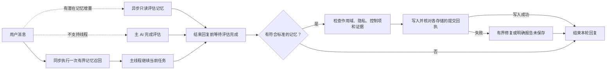

<h1 align="center">dev-memory</h1>

<p align="center"><strong>以开发者为中心的本地 AI 研发习惯记忆系统。</strong></p>

<p align="center">
  <a href="https://github.com/chrisstarr7/dev-memory/actions/workflows/check.yml"></a>
  <a href="../../LICENSE"></a>
  
  
</p>

<p align="center"><a href="../../README.md">English</a> · <strong>简体中文</strong> · <a href="../../docs/readme/README.ja.md">日本語</a> · <a href="../../docs/readme/README.ko.md">한국어</a></p>
<p align="center"><a href="#如何形成记忆">如何形成记忆</a> · <a href="#安装">安装</a> · <a href="#日常使用">日常使用</a></p>

Dev Memory 从开发者日常编码中的明确要求、纠错、技术决策和工作方式中，逐渐积累可追溯、可纠正、跨项目复用的个人研发习惯与思维偏好。配置宿主引导后，AI 可在不同项目和新会话中主动召回相关习惯，并用于问题分析、编码策略与交付流程。

## 如何形成记忆

1. **评估用户反馈。** AI 判断用户表达是否体现可跨项目复用的长期开发习惯。记忆捕获已获授权时，可让只读子智能体并行判断全局或项目记忆，主线程继续开发；结束本轮回复前必须等待评估完成，并确认需要保存的内容已写入。明确的跨项目规则仍可作为直接证据；推断出的反馈先作为候选，只有两个独立任务的证据才可晋升为软偏好。
2. **按当前任务采用。** AI 召回少量相关的有效习惯，结合条件与例外使用，并在任务内复用有效上下文。当前用户要求优先于推断的软偏好。
3. **依据纠正修订。** 新反馈修订已有习惯，保留来源与版本。程序检测完全重复，当前 AI 判断同义表达；AI 自己的总结和检索命中不增加用户证据。

| 开发者表达 | 处理方式 |
| --- | --- |
| “以后各项目改代码都先检查已有实现，再考虑新增。” | 明确的全局开发习惯 |
| 在独立任务中反复选择“先查实际证据，再修复” | 先形成候选，证据充分后成为软偏好 |
| “本项目不允许修改支付模块。” | 开启项目捕获后保存为项目约束 |
| “这次不要运行测试。” | 仅在当前对话生效，不写入记忆 |



## 安装

在项目根目录执行，将 `<agent>` 替换为下表参数：

```sh
npx -y --prefer-online chrisstarr7/dev-memory <agent>
```

| AI 宿主 | `<agent>` |
| --- | --- |
| Codex | `codex` |
| Claude Code | `claude` |
| Cursor | `cursor` |
| Gemini CLI | `gemini` |
| GitHub Copilot | `copilot` |
| OpenCode | `opencode` |
| DeepSeek Harness（DSH） | `deepseek` |

需要 Node.js 22+（含 npm/npx）、Git 和 Python 3.10+（含 sqlite3）。安装器复制运行程序并配置所选宿主的项目指令，完成后**新建宿主会话**。已激活的项目共用当前用户的全局习惯，各项目记忆保持隔离。这里的 DeepSeek 指本地 DSH 宿主，网页或手机聊天无法执行安装。

**Codex 使用上面这一条命令，就同时配置用户级全局习惯和当前项目。** 已初始化项目通过一次召回读取全局与项目规则；其他项目只使用全局习惯，初始化前不自动记录其业务信息。其他宿主使用项目适配器。重复执行同一命令可更新受管理程序，保留已有记忆、捕获设置及无关指令。离线安装、宿主路径与卸载见 [安装指南](../../docs/installation.md)。

## 日常使用

配置完成后正常开发即可。记忆思考和判断可由只读子智能体异步执行，主线程同时开发；结束本轮回复前，主 AI 必须等待评估完成、复核合规条目并核对写入成功回执，不能因开发先完成而丢弃记忆增量。宿主不支持线程或线程失败时，由主 AI 完成同样的评估；确认没有符合标准的记忆时无需写入。存储失败只进行有界修复，并如实报告未保存状态。该评估使用宿主已有的模型能力和账户额度。记忆读取仍在主流程中进行，所有写入由主 AI 负责，无关维护可延后。系统没有常驻对话监听、后台服务或独立学习服务。

| 想控制什么 | 对 AI 说 |
| --- | --- |
| 纠正习惯 | “修订这条偏好：现有实现适合当前需求时才复用。” |
| 暂停学习 | “暂停全局习惯写入，仍可召回。” |
| 排除本轮 | “这一轮不要保存记忆。” |
| 遗忘习惯 | “预览这条习惯的删除范围，我确认后再删除。” |

Skill 只召回全局习惯和当前项目的长期规则。新项目默认采用 **`developer-first`**：已有项目规则仍可召回，新项目记忆默认不新增，除非用户启用 `full-project`。任务进度和断点不属于常规 Skill 流程；旧任务记录会保留，但普通召回和维护会排除它们。

## 本地存储与控制

| 记忆 | 默认位置 |
| --- | --- |
| 全局开发者习惯 | `~/.dev-memory/global/` |
| 项目规则与决策 | `<project-root>/.dev-memory/` |

SQLite 保存原子习惯、证据与修订，当前有效习惯共同组成工作画像。运行程序支持幂等写入、作用域隔离、备份、只读访问和受控遗忘。全局习惯信号需去业务化，项目名称、业务数据、代码、路径及原始对话不应进入全局库。核心程序不上传记忆、不收集遥测；模型处理遵循宿主的数据政策。

## 文档与验证

运行时使用 Python 标准库和 SQLite。程序测试、对话语义评估与真实宿主检查分别记录；安装成功证明配置完成，实际自动使用依赖宿主加载指令和 AI 遵循。真实 Codex 用户级指令在两个独立项目中的自动加载，以及禁用／原版／新版同任务性能对照仍未验证。

[架构](../../docs/architecture.md) · [协议](../../skills/dev-memory/references/protocol.md) · [验证报告](../../reports/verification.md) · [0.7.0 任务对照](../../reports/benchmark-0.7.0.md) · [安全](../../SECURITY.md) · [贡献](../../CONTRIBUTING.md)

通过 [GitHub Issues](https://github.com/chrisstarr7/dev-memory/issues) 提交脱敏问题。本项目采用 [MIT License](../../LICENSE)。
