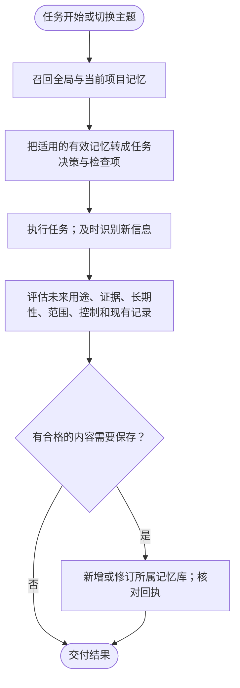
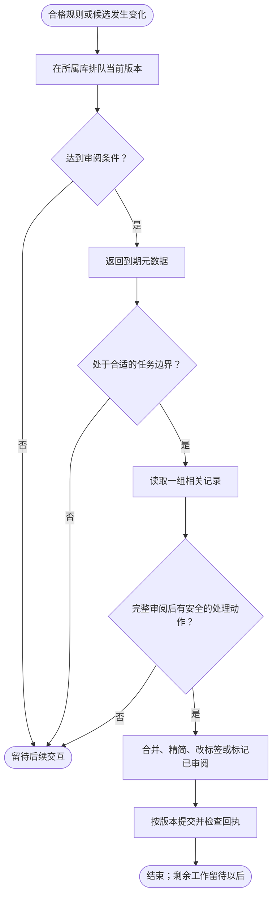

<h1 align="center">dev-memory</h1>

<p align="center"><strong>让 AI 记住你的研发习惯，以及每个项目自己的规则。</strong></p>

<p align="center">
  <a href="https://github.com/chrisstarr7/dev-memory/actions/workflows/check.yml"></a>
  <a href="../../LICENSE"></a>
  
  
</p>

<p align="center"><a href="../../README.md">English</a> · <strong>简体中文</strong> · <a href="README.ja.md">日本語</a> · <a href="README.ko.md">한국어</a></p>

Dev Memory 是用于 AI 辅助开发的 Skill 和本地 Python 程序。它帮助 AI 召回相关研发习惯与项目规则，并根据真实要求或证据保存长期知识。AI 判断含义，程序负责校验并将记录存入 SQLite。

## 安装

在开发项目的根目录执行：

```sh
npx -y --prefer-online chrisstarr7/dev-memory codex
```

使用其他 AI 宿主时，将 `codex` 换成对应参数：

| 宿主 | 参数 | 项目引导文件 |
| --- | --- | --- |
| Codex | `codex` | `AGENTS.md`，或已有的非空 `AGENTS.override.md` |
| Claude Code | `claude` | `CLAUDE.local.md` |
| Cursor | `cursor` | `.cursor/rules/dev-memory.mdc` |
| Gemini CLI | `gemini` | `GEMINI.md` |
| GitHub Copilot | `copilot` | `.github/copilot-instructions.md` |
| OpenCode | `opencode` | `AGENTS.md` |
| DeepSeek Harness | `deepseek` | `AGENTS.md` |

安装需要 Node.js 22+（含 npm/npx）、Git 和 Python 3.10+（含 sqlite3）。记忆运行时只依赖 Python 标准库。参数应对应实际运行 AI 的宿主：通过 OpenCode 使用 DeepSeek 模型时，选择 `opencode`。

Codex 安装会同时启用用户级全局习惯和当前项目记忆。在未初始化的其他项目中，用户级引导只召回全局习惯。需要项目记忆时，在该项目再次运行安装命令。其他宿主目前仅使用项目引导。安装或升级后，在项目中开启新的 AI 会话；之后正常提出需求即可，不必每轮调用 Skill 或说“记住”。新建记忆库从空库开始，已有记录会保留。

其他安装方式、权限和宿主细节见[安装与卸载说明](../installation.md)。

## 记录什么

Dev Memory 只有**两层持久记忆**：

| 范围 | 适合保存的信息 | 示例 |
| --- | --- | --- |
| 全局 | 脱离具体项目后仍可复用的研发习惯 | 新增实现前先检查是否已有合适代码 |
| 当前项目 | 长期有效的规则、契约、决策和有依据的事实 | API 要求、安全边界、代码规范 |

一次性要求、任务进度和未确认猜测留在当前对话中。Dev Memory 不保存对话正文或任务检查点。开启新会话后，可能需要重新检查代码来确认进度。两个范围都不能保存凭证。

项目知识也可以包括验收规则、兼容要求、部署约束、迁移和经过验证的故障经验。代码现状只有在长期有效、不易重新发现且可能影响后续工作时才值得记录；它只说明观察到了什么，不能代替用户期望。写入前，AI 应保持原有适用范围，并检查是否已有等价记录。即使审查后无需改代码，新提出的长期规则仍可能值得保存。

全局习惯有两种证据路径：明确要求长期适用于所有项目时，可以立即保存为有效规则；没有明确跨项目声明的可复用要求、选择或纠错，首次先保存为**未生效候选**，取得两个独立任务的证据后才晋升为软偏好。AI 的总结和重复召回不算新证据。

新项目默认使用 `full-project` 模式，允许自动保存合格的项目知识。可选的 `developer-first` 模式会阻止新增项目记录。升级保留原有模式，以及暂停、禁用和只读设置；旧项目切换到 `full-project` 需要明确操作。

## 日常如何工作

已初始化项目的 [Mermaid 流程图](https://mermaid.js.org/syntax/flowchart.html)如下。召回用于指导任务，新信息在工作过程中持续评估：



记录判断适用于要求、选择、规范、决策、有依据的事实、方法和纠错，不限于发现错误。新信息出现时及每轮结束前都应评估，纯审查任务也一样。重要纠错在受影响修改前保存；其他合格增量在交付前保存。

当前要求高于记忆。AI 应把适用的有效记录及其条件、例外转成当前任务的决策和检查项；未生效候选不能当作指令。旧观察和测试结果需结合当前工作区重新核对。召回会把上下文交给 AI；返回了记录本身不能证明 AI 已照做。

全局与项目分别提交，失败或部分成功都应如实说明；没有合格增量就不做空写入。

## 自动整理

发生变化的有效规则及非假设类未生效候选会在所属库排队。积压达到 5 条、待审正文不少于 1200 字符，或某项变更达到默认 7 天间隔时，可能触发一组相关记录的审阅。



每轮、每个库最多处理一组相关记录，上限为 8 条、12000 字符。未读完、超长或含义不确定的记录明确留在队列中；字符上限不能作为丢弃条件的理由。整理保留证据和候选的未生效状态。系统没有常驻进程、持续监听对话的程序，也不强制额外调用模型。操作、控制条件和版本保护见[操作协议](../../skills/dev-memory/references/protocol.md)。

## 存储与隐私

| 位置 | 内容 |
| --- | --- |
| `~/.dev-memory/global/` | 全局 SQLite 库、配置、可选视图和备份 |
| `<项目根目录>/.dev-memory/` | 当前项目的 SQLite 库与激活绑定 |

一次项目召回只打开全局库和当前项目库，不搜索其他项目。不同克隆和工作树默认各有自己的项目库。SQLite 是权威数据，可选的 Markdown 阅读视图可以重建。会话和轮次 ID 用于重试去重、隐私跳过与召回缓存，属于运行元数据，不是第三层记忆。

核心程序没有遥测，也不会自动上传记忆。召回内容若提交给托管 AI，仍受该宿主的数据政策约束。全局记录及证据必须去除项目名、业务细节、代码、路径、客户数据、原始对话、日志和密钥。备份也包含私有数据。

旧数据库可能仍有任务/检查点记录。当前版本不再创建、召回、整理或导出它们，但保留旧记录供显式审查和删除：先用 `list --scope project --status all` 查看，再走 `forget preview` / `forget apply` 流程。`reports/` 中的历史文件可能描述旧版行为。

## 召回统计

记忆正文实际返回给 AI 时，会在对应存储中递增该记忆的 UTC 月度计数。候选索引、缓存结果、只读调用和暂停捕获的存储不计数。这表示内容已返回，不证明 AI 实际采用。运行 `<Python解释器> <Skill目录>/scripts/dev_memory.py --global-root <全局记忆目录> recall-stats --scope both --month 2026-10 --project-root .` 查看单月；将 `--month` 替换为 `--from-month 2026-07 --to-month 2026-09` 可汇总季度。统计不保存提示词或对话内容。

## 本地记忆看板

运行 `<Python解释器> <Skill目录>/scripts/dev_memory.py dashboard serve`，会按需启动仅绑定 `127.0.0.1` 的本机页面；每次启动使用临时访问凭据，停止命令即关闭。看板分别读取全局库与已登记的各项目库，不合并数据库。已有项目可在页面登记，或运行 `dashboard add --project-root /项目绝对路径`；以后初始化项目时会自动登记。`dashboard list` 查看目录，`dashboard remove --namespace-id ID` 只移除目录项，不删除记忆。目录只保存本机路径和库身份，不扫描整台电脑，也不复制项目正文到全局库。

看板展示逐条原文、依据、修订历史、状态和月度详情返回次数。单库列表可翻页；跨库搜索最多展示前 50 条并提示截断。只读召回预览不会增加计数。返回次数不代表 AI 实际采用，计数功能出现前的历史也无法补算。禁用或排除的库仍显示目录状态，但不展示正文。修订和归档沿用原有版本检查，遗忘沿用两步确认；备份仍留在所属库。页面不加载外部资源或上传记忆。

## 用自然语言控制

- “这个项目新增或修改接口字段时，同步更新接口文档。”
- “以后所有项目，新增代码前先检查现有实现。”
- “暂停全局习惯写入，但继续读取已有记录。”
- “这一轮不要保存任何记忆。”
- “查看相关记忆。”
- “删除前先预览要遗忘的记录。”

当前要求始终高于记忆。如果发现没有记录或召回，让 AI 对**已安装的程序**运行一次 `doctor`，检查激活绑定、捕获模式、存储权限、候选与有效规则的区别，以及真实写入回执。安装回执或 AI 口头声称“已记住”，都不能单独证明记录已保存或使用。

## 更新

已有受管理安装时，在项目中执行更新命令，然后开启新的 AI 会话：

```sh
npx -y --prefer-online chrisstarr7/dev-memory update codex
```

其他宿主替换 `codex` 参数。更新保留已有记忆库、控制设置和无关引导内容，也不会初始化未绑定的项目。只更新源码工作区，不会自动更新已安装 Skill。

## 更多资料

- [架构说明](../architecture.md)：组件与存储边界。
- [操作协议](../../skills/dev-memory/references/protocol.md)：CLI 操作、证据、整理和限制。
- [安装与卸载](../installation.md)：宿主、路径和问题排查。
- [验证证据](../../reports/verification.md)：已完成的检查及已知缺口。
- [安全](../../SECURITY.md) · [贡献](../../CONTRIBUTING.md) · [MIT 许可](../../LICENSE)。

请通过 [GitHub Issues](https://github.com/chrisstarr7/dev-memory/issues) 提交脱敏问题。不要附带私有数据库、凭证或原始对话。
