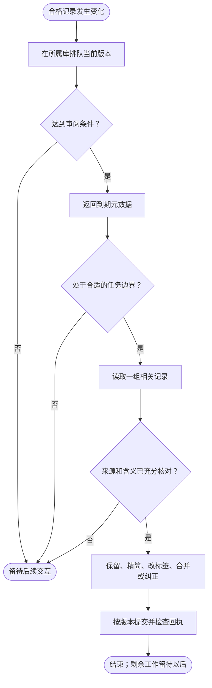

<h1 align="center">dev-memory</h1>

<p align="center"><strong>让 AI 记住你的研发习惯，以及每个项目自己的规则。</strong></p>

<p align="center">
  <a href="https://github.com/chrisstarr7/dev-memory/actions/workflows/check.yml"></a>
  <a href="../../LICENSE"></a>
  
  
</p>

<p align="center"><a href="../../README.md">English</a> · <strong>简体中文</strong> · <a href="README.ja.md">日本語</a> · <a href="README.ko.md">한국어</a></p>

Dev Memory 是用于 AI 辅助开发的 Skill 和本地 Python 程序。它帮助 AI 召回相关研发习惯与项目规则，并根据真实要求或证据保存长期知识。AI 判断含义，程序负责校验并将记录存入 SQLite。

## 安装前准备

先准备环境，再安装 Skill；已经符合要求的软件无需重复安装。

| 能力 | 环境要求 |
| --- | --- |
| 安装与基础记忆 | Node.js 22+（含 npm/npx）、Git、Python 3.10+（含 sqlite3） |
| Windows 本地向量 | x64 环境下的标准版 **64 位 CPython 3.10–3.14**，推荐 **3.14 的最新补丁版本**；安装 Microsoft Visual C++ x64 运行库。当前固定依赖不支持 Python 3.15、32 位、原生 ARM64 或自由线程版本。 |
| macOS 本地向量 | macOS 13+，支持 Apple Silicon 与 Intel；安装器自动准备兼容的 Python 3.12 向量环境。 |

**Windows PowerShell：按需安装缺少的前置软件。**

```powershell
winget install --exact --id OpenJS.NodeJS.LTS
winget install --exact --id Git.Git
winget install --exact --id Python.Python.3.14 --architecture x64
winget install --exact --id "Microsoft.VCRedist.2015+.x64"
```

已安装 Python 3.14 时，使用 `winget upgrade --exact --id Python.Python.3.14 --architecture x64` 升级。完成后重新打开终端并检查：

```powershell
node --version
git --version
py -3.14 -c "import sys,struct,sqlite3,venv; print(sys.version); print(sys.executable); print('bits:',struct.calcsize('P')*8)"
```

Python 应显示 3.14.x 和 64 位。Windows 的 npx 入口优先使用已安装的 Python 3.14；向量准备会检查虚拟环境真正使用的解释器。

**macOS 已安装 Homebrew 时：**执行 `brew install node git python@3.14`；已有环境升级用 `brew upgrade node git python@3.14`。再检查 `node --version`、`git --version` 和 `python3.14 --version`。其他安装方式与 Linux 说明见[环境准备](../installation.md#environment-prerequisites)。

安装器会自动下载 sqlite-vec、FastEmbed、ONNX Runtime 和模型到隔离目录。用户需允许访问 Python 软件源、模型下载源，并有运行目录写权限；无需手动安装上述依赖、配置 GPU/API Key 或安装 C++ 编译工具。依据：[Python 安装](https://learn.microsoft.com/en-us/windows/dev-environment/python)、[ONNX Runtime 环境要求](https://onnxruntime.ai/docs/install/#requirements)、[Homebrew Python](https://formulae.brew.sh/formula/python%403.14)。

## 安装

在开发项目的根目录执行：

```sh
npx -y --prefer-online chrisstarr7/dev-memory codex
```

使用其他 AI 宿主时，将 `codex` 换成对应参数：

| 宿主 | 参数 | 项目引导文件 |
| --- | --- | --- |
| Codex | `codex` | `AGENTS.md`，或已有的非空 `AGENTS.override.md` |
| Claude Code | `claude` | `CLAUDE.local.md` |
| Cursor | `cursor` | `.cursor/rules/dev-memory.mdc` |
| Gemini CLI | `gemini` | `GEMINI.md` |
| GitHub Copilot | `copilot` | `.github/copilot-instructions.md` |
| OpenCode | `opencode` | `AGENTS.md` |
| DeepSeek Harness | `deepseek` | `AGENTS.md` |

基础记忆运行时只依赖 Python 标准库。向量依赖与模型在独立环境中准备；失败时保留基础功能，并说明失败原因。只需离线基础安装时添加 `--without-vectors`。参数应对应实际运行 AI 的宿主：通过 OpenCode 使用 DeepSeek 模型时，选择 `opencode`。

Codex 安装会同时启用用户级全局习惯和当前项目记忆。在未初始化的其他项目中，用户级引导只召回全局习惯。需要项目记忆时，在该项目再次运行安装命令。其他宿主目前仅使用项目引导。安装或升级后，在项目中开启新的 AI 会话；之后正常提出需求即可，不必每轮调用 Skill 或说“记住”。新建记忆库从空库开始，已有记录会保留。

其他安装方式、权限和宿主细节见[安装与卸载说明](../installation.md)。

## 记录什么

Dev Memory 只有**两层持久记忆**：

| 范围 | 适合保存的信息 | 示例 |
| --- | --- | --- |
| 全局 | 脱离具体项目后仍可复用的研发习惯 | 新增实现前先检查是否已有合适代码 |
| 当前项目 | 长期有效的规则、契约、决策和有依据的事实 | API 要求、安全边界、代码规范 |

一次性要求、任务进度和未确认猜测留在当前对话中。Dev Memory 不保存对话正文或任务检查点。开启新会话后，可能需要重新检查代码来确认进度。两个范围都不能保存凭证。

项目知识也可以包括验收规则、兼容要求、部署约束、迁移和经过验证的故障经验。代码现状只有在长期有效、不易重新发现且可能影响后续工作时才值得记录；它只说明观察到了什么，不能代替用户期望。写入前，AI 应保持原有适用范围，并检查是否已有等价记录。即使审查后无需改代码，新提出的长期规则仍可能值得保存。

全局习惯有两种证据路径：明确要求长期适用于所有项目时，可以立即保存为有效规则；没有明确跨项目声明的可复用要求、选择或纠错，首次先保存为**未生效候选**，取得两个独立任务的证据后才晋升为软偏好。AI 的总结和重复召回不算新证据。

新项目默认使用 `full-project` 模式，允许自动保存合格的项目知识。可选的 `developer-first` 模式会阻止新增项目记录。升级保留原有模式，以及暂停、禁用和只读设置；旧项目切换到 `full-project` 需要明确操作。

## 日常如何工作

已初始化项目的 [Mermaid 流程图](https://mermaid.js.org/syntax/flowchart.html)如下。召回用于指导任务，新信息在工作过程中持续评估：


记录判断适用于要求、选择、规范、决策、有依据的事实、方法和纠错，不限于发现错误。新信息出现时及每轮结束前都应评估，纯审查任务也一样。重要纠错在受影响修改前保存；其他合格增量在交付前保存。

全局与项目分别提交，失败或部分成功都应如实说明；没有合格增量就不做空写入。

## 按需召回

召回根据当前任务检索少量相关记忆，不会把整个记忆库交给 AI，也不会搜索其他项目。任务开始、上下文丢失，或项目、模块、主题发生实质变化时，AI 执行一次聚焦的 `context` 查询；结果仍然有效时直接复用，不必每轮重复查询。

1. 使用任务关键词和可选的开发意图寻找相关记录。关键词检索独立可用；本地向量索引就绪时，同时利用语义匹配。
2. 在数量与字符预算内返回选中的记忆正文。默认联合预算为 5 条／4000 字符，为全局习惯和当前项目规则分别保留空间；没有合格的有效全局规则或全局召回关闭时，剩余预算可供项目使用。
3. AI 核对适用范围、条件、例外及来源时效，再转成当前任务的决策与检查项。当前要求始终优先；旧代码观察和测试结果不能直接当作当前事实。

预算不足时，结果会明确标出未返回的相关记录，AI 只补取当前必需的内容。返回了一条记忆，不代表 AI 一定采用，也不证明其中引用的代码仍然保持原行为。

| 记录状态 | 普通召回 | 自动整理队列 |
| --- | --- | --- |
| `active`，非假设 | 按相关性和预算选取 | 发生变更的当前版本入队 |
| `candidate`，非假设 | 不返回为有效指令 | 可以整理，但保持未生效 |
| `candidate + hypothesis` | 不参与 | 不进入，仍属未确认内容 |
| `conflicted` | 可能作为冲突上下文返回，采用前须解决冲突 | 不进入常规队列，需明确的冲突处理 |
| `stale`、`archived`、`superseded` | 不参与 | 不进入 |
| 历史 `active + hypothesis` | 不参与 | 作为异常纳入，须有依据地修订或归档 |

月度召回次数表示完整记忆正文曾返回给 AI，不表示已实际采用。缓存命中、只读查询和暂停采集时不增加计数。**召回统计与整理队列独立**：重复召回不会重新触发整理；新记忆即使从未召回，也可能需要质量审查。

## 自动整理

自动整理针对发生变化的知识，检查长期价值、来源依据、时效和重复情况。处理结果可以是保留、精简、调整标签、合并真正等价的记录，或依据权威证据修订、归档错误内容。不会只因文字相似就合并，也不会因记录变旧就删除，或在整理中自行晋升候选。

全局库和各项目库分别维护待审版本队列，满足以下任一条件时提示到期：

| 触发条件 | 准确含义 |
| --- | --- |
| 积压达到 5 条 | 5 个不同的合格记录 ID；同一条修改 5 次仍只算 1 条 |
| 某条待审正文达到 1200 字符 | 长记录无需等待凑足 5 条 |
| 某项待审修改满 7 天 | 默认时间阈值，在下一次获准的交互中判断 |

**达到阈值表示需要审阅，不表示后台已经改写记忆。** 普通召回和保存只返回到期提示，不加载历史整理正文。AI 在合适的任务边界获取一组相关记录，判断后按修订版本提交，并检查回执；任务紧急或证据不足时保留待审。整理周期开始后，后续轮次可以继续处理不足 5 条的尾批，无需重新等待凑数。



每轮、每个库最多处理一组相关记录：**8 条／12000 字符，包含随附的来源证据**。每条最多附带 3 条近期证据摘要，并标明是否省略更早证据；缺少上下文时应定向核对来源，不能仅凭脱离原方案的简短确认推导出更多详细约束。

整理必须保留有效条件、例外、否定要求和作用域，区分业务要求与代码事实；核对观察记录引用的当前代码，优先保留简明约束和权威文档入口，避免复制整份实施方案。历史 active 假设须解决后才能标记已审。未读完、超长或尚未确认的记录留在队列中，不能为了清空积压删减约束。

整理协议升级时，可能将已有合格记录重新排队一次，但不会因此改变正文。暂停、禁用、排除和只读控制继续有效。系统没有常驻整理进程或持续对话监听，也不强制额外调用模型；自动执行依赖宿主加载规则并由 AI 落实。普通召回不读取整理证据。整理后仍保留原始证据与修订历史，因此有效记录变少不等于磁盘占用同比减少。操作和保护机制见[操作协议](../../skills/dev-memory/references/protocol.md)。

## 存储与隐私

| 位置 | 内容 |
| --- | --- |
| `~/.dev-memory/global/` | 全局 SQLite 库、配置、可选视图和备份 |
| `<项目根目录>/.dev-memory/` | 当前项目的 SQLite 库与激活绑定 |

一次项目召回只打开全局库和当前项目库，不搜索其他项目。不同克隆和工作树默认各有自己的项目库。SQLite 是权威数据，可选的 Markdown 阅读视图可以重建。会话和轮次 ID 用于重试去重、隐私跳过与召回缓存，属于运行元数据，不是第三层记忆。

核心程序没有遥测，也不会自动上传记忆。召回内容若提交给托管 AI，仍受该宿主的数据政策约束。全局记录及证据必须去除项目名、业务细节、代码、路径、客户数据、原始对话、日志和密钥。备份也包含私有数据。

旧数据库可能仍有任务/检查点记录。当前版本不再创建、召回、整理或导出它们，但保留旧记录供显式审查和删除：先用 `list --scope project --status all` 查看，再走 `forget preview` / `forget apply` 流程。`reports/` 中的历史文件可能描述旧版行为。

## 本地语义召回

每个记忆库继续使用现有 SQLite 文件：中文原文是权威数据，向量索引是可选的检索辅助。安装或更新时会尝试准备本地模型；模型不可用时，原文和关键词检索仍可使用。普通开发不会下载模型。向量检索只帮助找候选，不会改变记忆的有效状态。

未完成的向量计算不会影响已保存的原文。看板可查看索引状态；浏览看板不会启动模型推理。平台要求、恢复方法和诊断命令见[向量运行说明](../../skills/dev-memory/references/vectors.md)。

## 本地看板

已安装 Node.js 22+ 和 Python 3.10+ 后，在项目目录运行这一条命令；Windows、macOS 和 Linux 均可使用：

```sh
npx -y --prefer-online chrisstarr7/dev-memory dashboard
```

命令会在本机启动看板并尝试打开浏览器。若浏览器没有打开，复制终端打印的地址到浏览器；保持终端运行，按 `Ctrl+C` 停止服务。看板只监听本机地址，不会上传记忆；地址含临时访问凭据，不要分享。

看板支持查看原文、依据、修订历史和向量数据，搜索及筛选记录，预览召回，管理项目和备份。月度召回次数表示完整记忆曾返回给 AI，不代表 AI 一定采用；启用统计前的历史无法补算。

若 Windows 页面提示项目列表权限错误，看板仍可显示全局记忆。按[Windows 看板权限修复](../installation.md#windows-dashboard-permissions)修复后重启看板。

## 记忆控制

可以直接告诉 AI：

- “暂停全局记忆写入，但继续读取已有记录。”
- “这一轮不要保存记忆。”
- “查看相关记忆。”
- “删除前先预览影响范围。”

当前要求始终优先于记忆。若记忆没有保存或无法读取，让 AI 对已安装程序运行一次 `doctor`，并核对实际回执；口头确认不等于写入成功。

## 更新

在项目目录运行更新命令，并在完成后开启新会话：

```sh
npx -y --prefer-online chrisstarr7/dev-memory update codex
```

更新会保留现有记忆库、控制设置和无关引导内容。需要在其他项目启用项目记忆时，在该项目中单独执行安装命令。

## 参考与问题反馈

- [安装、卸载与排障](../installation.md)
- [向量运行说明](../../skills/dev-memory/references/vectors.md)
- [架构说明](../architecture.md) · [操作协议](../../skills/dev-memory/references/protocol.md)
- [验证记录](../../reports/verification.md) · [安全](../../SECURITY.md) · [贡献](../../CONTRIBUTING.md)

请通过 [GitHub Issues](https://github.com/chrisstarr7/dev-memory/issues) 提交脱敏问题，不要附上数据库、凭证或原始对话。
